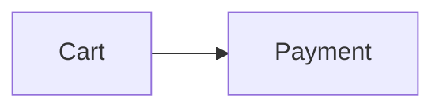

# Semantic Markdown (`.smd`) — Specification v2

Semantic Markdown is a **strict superset of CommonMark + GitHub-Flavored Markdown**. It adds a small, validated vocabulary for styling, layout, diagrams, math and audience-aware content, so a single file works well for developers, product managers and AI agents.

- File extension: `.smd`
- Author: Roshan Alwis
- Media type (suggested): `text/x-semantic-markdown` (`text/x-styled-markdown` before 3.0, still accepted as the same format)
- Encoding: UTF-8
- Spec version: `2` (declared in front matter as `smd: 2`). A document without `smd: 2` follows spec v1, which Semantic Markdown 2.x keeps in full. Where the two differ, a rule says so: see §10
- Status: **stable**. Spec v2 gets no breaking change; a change that reads existing documents differently needs a spec v3 RFC. The spec is versioned apart from the tools (tools 2.5.0 implement spec v2): see the [compatibility policy](compatibility.md)

---

## 1. Design principles

| # | Principle | What it means in practice |
|---|-----------|---------------------------|
| 1 | **Superset, never fork** | Every valid `.md` file is a valid `.smd` file with identical meaning. Rename `.md` → `.smd` and nothing breaks. Spec v2 also shows text as GitHub does: no typographic quotes or dashes unless the document asks for them, and only GFM autolink literals become links (§4.8). |
| 2 | **Readable as plain text** | The raw source must still read well in a terminal, a diff, a code review or an LLM context window. No HTML soup, no opaque IDs. |
| 3 | **Borrow proven syntax** | Containers follow the *generic directives* proposal used by remark-directive, MyST and Docusaurus; attribute lists follow Pandoc; alerts map to GitHub alerts. Nothing is invented where a convention already exists. |
| 4 | **Semantic before presentational** | Prefer `:::warning` over red text. Colors are *named tokens* (`red`, `green`, `accent`) that adapt to light/dark themes instead of hard-coded hex. |
| 5 | **Validated** | Every extension has a schema. Tools can report precise, line-level errors with stable rule codes and machine-applicable fixes. |
| 6 | **Safe** | No scripts. Style attributes are whitelisted keys with whitelisted values, so documents cannot inject CSS or JavaScript. |
| 7 | **Graceful degradation** | Every `.smd` feature has a defined plain-Markdown fallback (`smd export --to md`, also `smd to-md`), e.g. callouts → GitHub alerts. |
| 8 | **Agent-addressable** | Front matter gives agents a summary and status up front; `:::agent` blocks carry instructions without cluttering the human view. |

---

## 2. Document structure

```text
┌─────────────────────────────┐
│ ---                         │  Optional YAML front matter
│ smd: 2                      │  (recommended)
│ title: …                    │
│ ---                         │
├─────────────────────────────┤
│ Markdown body               │  CommonMark + GFM
│   + containers  :::name     │  + Semantic Markdown extensions
│   + inline      :name[…]{…} │
│   + spans       […]{…}      │
└─────────────────────────────┘
```

### 2.1 Front matter

A YAML mapping between `---` lines at the very start of the file. It is parsed with the YAML *core* schema, so `2026-09-26` stays a string.

- **Opening and closing:** the first line is `---`. The front matter ends at the next line that is `---` or `...` (YAML's document end marker), trailing spaces allowed. Front matter that is never closed is not front matter: the `---` is a thematic break and the lines after it are the body.
- **Front matter that can't be read** *(all documents, since 2.0; spec v2 RFC, proposal 1)*: when the lines up to the closer are not a YAML mapping (the YAML doesn't parse, or is a list or a scalar), renderers show them as written, escaped, in a visible error block where the header goes (`<div class="smd-frontmatter-error" role="note">` with the label "Front matter could not be read" and the lines in `<pre><code>`). The body after the closer renders as usual, and the document has no front matter values. The usual cause is a forgotten closing `---`, which makes a later thematic break the closer. The agent view shows a `[front matter could not be read]` line and the lines in a fenced block, `smd export --to md` keeps them as written, and `smd validate` reports `frontmatter/invalid` (an error). Before 2.0 those lines were hidden.

| Key | Type | Meaning |
|-----|------|---------|
| `smd` | integer | Spec version: `1` or `2`. **Recommended.** It selects the rules the document is read with (§10): `smd: 2` is spec v2; `smd: 1`, or no `smd` key, is spec v1. A whole number; a string of digits (`"2"`) is tolerated. Other values (`true`, `[2]`, `1.5`, `"v2"`) are read as version 1 and reported as a `frontmatter/version` warning (an info in 1.10); a newer version (`smd: 3`) is read with the newest rules the tool has, with a warning. Tools before 2.0 warn about `smd: 2` and read the document with the version 1 rules. |
| `title` | string | Document title. Rendered as the page heading — don't repeat it as `# H1`. |
| `summary` | string | 1–2 sentences. Agents should read this first. Inline Markdown allowed. |
| `status` | enum | `draft` · `review` · `approved` · `deprecated` · `archived` |
| `owners` | list | People or teams, e.g. `["@alice", "@platform"]` |
| `audience` | enum | `humans` · `agents` · `both` |
| `tags` | list | Free-form tags |
| `version` | string/number | Document version |
| `created`, `updated` | date | `YYYY-MM-DD` |
| `theme` | enum | Rendering hint: `auto` · `light` · `dark` |
| `accent` | color | Accent color for headings, links, badges (see §5) |
| `toc` | boolean | `true` renders a table of contents after the header |
| `related` | list | Paths or URLs of related documents |
| `lang` | string | Language of the labels the renderer adds (callout titles, "Figure 2", "overdue"…), a BCP 47 tag such as `de` or `pt-BR`; see §2.2. Default English |
| `typography` | boolean | Spec v2: `true` turns on typographic quotes, dashes and ellipses (§4.8). Spec v1 always has them, and ignores the key |
| `views` | mapping | Task views for agents: each name maps to `sections`, `query`, `mandatory`, `optional`, `budget`, `evidence` and `description` (§8b). The agent view's header lists the names only |

The values of the enum keys (`status`, `audience`, `theme`) are matched in any case: `audience: Both` is `both` (§5).

Unknown keys are allowed and preserved (reported as *hints* so typos are caught, except keys the body shows with `{{key}}`).

Any key, standard or custom, can be shown in the text with `{{key}}` (§4.7).

The table is published as a JSON Schema: [`extension/schemas/smd-frontmatter.schema.json`](https://raw.githubusercontent.com/bislink360/semantic-markdown/main/extension/schemas/smd-frontmatter.schema.json), also shipped on npm as `semantic-markdown/frontmatter.schema.json`. The validator and editor completion read the same schema, and YAML tools or pipelines can use it to check document metadata.

A document is **stale** when `updated` is more than 180 days before today (tools may make this configurable) and `status` is not `archived` or `deprecated`.

### 2.2 Localization

The renderer adds a few words of its own around a document's text: callout titles (`Note`, `Warning`), "Figure 2", "overdue", the hidden "Footnotes" heading, header labels such as "Owners" and "Updated", status names, the risk matrix headers and the static site's navigation. `lang` in the front matter picks their language:

```yaml
lang: de        # Hinweis, Abbildung 2, überfällig, Fußnoten …
```

- **Value**: a BCP 47 language tag. It is matched by lookup, dropping subtags from the end: `pt-BR` uses `pt`, `zh-Hant-TW` uses `zh`. Case does not matter, and `_` reads as `-`.
- **Languages with labels**: `en` (the default), `de`, `es`, `fr`, `ja`, `pt`, `zh`. A label a language lacks is shown in English.
- **Other languages**: an unsupported or malformed `lang` renders English labels; `smd validate` reports it as `frontmatter/lang` (info, never an error) with the supported list. A well-formed tag is still put on the page, so a `lang: ko` document is marked as Korean for screen readers and browsers.
- **What changes**: rendered HTML only. The article gets `lang="…"` (and the page `<html lang="…">`) and the labels the page script shows (copy buttons, diagram messages) travel with it in `data-smd-labels`. Values the author wrote are translated only where they are vocabulary: `status: draft`, `:priority[high]`, `impact=high`, `color=green` with no text. Dates, numbers, titles and all other text stay as written.
- **What does not change**: agent views, `smd outline`, `smd to-md` (including its "Figure 2" labels), validator messages and JSON outputs stay English. They are read by agents and tools, for which stable, compact output matters more than the reader's language.
- **English**: a document without `lang`, or with `lang: en` (or any `en-…` tag), renders exactly as it did before `lang` existed.
- **Fallback**: renderers may take a language for documents that don't name one: `renderSmd(text, { lang })`, the markdown-it plugin's `lang` option or a render's `env.lang`, and `--lang` on `smd export` and `smd build`. The document's own `lang` always wins. `smd build` labels its navigation, search and dashboard in `--lang`, else the home document's `lang`, else English.

---

## 3. Block containers

```text
:::name{attributes} Optional title
Any Markdown content, including other containers.
:::
```

- An opening fence is **three or more colons**, then a name (`[a-zA-Z][\w-]*`), then an optional attribute list `{…}` directly after the name, then an optional title.
- A closing fence is a line with **three or more colons and nothing else**.
- **Nesting**: a closing fence with N colons closes the innermost open container that was **opened with exactly N colons**. Containers opened inside that one close with it: they have no closing fence of their own, and the validator reports each (`container/unclosed`, a warning). When no open container was opened with N colons, the fence closes the innermost open container, as in spec v1, and the validator warns `container/colons`. Outer containers usually have more colons than the ones inside them (`::::tabs` around `:::tab`); write each closing fence with as many colons as its opener, as `smd fmt` does, so every fence closes its own container.
- A closing fence inside a list item or a block quote can only close a container opened in that item or quote.

  **Spec v1 (documents without `smd: 2`):** a closing fence always closes the *innermost* open container, whatever its colon count; colon counts are cosmetic. 1.10 and later report a fence whose count differs from its container's as the hint `container/colons`.
- Fenced code blocks and `$$` display math (§4.4) inside a container are opaque; a `:::` inside a code block or a math block never closes the container (nor opens one).
- An unclosed container extends to the end of its parent (and is a validation error).
- Titles support inline Markdown.
- **Unknown containers degrade with their title.** A name the vocabulary (§3.1) doesn't define renders as a box with its content, `<div class="smd-box smd-box-name">`, and keeps its title (text after the name, or `title="…"`, which wins): a `<div class="smd-box-title">` first in the box, set as a card title; a `Title:` line in the agent view (§8a), as for a card; a `**Title**` paragraph in plain Markdown (§8). Style attributes and `{#id}` apply as on any container, and the validator warns `container/unknown`. Known containers that take no title (`box`, `tabs`, `columns`, `column`, `steps`, `timeline`, `include`, `quote`) still drop text after their name. Tools before 1.10 drop an unknown container's title too, so new containers that older readers should understand put what matters in the body.

### 3.1 Container vocabulary

| Name | Purpose | Extra attributes |
|------|---------|------------------|
| `note` `info` `tip` `success` `warning` `danger` `question` | Callouts | `title`, `collapsible` (value `open` starts expanded). `question` also takes the lifecycle attributes `status` (`open` `answered` `incorporated` `withdrawn`), `owner`, `due`, `between`, `reason`, `by`, `on` (§3.9) |
| `details` | Collapsible section; title = summary | `title`, `open` |
| `card` | Bordered card with accent stripe | `title`, `accent` |
| `box` | Generic block for style attributes | — |
| `tabs` → `tab` | Tab group; each `tab` title is its label | `title` (on `tab`) |
| `columns` → `column` | Side-by-side layout (stacks on narrow screens) | `width` (`30%` or ratio `2`) |
| `steps` | Renders the ordered list inside as numbered steps | — |
| `agent` | Content addressed to AI agents (instructions, constraints) | `title` (`priority` was removed in 2.0, see §11.2) |
| `human` | Content addressed to human readers only | `title` |
| `decision` | Decision record (ADR-style); title = the decision | `status` (`proposed` `accepted` `rejected` `superseded` `deprecated`), `date`, `owner`, `supersedes`, `depends-on` (§3.9) |
| `risk` | Risk with mitigation in the body | `impact`, `likelihood` (`low` `medium` `high` `critical`), `owner`, `status` (`open` `mitigated` `accepted` `closed`), `depends-on` |
| `requirement` | A required behavior; title = the requirement in one sentence (§3.9) | `priority` (`P0`–`P4` or `critical` `high` `medium` `low`), `status` (`proposed` `accepted` `implemented` `verified` `deprecated`; default `proposed`), `owner`, `depends-on` |
| `constraint` | A restriction work must respect (§3.9) | `scope` (`section` `document`; default `section`), `applies-to`, `level` (`must` `should`; default `must`), `owner`, `depends-on` |
| `acceptance` | Observable conditions that say how to check a requirement (§3.9) | `verifies`, `test` (a relative path) |
| `assumption` | A premise nobody has checked yet (§3.9) | `status` (`unvalidated` `validated` `invalid`; default `unvalidated`), `owner`, `review-by` (`YYYY-MM-DD`), `depends-on` |
| `evidence` | The record of a check for or against a block (§3.9) | `supports`, `contradicts`, `method`, `result` (`pass` `fail` `inconclusive`), `source`, `commit`, `date`, `by`, `rev` |
| `non-goals` | A list of what the work leaves out on purpose, kept in every agent view (§3.9) | `title` |
| `example` | A good or bad example (§3.9) | `kind` (`do` `dont`; none means neutral) |
| `limitation` | Something that does not work, does not hold or has not been checked (§3.9) | `status` (`open` `mitigated` `resolved`; default `open`), `affects`, `owner` |
| `deprecated` | Content that should not be used for new work (§3.9) | `since`, `use` (inline Markdown) |
| `comment` | A review comment on a block (§3.10) | `for` (needed, see `review/for`), `author`, `date`, `rev`, `kind` (`remark` `answer` `correction`; default `remark`), `status` (`open` `resolved`; default `open`), `by`, `on` |
| `suggestion` | A proposed replacement for a block's body (§3.10) | `for` (needed, see `review/for`), `author`, `date`, `rev`, `status` (`open` `accepted` `rejected` `withdrawn`; default `open`), `by`, `on`, `reason` |
| `risk-matrix` | Impact × likelihood matrix of the document's `risk` blocks (closed ones left out); cells coloured by score, risks with an `{#id}` linked. Write it with an empty body; a body renders below the matrix as a caption | `title` (or title text after the name) |
| `api` | API endpoint; body documents params/responses | **`method`** (`GET` `POST` `PUT` `PATCH` `DELETE` `HEAD` `OPTIONS` `WS` `RPC` `EVENT`), **`path`**, `auth` |
| `timeline` | Renders the list inside as a vertical timeline (tasks inside show done state) | — |
| `figure` | Numbered figure around an image, diagram, table or code block; title = the caption (§3.3) | `title`, `kind` (`figure` `table` `listing`) |
| `include` | Transclusion: another document's body, or one section of it, in place of the block (§3.4). The body is fallback text | `file` (needed), `section`, `level` (`1`–`6`) |
| `glossary` | Glossary: a `**Term**: definition` list, rendered as a definition list; the first use of each term per section shows its definition (§3.5) | `title` (or title text after the name) |
| `changelog` | Release history: each heading directly inside is a release, `## 1.2.0 — 2026-03-01`, newest first, followed by its notes; rendered as a timeline (§3.6) | `title` (or title text after the name) |
| `quote` | Quotation; the body is the quoted text, rendered with a `— Author, Source` line (§3.7) | `author` (recommended), `source`, `cite` (an `http(s)` or relative URL) |

All containers additionally accept the style attributes in §5. Attributes in **bold** are required.
`tab` must be a direct child of `tabs`; `column` of `columns`.
Unknown container names render as a plain `box` that keeps its title (§3), and produce a warning.
A `risk` without `impact` has impact `medium`. Risk registers (`smd risks`, `:::risk-matrix`) score a risk as impact × likelihood, each ranked `low` 1, `medium` 2, `high` 3, `critical` 4; a missing or unknown likelihood also counts as `medium`, and a missing `status` means `open`.
The attributes `verifies`, `applies-to`, `depends-on`, `supports`, `contradicts`, `supersedes`, `between` and `for` name blocks by id, one id or a comma-separated list (`verifies=R1,R2`). Each id must name exactly one block of the document (`ref/unknown`, `ref/ambiguous`, §7).

### 3.2 Audience semantics

- **`:::agent`** — Agents MUST treat the content as instructions/constraints relevant to the document. Human-facing renderers SHOULD show it collapsed (configurable: collapsed / expanded / hidden).
- **`:::human`** — Agents MAY skip this content when extracting instructions; it's context for people.
- Everything else is for both audiences.

### 3.3 Figures and numbered references

````text
The flow is in :ref[fig-checkout].

:::figure{#fig-checkout} Checkout flow

:::
````

- **Content:** a `figure` wraps the thing it captions: usually one image, Mermaid diagram, table or code block. Any Markdown is allowed.
- **Caption:** the title (text after the name, or `title="…"`). Inline Markdown is allowed. A figure without a caption is still numbered.
- **Numbering:** figures are numbered in document order, nested ones included, with one counter per `kind`: `figure` (the default; an unknown value also counts as `figure`) is labelled *Figure n*, `table` *Table n*, `listing` *Listing n*. Numbers are computed, never written, so they stay right when figures move.
- **Rendering:** `<figure id="…" class="smd-figure smd-figure-{kind}">`, the content, then `<figcaption class="smd-figure-caption"><span class="smd-figure-label">Figure 1:</span> Caption</figcaption>`. The stylesheet shows a table's caption above it.
- **References:** the inline directive `:ref[id]` (§4.2) stands for the label of the figure with that `{#id}`, e.g. *Figure 2*, linked to it: `<a class="smd-ref" href="#id">Figure 2</a>`. It may come before the figure and may appear in titles. An id that names no figure renders as written, marked `smd-ref-missing`, and is a `figure/unknown-ref` warning. When two figures share an id, references go to the first (`figure/duplicate-id`).
- **References to other blocks** (since 3.1, semantic tags RFC D4): when no figure has the id, `:ref[id]` names the one block that gives it, a heading, task, container or raw HTML element (§4.2.3). It shows the id as written, linked, with the block's title as its tooltip and accessible name: `<a class="smd-ref" href="#R1" title="Export rules" aria-label="R1, Export rules">R1</a>`. The agent view shows `R1`, and `smd to-md` writes `[R1](#R1)`. An id two blocks give names neither: it renders as `<span class="smd-ref smd-ref-ambiguous">`, stays as written in the agent view and plain Markdown, and is a `ref/ambiguous` warning. A figure still wins over any other block with the same id.

Why a directive and not a link: an empty-text link `[](#fig-checkout)` would be invisible in every renderer that doesn't know figures (GitHub, older `.smd` tools), and `[@fig-checkout]` could already appear in documents as plain text (a bracketed mention). `:ref[…]` follows the existing directive rules (a `:` after whitespace or opening punctuation), so no existing text changes meaning, and an older renderer shows it as the readable text `:ref[fig-checkout]`.

**Older renderers** (1.5 and earlier) treat `:::figure` as an unknown container: the content renders inside a plain box (`<div id="…" class="smd-box smd-box-figure">`) without the caption, the validator reports `container/unknown` (a warning) and the agent view and `smd to-md` keep the content only. `:ref[id]` stays literal text, with no diagnostic.

### 3.4 Includes (transclusion)

```text
:::include{file="shared/terms.smd" section="Pricing" level=3}
See [Pricing](shared/terms.smd#pricing) in the shared terms.
:::
```

- **`file`** is a path relative to the including document. The included document's body is used, without its front matter.
- **`section`** picks one section: the heading whose id (`#pricing` or `pricing`) is the value, or whose whole text is the value in any case (`Pricing`, `PRICING`), with everything up to the next heading of the same or a higher level, subsections included. An id wins over text; among equals the first heading wins. A value that names no heading this way, such as a part of a heading's text (`section="refund"` for `## Refunds`), is a missing section: the include shows its fallback, and `smd validate` reports `include/missing-section` (a warning). The version of the *including* document decides, for nested includes too, whatever the included files say. `smd agent --section` still matches a part of a heading's text: it is an option for people typing, not document syntax.

  **Spec v1 (documents without `smd: 2`):** `section` also matches a heading whose text *contains* the value, as `smd agent --section` does: an exact id wins, else the first heading that matches at all, so `section="deploy"` includes `## Rapid deployment`. Since 1.10 a section found only by a part of its heading's text is the info `include/section-match`, with a fix to the heading's id; `smd migrate --to 2` makes the same rewrite.
- **`level=N`** moves the included headings so the top one (the section heading, or the document's highest heading) becomes level N; the others keep their distance from it (capped at 6). Without it, headings keep the levels they have in their own file. Use it to nest the included text under the current heading.
- The block is closed with `:::` like every container. Its **body is fallback text**: renderers that include ignore it, and show it (under a short note with a link to the file) only when the file can't be included. A link to the file is a good body: renderers older than 1.6, which don't know `include`, show it as a plain box.
- The included text is parsed with the same rules as the document, so nested includes and every block (and markdown-it plugins the host adds) work. Paths inside it (nested includes, links, images, code embeds) stay relative to the included file. Its tasks can't be checked off from the including document.
- **Heading ids.** The including document's own headings keep exactly the ids they have without the include. Included headings keep the ids they have in their own file, numbered (`pricing-1`) where the including document already uses them; links inside the included text follow the renamed ids. Links in the including document may point at included headings by their ids.
- **Files are read only through the host's sandboxed reader**, the same one that reads code embeds (§6): the CLI reads inside the working directory, the document's folder and its Git repository; VS Code inside the workspace folders and the document's folder; the MCP server inside its root. A host without a reader (and the markdown-it plugin without `readFile`) includes nothing and shows the fallback with an "Include not available here" note.
- **Limits.** An include chain that leads back to a document being included (`a.smd → b.smd → a.smd`, or a document that includes itself) stops there with a note instead of repeating. Includes nest at most 8 deep, and one document includes at most 200 times and 2,000,000 characters.
- **What includes, what doesn't.** Rendered output (preview, HTML, PDF, `smd build`), the agent view (§8a) and `smd to-md` (§8) include. `smd outline` lists the including document's own headings and line ranges, and an include adds to the token cost of the section it is in, as `smd agent --section` would show it. `smd query`, `smd tasks`, `smd decisions`, `smd risks`, `smd index` and `smd diff` read each document as written, an include being a one-line pointer there; the included document is read on its own.
- **Figures (§3.3) in included text** are numbered with the including document's figures: one counter per kind across the document with its includes expanded, in document order, nested includes included. The fallback body of an include that is included doesn't count, since it isn't shown; an include that can't be read keeps its body, and the figures in it. `:ref[id]` anywhere in the expanded document names any of these figures, the first with an id winning. Rendered output, the agent view and `smd to-md` agree (the agent view's `<figure id="fig-b"> Figure 2` is then in the `<included>` block); `smd agent --no-includes`, and tools without a file reader, number them as if the includes couldn't be read. `smd validate` accepts references to included figures when it can read the include.

### 3.5 Glossaries and defined terms

```text
Every API call counts against the SLO; the error budget is what is left.

:::glossary Glossary
- **API**: Application Programming Interface
- **SLO**: Service level objective
- **Error budget**: How much unreliability the SLO allows in a period.
:::
```

- **Entries:** the bullet list directly inside a `glossary` holds its entries. Each item starts with a bold term and a colon, `**Term**: definition` (or `**Term:** definition`); the rest of the item is the definition, and may have inline Markdown, more paragraphs and nested lists. A list renders as a glossary only when every item is an entry; otherwise it stays a plain list and defines nothing (`glossary/entry`). Other content in the block, such as an introduction, renders as usual. A document may have several glossaries; they share one set of terms.
- **Rendering:** `<div class="smd-glossary">`, the title if any (`<div class="smd-glossary-title">`), then `<dl class="smd-glossary-list">` with `<dt id="term-{slug}"><dfn>Term</dfn></dt><dd>definition</dd>` for each entry. When a term is defined twice, the first definition wins and only its `<dt>` has the id (`glossary/duplicate`). Term ids are never renumbered: when a heading or another element of the document already has the id (`## Term limits` is `#term-limits`, as is the term *Limits*), it stays on both, and `glossary/duplicate-id` warns, so links that work today keep working and the author decides which element keeps it.
- **Uses:** elsewhere in the document, the first use of each term in each section (the text between two headings of any level) links to its definition, with the definition's plain text as a tooltip: `<a class="smd-term" href="#term-api"><abbr title="Application Programming Interface">API</abbr></a>` for an abbreviation, `<a class="smd-term" href="#term-error-budget" title="How much …">error budget</a>` for any other term. Later uses in the same section stay plain text.
- **Matching:** a use is a whole word: no letter, digit or `_` on either side, no `.` `/` `@` `#` `-` just before it and no `.` `/` `@` `-` followed by a letter or digit just after it, so `API.md`, `/api`, `#API` and `API-first` are not uses. An *abbreviation* (a term with capital letters and no lower-case ones: `API`, `SLO`, `P99`) matches only as written. Any other term matches as written or with the case of its first letter changed (`Error budget`, `error budget`), not otherwise (`ERROR BUDGET`). Longer terms win (`API gateway` over `API`). Straight and typographic quotes and dashes are the same character for matching (`'` `‘` `’`, `"` `“` `”`, `--` `–`, `---` `—`), so a term with an apostrophe (`Builder's rule`) is found in rendered text, where typography (§4.8) curled it. Other word forms (plurals) are not uses.
- **Never changed:** headings (so heading ids and the table of contents stay the same), container titles, glossaries themselves, code spans and blocks, math, links and their text (raw `<a>` links too), autolinks and URLs, raw HTML blocks and tags, image alt text, attribute lists and inline directives. Footnote references and footnote definitions (§4.6) are never marked either.
- **Includes (§3.4):** included text is part of the rendered document. A glossary in an included file defines terms for the whole document (so a shared glossary can be included), and the document's terms are marked in included text, under the same first-use-per-section rule. `smd validate` counts uses in included text when it can read the include, so a term used only there is not `glossary/unused`; editor hovers know the document's own glossaries.
- **Accessibility:** a definition is never available only on hover. Each marked use is a link to its `<dt>`, which keyboard and screen-reader users can follow (rendered pages move focus to it), and the expansion of an abbreviation is its `<abbr title>`.

Why the first use in each section: style guides expand an abbreviation at its first use, marking every use fills paragraphs with underlines, and a reader who jumps to a section from the contents or a link still finds the term marked there. Why a block and not front matter: a glossary is content people read and print, it is a readable list in GitHub and older tools, and agents read it once in the agent view.

**Older renderers** (1.5 and earlier) treat `:::glossary` as an unknown container: the list renders as a normal bulleted list inside a plain box (`<div class="smd-box smd-box-glossary">`), uses of the terms stay plain text, and the validator reports `container/unknown` (a warning). See §10.

### 3.6 Changelogs (release history)

```text
:::changelog Release history
## 1.2.0 — 2026-03-01
- Added CSV export

## [1.1.0] - 2026-01-15
### Fixed
- Date picker in Safari

## Unreleased
:::
```

- **Entries:** the ATX headings directly inside a `changelog` (not inside a nested container, list or blockquote) at the highest level used there are its releases; deeper headings (`### Fixed`) are sections of the release above them. Content before the first release (an introduction) stays above the list. Releases are written **newest first**, and render in the order written.
- **Entry heading:** the version, then a separator (` — `, ` – `, ` - `, ` -- ` or ` --- `, with spaces around it), then the date as `YYYY-MM-DD`. The date is the text after the last separator; `v1.2.0 (2026-03-01)` is also read as a date. A heading without one is a version without a date (`## Unreleased`). The version is any inline Markdown, so Keep a Changelog's `## [1.2.0] - 2026-03-01` (a link when `[1.2.0]: …` is defined) works as written. For ordering, the version number is the first `1.2.0`-like number in it (a leading `v` ignored), compared as a semantic version: part by part, a pre-release (`1.2.0-beta.1`) before its release.
- **Rendering:** `<div class="smd-changelog">`, the title if any (`<div class="smd-changelog-title">`), the introduction, then `<ol class="smd-changelog-list">` with one `<li class="smd-changelog-entry">` per release holding its heading and notes. In the heading, the version is wrapped in `<span class="smd-changelog-version">` and a valid date in `<time class="smd-changelog-date" datetime="2026-03-01">`; a date that isn't one is `<span class="smd-changelog-date smd-changelog-date-invalid">`. The heading's text is not changed, only wrapped.
- **Headings stay headings:** release headings keep the ids, `{#id}` attributes and outline entries that the same heading has outside the block (and in 1.5), so `smd outline`, `--section`, the table of contents and links to them behave as for any heading.
- **Validation (warnings):** `changelog/date` for a date that is not a real `YYYY-MM-DD` date (fix for year-first dates such as `2026/3/1`), `changelog/order` for a version newer than the one listed above it, `changelog/duplicate` for a version listed twice (the same number, or the same text for entries without one).

Why headings and not `:::release{version=… date=…}` children: the version and date stay visible text in GitHub, in 1.5 renderers and in any Markdown tool, release notes copied from a `CHANGELOG.md` work unchanged, and there is no nested block syntax to get wrong.

**Older renderers** (1.5 and earlier) treat `:::changelog` as an unknown container: the headings and lists render as usual inside a plain box (`<div class="smd-box smd-box-changelog">`) with the same heading ids, and the validator reports `container/unknown` (a warning). See §10.

### 3.7 Quotes with attribution

```text
:::quote{author="Ada Lovelace" source="Notes" cite="https://example.com/notes"}
The quoted text, any Markdown.
:::
```

- **Body:** the quotation. **`author`** is who said or wrote it, **`source`** where (a book, talk or page), **`cite`** the URL of the source. `author` and `source` may contain inline Markdown.
- **Rendering:** `<figure class="smd-quote"><blockquote cite="…">` the body `</blockquote><figcaption class="smd-quote-caption">— <span class="smd-quote-author">Author</span>, <cite>Source</cite></figcaption></figure>`. When `cite` is given, `source` links to it. Without `author` and `source` there is no caption.
- **`cite`** must be an `http:` or `https:` URL or a relative one (no scheme, not `//host`, no spaces); it then goes through the same checks and normalization as link targets. Any other value (`javascript:`, `data:`, `mailto:`…) is left out of the output and reported as `quote/cite`.
- **Not a figure:** quotes use the `<figure>` element but are never numbered with `:::figure` (§3.3) and are not `:ref` targets. A quote inside a `:::figure` is part of that figure's content.
- **Validation (warnings):** `quote/empty` for a quote without text, `quote/author` for one without `author`, `quote/cite` for a `cite` that is left out.

**Older renderers** (1.5 and earlier) treat `:::quote` as an unknown container: the text renders inside a plain box (`<div class="smd-box smd-box-quote">`) without the attribution, and the validator reports `container/unknown` (a warning). See §10.

### 3.8 GitHub alerts

```text
> [!WARNING]
> Rotate the keys before you deploy.
```

A blockquote written as a [GitHub alert](https://docs.github.com/en/get-started/writing-on-github/getting-started-with-writing-and-formatting-on-github/basic-writing-and-formatting-syntax#alerts) renders as the matching callout, so a document reads the same in Semantic Markdown and on GitHub:

| Alert | Callout |
|---|---|
| `> [!NOTE]` | `note` |
| `> [!TIP]` | `tip` |
| `> [!IMPORTANT]` | `info` (as `smd from-md` converts it) |
| `> [!WARNING]` | `warning` |
| `> [!CAUTION]` | `danger` |

- **Syntax, as on GitHub:** the marker is the blockquote's whole first line (blanks after it are allowed), in any case (`[!note]`, `[!Warning]`). The rest of the blockquote is the body, which must not be empty. There is no title: the callout shows its type, as `:::warning` without a title does.
- **Not alerts** (they stay blockquotes): text after the marker on its line (`> [!NOTE] Text`), an unknown kind (`> [!UNKNOWN]`), any other spelling (`> [! NOTE]`), a marker that isn't on the quote's first line, a quote with only the marker, and a quote nested in a list item or in another quote, which GitHub doesn't render as an alert either. A quote inside a `:::` container is an alert, since GitHub doesn't see the container.
- **Rendering:** exactly the callout's HTML and accessible structure, as if the body were written in `:::warning` … `:::`. Exports (Confluence, Notion, Word, PDF) show it as that callout too.
- **Agent view:** the callout's tags, `<warning>` … `</warning>`, around the body without its `>` markers (§8a).
- **Plain Markdown (`smd to-md`):** kept as written, the same GitHub alert (§8). `smd from-md` turns an alert into the matching `:::` callout.
- **The markdown-it plugin** renders alerts with its `containers` option (on by default), so `.md` previews with Semantic Markdown syntax show them too.

Tools before 1.10 render an alert as a blockquote whose first line is the `[!WARNING]` marker. Alerts add no diagnostics.

### 3.9 Semantic tags: requirements, constraints, acceptance, assumptions, evidence

*Semantic tags RFC, phases 1 to 3 ([rfcs/semantic-tags.smd](../rfcs/semantic-tags.smd), [rfcs/feedback-loop.smd](../rfcs/feedback-loop.smd)).*

```text
:::constraint{#C1 scope=document} Included files stay inside the workspace
No reader follows a path outside the allowed roots.
:::

:::requirement{#R1 priority=P0 status=accepted owner=@api-team} Section reads keep applicable instructions
Detail and rationale.

:::acceptance{#AC1 test="test/sections.test.ts"}
Given a document with an agent block in section 2
When an agent reads only section 3.1
Then the view holds the agent block
:::
:::

:::assumption{#A1 owner=@maya review-by=2026-12-01} Most documents stay under 4,000 tokens
:::

:::evidence{#E1 supports=R1 method=test result=pass commit=1a2b3c4 date=2026-11-07 by=@ci}
The section-read tests pass.
:::
```

- **The tags.** Five containers say what a block is. A `requirement` is a required behavior. A `constraint` is a restriction work must respect. An `acceptance` block says how to check a requirement, written as Given, When and Then lines. An `assumption` is a premise nobody has checked yet. An `evidence` block records a check for or against a block. Each takes a title and an `{#id}`. `smd fmt` writes the id first, then the attributes in the order §3.1 lists them.
- **Defaults.** A requirement without `status` is `proposed`. A constraint is `scope=section` and `level=must`. An assumption is `unvalidated`. Queries, the agent view and rendering all use these defaults. People write the states. No tool moves a requirement to `verified` or an assumption to `validated` by itself.
- **What an acceptance block verifies.** The ids in its `verifies`, and the requirement it is nested in, which comes first. An acceptance block says how to check a requirement. It is not evidence that the requirement passed.
- **Constraint scope.** `scope=section` binds the section the constraint is in, and `scope=document` the whole document. `applies-to` names the blocks or headings it binds instead. A section-scoped constraint above the first heading applies to the whole document (`constraint/scope`).
- **Constraints in section views.** A constraint applies to a view when it is document-scoped, when the view shows its section or a subsection of it, or when its `applies-to` names a block or heading the view shows. A constraint in an included file counts as if it were written where the include is. Constraints that apply from outside the selected sections appear in full under `Constraints that apply here:`, after the agent instructions and before the dangers, also with `--brief`. Constraints in `{agent=skip}` sections and `:::human` blocks never appear.
- **Dependencies in views.** When a view shows a block with `depends-on`, or a task with `:depends`, it also shows what that block needs, transitively and at most 5 steps deep, under `Dependencies of the selected content:`. A cycle, a cut at the depth limit, or a missing, ambiguous, hidden or unread target is listed under `Not satisfied:`, and the view ends that list with `[incomplete: N mandatory dependencies are not satisfied]`. `smd agent` and `smd read` also warn on stderr.
- **Budgets.** `--max-tokens` never leaves out a section with a document-scoped constraint. A section with a constraint whose `applies-to` target is kept, or with a dependency of kept content, goes only after what needs it. An omitted section that holds a constraint says `holds constraint`. Answered, incorporated and withdrawn questions are ordinary content, and open ones stay key content.
- **`--constraints`** uses policy `constraints/2` in a document with a `:::constraint` (its own or an included one) and adds a pointer for each constraint that applies nowhere in the view. Documents without one keep `constraints/1`.
- **Evidence.** `supports` or `contradicts` names what the record is about. Evidence with neither is linked to nothing (`evidence/unlinked`). `source` is an http(s) URL or a relative path, checked as a quote's `cite` is, and any other value is left out of the preview, the exports and the agent view (`evidence/source`). `commit` is 7 to 40 hex characters (`evidence/commit`). `method` is free text, and `test`, `review`, `benchmark`, `manual`, `analysis` and `acceptance` are the known values. `method=acceptance` with a person in `by` records that a person accepted the result. `rev` holds the revision (§3.10) of each supported block when the check ran, as `R1@3f2a9c1b0d4e`, or a bare revision when the record names one block. A record is outdated for a block once the block's revision differs from the one recorded (`evidence/stale`). A person rechecks the block and records the new revision, and no tool does it for them. A record without `rev` counts as current. Evidence supports blocks in its own document only.
- **Verified requirements.** Passing verification evidence is a current record with `result=pass` and a method other than `acceptance`. A requirement that says `status=verified` without it is `requirement/verified`. A checked task and an acceptance criterion are never evidence. `smd trace` lists each requirement's status, coverage, task claims, evidence and acceptance by a person apart ([feature guide](features.md#tracing-requirements-smd-trace)).
- **Rendering.** `<div class="smd-block smd-requirement smd-requirement-accepted" id="R1">`, then a head (`smd-block-head`) with the kind, the id, pills with text labels (priority, status, level, result) and facts (owner, scope, verifies, test, review-by, depends-on), then the title (`smd-block-title`) and the body (`smd-block-body`). The ids in id attributes are links, rendered as `:ref[id]` renders them (§3.3). An unvalidated assumption past its `review-by` date says "overdue" in words. Colour never carries the meaning alone, and the labels follow `lang` (§2.2). Exports (Confluence, Notion, Word) show each tag as a panel with its facts. The agent view is in §8a and plain Markdown in §8.

**Questions, decisions and dependencies.** The phase 2 attributes link blocks to each other.

```text
:::question{#Q1 status=open owner=@maya due=2026-12-01} Should constraints cost more than 500 tokens?
:::

:::comment{for=Q1 kind=answer author=@sam date=2026-11-08}
No. Move the large ones into their sections.
:::

:::decision{#D2 status=accepted supersedes=D1 depends-on=R1} Give each reader its own cache
:::

- [ ] Build the overflow line :depends[R2] {#t2}
```

- **Question lifecycle.** A `:::question` uses the lifecycle when it has `status`, `owner`, `due`, `between` or `reason`, or when an answer exists. Its states are `open` (the default), `answered`, `incorporated` and `withdrawn`. A question is answered only when an answer exists. An answer is a `:::comment{kind=answer for=Q1}` anywhere in the document, or a `kind=answer` comment nested in the question. A written `answered` or `incorporated` without an answer reads as `open` on every surface and is warned (`question/unanswered`). A question with an answer and no `status` is `answered`. `withdrawn` needs a `reason`. `by` and `on` record who changed the state and when. `between=A,B` names two blocks that disagree. Both are shown, marked as conflicting, and nothing picks a winner. A question without these attributes and without an answer renders, converts and reads as before.
- **Superseded decisions.** `supersedes=D1` on a decision names the decision it replaces. A view that shows D1 adds the decisions that supersede it as `superseded-by`, which is computed and never written. D1's own status should say `superseded` (`decision/supersedes`, with a fix).
- **Dependencies.** `depends-on=` on a requirement, constraint, decision, risk or assumption names the blocks it needs. A task names them with the inline `:depends[R1,Q1]` (§4.2, spec v2 only). A task is blocked while a task it depends on is unchecked, a requirement it depends on is not `implemented` or `verified`, or a question it depends on is open. Other ids never block. `smd tasks` prints `(depends on R2; BLOCKED by R2)` and counts blocked tasks. A `depends-on` or `supersedes` chain that returns to its start is `depends/cycle`.

**Older readers.** The tags are additive. A document without them renders, converts, validates and reads byte for byte as before.

| Reader | The five tags | Question lifecycle, `supersedes`, `depends-on`, `:depends` |
|---|---|---|
| `.smd` tools 4.0.0 and earlier | Unknown containers. Each renders as a box with its title (`smd-box smd-box-requirement`) and a `container/unknown` warning, the agent view shows a `Title:` line and the content, and plain Markdown a `**Title**` paragraph and the content. `smd validate` still passes | The attributes are kept and not shown, with `attrs/unknown` warnings. A question renders as the callout it always was. `:depends[R1]` in a spec v2 document is an unknown directive that shows `R1`, with a `directive/unknown` warning |
| GitHub and other Markdown renderers | The `:::` lines as text around the body | The `:::question` line as text, and `:depends[R1]` as written |

A document that already used one of the five names as an unknown container now renders it as the tag, with the tag's rules.

**Non-goals, examples, limitations and deprecated content.** Phase 3 adds four blocks and one inline directive.

```text
:::non-goals
- No requirements-management tool.
:::

:::example Spell the id as an attribute
`:::requirement{id=R1}`
:::

:::limitation{#L1 affects=R1 owner=@api-team} PDF export needs a local browser
:::

:::deprecated{since=2.0 use="`smd export`"} `smd convert`
Added :since[1.6].
:::
```

- **Non-goals.** `:::non-goals` wraps a list of exclusions. It is kept wherever an `:::agent` block is. A section view that doesn't include it shows it under `Document-wide agent instructions:`, `--max-tokens` never leaves out its section, and `--brief` keeps it whole inside a condensed `:::details`. A block with no list item is `non-goals/list`.
- **Examples.** `kind=do` is a good example and `kind=dont` a bad one. Without `kind` an example is neutral. The agent view writes the kind on the tag, so a bad example is never read as guidance.
- **Limitations.** A limitation says something does not work, does not hold or has not been checked, such as a known issue or a threat to validity. `affects` names the blocks it limits and is an id attribute (§3.3), with the edge kind `evidence`. A limitation that is not `resolved` is key content for `--max-tokens`.
- **Deprecated content.** `since` is the version that deprecated it and `use` what to use instead. `smd query "deprecated[since=2.0]"` selects them.
- **Version labels.** `:since[1.6]` renders `since 1.6` (`smd-since`), in spec v2 only (§4.2). In spec v1 it stays text and `smd migrate --to 2` escapes it. §11.3 shows this specification's own version notes written with `:::deprecated` and `:since`.
- **Rendering.** The same panel as the other tags, with the class `smd-non-goals`, `smd-example smd-example-dont`, `smd-limitation smd-limitation-open` or `smd-deprecated`. The outline notes `non-goals`, `limitation` and `deprecated`. `.smd` tools 4.0.0 and earlier show the blocks as boxes with their title, and `:since[1.6]` in a spec v2 document as `1.6` with a `directive/unknown` warning.

### 3.10 Review comments and suggestions

*Collaboration RFC, phase 3 ([rfcs/collaboration.smd](../rfcs/collaboration.smd)), and the feedback loop RFC.*

```text
:::requirement{#R1 status=accepted} The cache keeps results for 10 minutes
Pricing pages use the same cache.
:::

:::comment{for=R1 author=@maya date=2026-11-06 rev=69a84ed3b073} Too long?
Pricing changes hourly, so 10 minutes may show stale prices.
:::

:::suggestion{for=R1 author=@agent date=2026-11-06 rev=69a84ed3b073} Shorter cache
The cache keeps results for 5 minutes, and pricing pages bypass it.
:::
```

- **Target.** `for` names the block the item is about by its id, and that block may be a heading, a task or a container. It is needed (`review/for`). A comment or suggestion is never the target of another one.
- **Block revisions.** `rev` is the target's revision when the item was written. A revision is the first 12 hex digits of the SHA-256 of the block's text. For a container that text is its title and body. For a task it is its text without the list marker, the checkbox and the trailing `{#id}`. For a heading it is its text and its own section body, up to the next heading of any level. Attributes are not part of it, and neither are the `:::comment`, `:::suggestion` and `:::evidence` blocks nested in it, so recording a response or a check never makes an earlier one stale. Nested tasks and acceptance blocks are part of it. Lines are compared without trailing white space and outer blank lines, and CRLF reads as LF. So a status change, a ticked box or a new comment never changes a revision.
- **Stale items.** An open item whose `rev` differs from its target's revision now is stale (`review/stale`). Tools show it as stale with the revision now, and refuse to accept a stale suggestion until a person rebases it, which records the revision now. An item without `rev` can't be told stale (`review/rev`).
- **States.** A comment is `open` or `resolved`. A suggestion is `open`, `accepted`, `rejected` or `withdrawn`. Any other value counts as open. A closed state stays in the document, written in place with `by` (who) and `on` (when), and with `reason` for a rejected or withdrawn suggestion. A closed item without `by` and `on` is `review/transition`. An open item is `review/open`, a hint, and an error in a document with `status: approved`.
- **Kinds.** `kind=remark` (the default) is a remark, `correction` a correction, and `answer` answers the question `for` names (§3.9). An answer is not a review remark. It is never `review/open` or `review/stale`, and the agent view keeps it with its question whatever its status.
- **Accepting a suggestion.** The suggestion's body replaces the target's body. A container keeps its opening and closing lines, a task its list marker, checkbox and id, and a heading its own line. Review blocks nested in the replaced body stay, after the new text. `smd review` makes each change and records it ([feature guide](features.md#review-comments-and-suggestions-smd-review)).
- **Rendering.** An open item is an `<aside class="smd-review smd-review-comment smd-review-open" data-review="comment" data-review-status="open" data-review-for="R1">` with its label, kind, target, author and date, and a "stale" pill (`smd-review-stale`, `data-review-stale="true"`) when stale. A closed item is a one-line `<details class="smd-review smd-review-comment smd-review-closed smd-review-resolved">` record of its state, who and when, which opens to show the body. The labels follow `lang`.

| Surface | Open items | Closed items |
|---|---|---|
| Preview, Block Editor, `renderSmd` (option `reviewBlocks`, default `shown`) | A review box | A one-line record |
| Agent view | `<comment for="R1" author="@maya" kind="remark">` … `</comment>` or `<suggestion for="R1" author="@agent">` … `</suggestion>`, with `stale="true" current-rev="…"` when stale | Left out, counted on one line at the end (§8a). Answers are kept |
| `smd export` (every format), `smd to-md`, `smd build` and its search index | Left out. `--comments` keeps them | Left out. `--comments` keeps them |
| `smd query` | `comment` and `suggestion`, with their attributes, defaults and the computed `stale` | The same |

**Older readers.** Review blocks are additive. A document without them renders, converts, validates and reads byte for byte as before.

| Reader | `:::comment` and `:::suggestion` |
|---|---|
| `.smd` tools 4.0.0 and earlier | Unknown containers. Each renders as a box with its title and body, in the preview and in every export, with a `container/unknown` warning. The agent view shows a `Title:` line and the body, and plain Markdown a `**Title**` paragraph and the body. Nothing is stale or closed there |
| GitHub and other Markdown renderers | The `:::comment{…}` and `:::` lines as text around the body |

A document that already used `comment` or `suggestion` as an unknown container now renders it as a review block, and the exports leave it out unless `--comments` is given.

---

## 4. Inline syntax

### 4.1 Styled spans

```text
[text]{attributes}
```

A bracketed span immediately followed by an attribute list. Only style attributes (§5) are allowed. Content may contain other inline Markdown. Links (`[text](../url)`) and images are unaffected because a styled span requires `{` directly after `]`.

Any attribute list that parses makes a span, in both spec versions: the rule that a heading's `{}` or `{word}` is text (§4.2.2) is not applied to spans. A heading's braces end ordinary prose (`## Returns {ok}`, `## Object {}` in API references), where a span's need `{` right after a `]`, which prose almost never has; a bare word in a span is already reported as an unknown style attribute (`attrs/unknown`); and reading such spans as text would change documents that render a span today, for no case in the corpus.

### 4.2 Inline directives

```text
:name[content]{attributes}
```

The `:` must be at the start of a line or preceded by whitespace or opening punctuation, so `10:30` and `note:[x]` are never directives. A backslash before the colon (`\:abbr[HTML]`) keeps the text as written, as for any CommonMark punctuation.

**Any name is a directive** (spec v2 RFC, proposal 7b): `:name[content]{attributes}`, with brackets, an attribute list or both, is a directive whatever its name. A name the table below doesn't list renders its content as inline Markdown in `<span class="smd-directive smd-directive-<name>">`, with its attributes applied as on a styled span (§4.1): `.class` adds `smd-u-<class>`, `#id` sets the id, and the style keys (§5.1) style it; other keys are kept for the tools that know the directive and are not shown. The agent view, `smd to-md` and the exports show the content, as for a styled span. The validator reports every such name as the warning `directive/unknown`, with a fix when a known name is close (`:badg[x]` → `:badge[x]`). A list that doesn't parse leaves the whole item as text, as for known names.

**Names are read in any case** (proposal 11): `:Badge[x]` is `:badge[x]`, and an unknown `:Abbr[x]` renders in `smd-directive-abbr`. `smd fmt` leaves a name's case as written.

**Spec v1 (documents without `smd: 2`):** only the nine names v1 has always had (`badge` `status` `kbd` `mention` `progress` `priority` `due` `metric` `ref`), written in lower case, are directives. The list is frozen: directives added later exist only in spec v2, so no v1 document changes when one is added (semantic tags RFC D5). Any other `:name[…]` (`:abbr[HTML]`, `:Badge[x]`) is text, and the validator reports a name only when it is close to a known one. `smd migrate --to 2` escapes such text as `\:name[…]`, so it stays text in spec v2 (§10.1).

The content, like CommonMark link text and a styled span's text (§4.1), may run over a line break: `:badge[on track` on one line and `for the beta]{color=green}` on the next is one badge. Tools read it as one item, as rendering does.

| Directive | Content | Attributes | Example |
|-----------|---------|------------|---------|
| `badge` | required | `color` | `:badge[Shipped]{color=green}` |
| `status` | required | `color` | `:status[At risk]{color=red}` |
| `kbd` | required (`+` separates keys) | — | `:kbd[Ctrl+Shift+P]` |
| `mention` | required | — | `:mention[@platform]` |
| `progress` | — | `value` (0–100 or `unknown`), `color`, `label`, `basis` (`tasks` `measured` `estimate`) | `:progress{value=60 basis=estimate}` |
| `priority` | required: `P0`–`P4` or `critical` `high` `medium` `low` | — | `:priority[P1]` |
| `due` | required: `YYYY-MM-DD` | — | `:due[2026-10-15]` (overdue = red, ≤ 7 days = amber) |
| `metric` | required: the value | `label` (recommended), `delta`, `trend` (`up` `down` `flat`), `good` (`up` `down`) | `:metric[42%]{label="Activation" delta="+3%" trend=up}` |
| `ref` | required: the id of a `figure` or another block | — | `:ref[fig-checkout]` → *Figure 2*, linked; `:ref[R1]` → *R1*, linked (§3.3) |
| `depends` | required: block ids, comma-separated. Spec v2 only, on a task | — | `:depends[R1,Q1]` → *depends on R1, Q1*, each linked (§3.9) |
| `since` | required: a version. Spec v2 only | — | `:since[1.6]` → *since 1.6* (§3.9) |

### 4.2.1 Task metadata

A task item may carry an owner (`@name` or `:mention[…]`), `:priority[…]` and `:due[…]`. Tools extract these (`smd tasks`, `smd meta`), and open tasks past their due date produce a `task/overdue` info diagnostic.

```text
- [ ] Idempotent order creation :priority[P0] @api-team :due[2026-10-03]
- [ ] Ship the migration @ops {#ship-migration}
- [ ] Build the importer :depends[R1,Q1] {#build-importer}
```

**Dependencies.** In a spec v2 document a task may name the blocks it waits for with `:depends[…]` (§3.9). `smd tasks` prints them, and while one isn't done it adds `BLOCKED by` with those ids. `--json` gives `depends` and `blocked`, and `smd query` selects `task[depends=R1]` and `task[blocked=true]`. In a spec v1 document `:depends[…]` is text and a task has no dependencies.

### 4.2.4 Progress with a basis

*Feedback loop RFC, "Progress with a basis".* A progress bar says how its number was found.

```text
:progress{basis=tasks}              8 of 10 tasks checked
:progress{value=40 basis=measured}  40% (measured)
:progress{value=40 basis=estimate}  40% (estimated)
:progress{value=unknown}            unknown
```

- **`basis=tasks`** counts the checked tasks in the section of the nearest heading above the bar, its subsections included, or in the whole document when the bar is above the first heading. The bar shows "8 of 10 tasks checked", also as its `aria-valuetext`. A section without tasks gives a bar with no fill and no `aria-valuenow`. A `value` next to `basis=tasks` is ignored (`progress/basis-value`).
- **`basis=measured`** and **`basis=estimate`** say how a written `value` was found. The bar shows "40% (measured)" or "40% (estimated)".
- **`value=unknown`** shows "unknown" and no fill.
- **Labels.** On a bar with a basis, `label=` is the bar's accessible name only. The words the bar adds follow `lang` (§2.2).
- **Bars without `basis` or `value=unknown`** render as before. A number without a basis is the hint `progress/basis`, in every spec version.
- **Checked boxes are claims.** A checked task says someone did the work. It doesn't verify a requirement (§3.9), so `smd tasks` says so on stderr after its summary.

**Task ids (3.1).** A task takes an id as a trailing `{#id}` on its first line, after a space, the form headings use (§4.2.2), so the line is still a GitHub task in plain Markdown. Only a list with exactly one `#id` counts, the id written with letters, digits, `_` and `-`. `{#a .b}`, braces right after text (`:badge[x]{#y}`), an escaped `\{#id}` and an id on a later line of the task stay text. Rendering puts the id on the task's list item (`<li id="ship-migration" class="smd-task">`) and leaves it out of the text. The agent view and `smd query` show it as written, `smd tasks` prints it last (`{#ship-migration}`) and gives it as `id` in `--json`, `smd query` selects it with `task[id=ship-migration]`, and `smd to-md` writes it as an anchor, `<a id="ship-migration"></a>`. Spec v1 documents read task ids the same way.

**One id namespace per document.** Heading ids (slugs and `{#id}`), task ids, container and figure `{#id}`s and raw HTML ids share one namespace. When two blocks give the same id, a link, reference or feedback target naming it resolves to none of them and is reported as ambiguous, never matched to the first (research contract, "Identity"): the validator reports `id/duplicate` on each block after the first, and `link/ambiguous-anchor` on links to the id. Two figures keep their released rule instead: `figure/duplicate-id`, and `:ref` goes to the first. A heading's slug changes with its text, so tools that record a target treat it as unstable; an author-written `{#id}` is stable.

### 4.2.2 Heading attributes

A heading may end with an attribute list: `## Title {#custom-id .class agent=skip}`.

- `#id` sets the anchor id (§4.2.3).
- `agent=skip` marks the section (up to the next heading of the same or higher level) as **human-only**. Agent views omit it, and the preview shows a "humans only" tag.
- A trailing list is attributes only when it parses, has items and each item is `#id`, `.class` or `key=value` (spec v2 RFC, proposal 5). Otherwise it is part of the heading text, as GitHub shows it: `## Returns {ok}` reads "Returns {ok}" with the id `returns-ok`, `## Object {}` reads "Object {}" with the id `object-`, and `## Mixed {#m ok}` reads "Mixed {#m ok}" (one bare word makes the whole list text). The heading's id (§4.2.3), the table of contents, `smd outline`, the agent view, `smd to-md`, `smd tasks` sections and `smd fmt` all read the text so. A list that doesn't parse is text too, and still the error `attrs/syntax`.

**Spec v1 (documents without `smd: 2`):** any trailing `{…}` that parses is read as the list and left out of the heading text, including an empty `{}` and a bare word such as `{ok}` (which headings don't accept; `{agent}` is `agent=true`). The line-based readers (the agent view, `smd to-md`, `smd tasks`) leave out any trailing `{…}`, even one that doesn't parse. 1.10 and later report such a list as the hint `heading/attrs-text`, with a fix that removes the braces or the bare words, which keeps how the heading renders; `smd migrate --to 2` applies it, and writes `{agent}` as `{agent=true}`.

### 4.2.3 Heading ids

Every heading has an id, which links (`[x](#id)`, `other.smd#id`), the table of contents, `smd outline` and `--section` use. The algorithm below has been the same since 1.0 and does not change in 1.x, since links depend on it.

**The heading's text.** The id is made from the heading's inline content *as written*: plain text, the text inside emphasis, links, `==highlights==` and `[styled spans]{…}`, the content of code spans, footnote references as written (`[^1]`) and front matter variables as written (`{{version}}`, whatever its value; §4.7). Raw HTML tags, images, inline directives (`:badge[…]` and the rest), inline math and the trailing attribute list are left out. Heading text elsewhere (the table of contents, outlines) shows the variables' values.

**The slug** of that text:

1. Lower-case it (Unicode lower case, independent of the locale).
2. Trim whitespace at both ends.
3. Remove every run of `<` followed by one or more characters other than `>` and then `>`, wherever it comes from (`` `Map<K, V>` type `` → `map-type`).
4. Remove every character that is not a Unicode letter (`\p{L}`), number (`\p{N}`), whitespace or `-`. Punctuation, `_`, symbols, emoji and combining marks (`\p{M}`) go: `foo_bar` → `foobar`, `Café` written with a combining accent → `cafe`.
5. Replace each run of whitespace with one `-`.
6. Replace each run of `-` with one `-`. Leading and trailing hyphens stay: `🚀 Launch` → `-launch`.
7. If nothing is left, the slug is `section`.

| Heading | Id | GitHub's id |
|---|---|---|
| `## Getting Started` | `getting-started` | `getting-started` |
| `## max_tokens` | `maxtokens` | `max_tokens` |
| `## Errors & retries` | `errors-retries` | `errors--retries` |
| `## 1.2.0 — 2026-03-01` | `120-2026-03-01` | `120--2026-03-01` |
| `## Hinweise für Straße` | `hinweise-für-straße` | `hinweise-für-straße` |
| `## 🚀 Launch` | `-launch` | `-launch` |
| `## !!!` | `section` | (empty) |

**Repeats.** In document order, the first heading with a slug gets it as its id, and the *n*-th later one gets `slug-n` (`a`, `a-1`, `a-2`). Numbered ids are not checked against other headings, so `## A`, `## A`, `## A-1` give `a`, `a-1`, `a-1`.

**Explicit ids.** A heading ending in an attribute list with `#id` (§4.2.2) has that id exactly as written: not slugged, not numbered and not checked for repeats. It does not count as a use of its text's slug, so the next heading with the same text still gets the plain slug. An attribute list that does not parse is part of the heading's text.

**Included headings** keep the ids they have in their own file, numbered where the including document already uses them (§3.4).

**GitHub ids as aliases.** GitHub makes ids differently: it lower-cases the text, removes everything but letters, marks, digits, `_`, `-` and spaces, turns each space into a `-` and collapses nothing; repeats get `-1`, `-2`… skipping ids already given. A heading's *GitHub id* is the id GitHub gives it in the document's `smd to-md` output, where badges and variables are plain text (`## Install :badge[beta]` is `install-beta` there). Where it differs from the heading's id:

- `smd to-md` writes `<a id="heading-id"></a>` on the line before the heading, so links by either id work on GitHub (§8).
- The validator accepts a link by GitHub id (`[x](#max_tokens)`, `other.smd#max_tokens`) as naming the heading, with an `info` diagnostic and a fix to the heading's id, because the rendered HTML has only the heading's own id (`link/github-anchor`, §7). An id that something in the document has itself (a heading, a `{#id}`, an HTML `id`) is never an alias.
- Editors resolve such links the same way for go to definition, hover, find references and renaming a heading, and offer the heading's id when its GitHub id is typed.

The rendered HTML is unchanged: it has the heading's own id only.

### 4.3 Highlight

`==text==` renders highlighted text (`<mark>`).

### 4.4 Math

- Inline: `$E = mc^2$` — no whitespace just inside the `$`, and the closing `$` must not be followed by a digit (so `$5 and $10` is plain text).
- Display: a `$$ … $$` block, or a fenced block with language `math`. Display math opens on a line (indented less than four spaces) that is **only `$$`**, and closes on the next line that is only `$$`; or it is `$$ E = mc^2 $$` on one line, a line that starts and ends with `$$` with math between. When no later line is only `$$`, the opening line opens nothing and is text. A line that starts or ends with `$$` and has other text beside it (`$$5 per seat`, `costs $$`) is text: it neither opens nor closes math. Display math may interrupt a paragraph, since its delimiters are on lines of their own, as a code fence may.

  **Spec v1 (documents without `smd: 2`):** a line starting with `$$` opens display math that ends on the same line when it also ends with `$$` (`$$ E = mc^2 $$`), else on the next line *ending* with `$$`; when no later line ends with `$$`, the line opens nothing and is text. So `Pricing:` followed by `$$5 per seat` opens math that runs to the next line ending in `$$`. `smd migrate --to 2` moves delimiters onto lines of their own, which v1 reads the same way.
- Display math is opaque, as code is: nothing inside it is SMD syntax, and a `:::` line inside it neither closes nor opens a container (§3).
- Syntax: LaTeX as supported by KaTeX.

### 4.5 Task lists

GFM task lists (`- [ ]`, `- [x]`). Renderers connected to an editor MAY make them toggleable.

A task is a list item whose text starts with `[ ]`, `[x]` or `[X]` and a space, as GFM reads it. A task-shaped line that is not such an item is text: in code, raw HTML or display math, or where it continues a paragraph (indented four columns or more after a line of text, or past the content column of the item above by four, or an ordered item other than `1.` right after text, which can't interrupt a paragraph). Tools that list or count tasks (`smd tasks`, `smd meta`, outlines, `task/overdue`) read the same tasks that rendering shows.

### 4.6 Footnotes

GitHub-compatible (GFM) footnotes, since 1.6:

```markdown
Retries are capped at five[^retries], as the SRE review asked[^SRE].

[^retries]: Five covers 99.9% of transient failures in last quarter's logs.
[^sre]: SRE review, 2026-09-12.
    Lines indented by 4 spaces continue the footnote.

    So do further paragraphs, lists and code, indented the same way.
```

- **Reference:** `[^label]`. The label is a number or a word without spaces or tabs and matches its definition case-insensitively (`[^SRE]` uses `[^sre]:`).
- **Definition:** `[^label]: text` at the start of a line (up to 3 spaces of indent), anywhere in the document, including inside containers and lists. Lines indented by 4 spaces continue it, so a footnote can hold several paragraphs, lists or code.
- **Rendering:** footnotes are numbered by their first reference, whatever the labels and the order of the definitions, and collected in a footnotes section at the end of the document, each with a back link (↩) to every reference. Unreferenced definitions are not shown, the first definition of a repeated label wins, and a reference to an undefined label stays literal text — all as on GitHub. References inside link text stay text, and `[^x](../url)` remains a link.
- **HTML:** GitHub's structure, with `smd-` classes added and ids without GitHub's `user-content-` prefix:

  ```html
  <p>…capped at five<sup class="smd-footnote-ref"><a href="#fn-1" id="fnref-1" data-footnote-ref role="doc-noteref" aria-describedby="footnote-label">1</a></sup>…</p>
  <section class="footnotes smd-footnotes" data-footnotes>
  <h2 id="footnote-label" class="smd-sr-only">Footnotes</h2>
  <ol>
  <li id="fn-1">
  <p>Five covers… <a href="#fnref-1" class="smd-footnote-backref" data-footnote-backref role="doc-backlink" aria-label="Back to reference 1">↩︎</a></p>
  </li>
  </ol>
  </section>
  ```

  Ids use the footnote's number: `fn-1`, `fnref-1`, and `fnref-1-2` for the second reference to the same footnote, whose back link reads `↩︎²` ("Back to reference 1-2"). The "Footnotes" heading is visually hidden; it labels the references for screen readers. Heading ids and outlines are unchanged: a reference in a heading counts as its text as written, as it did before 1.6.
- **Older renderers** (Semantic Markdown before 1.6, and Markdown renderers without footnotes) show the syntax as written: `[^1]` stays text and a definition is a plain paragraph — except a definition whose text is a single word, such as `[^1]: Note`, which CommonMark reads as a link reference definition, so `[^1]` then renders as a link labelled `^1` pointing at `Note`. Write definitions as sentences to keep that degradation readable. Conversely, a document that used `[^label]: url` as a link reference definition now gets a footnote; GitHub reads it the same way.

### 4.7 Front matter variables

```text
---
smd: 2
title: Release notes
version: 2.10
release:
  date: 2026-10-20
owners: ["@platform", "@docs"]
---

## What's new in {{version}}

Version {{version}} ships on {{release.date}}. Questions: {{owners}}.
```

renders *What's new in 2.10* and *Version 2.10 ships on 2026-10-20. Questions: @platform, @docs.* (since 1.6)

- **Syntax:** `{{name}}`, with optional spaces inside the braces (`{{ version }}`). A name is a front matter key: letters, digits, `_` and `-`, starting with a letter or `_`. Dots reach into nested mappings (`{{release.date}}`) and lists (`{{owners.0}}`); a key that itself contains the dots wins over the nested path.
- **Values:** strings, numbers and booleans, and lists of those joined with `, `. A number or boolean written as a plain YAML scalar is shown **as written in the source**: `version: 2.10` shows `2.10`, `build: 007` shows `007`, `beta: True` shows `True`, `size: 1e3` shows `1e3`, in lists and nested mappings too. A quoted string shows its value as YAML reads it (`"2.10"` shows `2.10`), and so does a block scalar (`|`, `>`); dates such as `updated: 2026-10-05` are strings already. A string on several lines becomes one line. The value is **text**: Markdown and HTML in it are shown as written, never rendered (HTML is escaped). The page header shows `version`, `updated`, `owners` and `tags` with the same spelling, and the agent view's header (§8a) every value it lists.

  **Spec v1 (documents without `smd: 2`):** numbers and booleans are shown as YAML reads them, so `version: 2.10` (the number 2.1) shows `2.1`, in `{{version}}` and in the header (`v2.1`); `007` shows `7`, `True` shows `true` and `1e3` shows `1000`. Quote a value to keep its spelling: `version: "2.10"`. `smd migrate --to 2` notes each value shown differently, and with `--quote-variables` quotes it, so every version shows it as written.
- **Only defined names are replaced.** `{{name}}` for a key the front matter doesn't have, or whose value is a mapping or empty, stays exactly as written, so documents that show Handlebars, Jinja or Mustache syntax in prose render as before. The validator reports them (§7): `variable/undefined` as info, with the closest key as a fix, and `variable/not-text` as a warning.
- **Escaping:** `\{{name}}` shows `{{name}}` (the backslash escapes the brace, as for any Markdown punctuation), and so does a code span. `{{{name}}}` (Handlebars' triple braces) is never a variable.
- **Where values are shown:** text in paragraphs, headings, lists, tables, block quotes and footnotes, link text, image alt text, container titles (`:::note Upgrading to {{version}}`, also `title="…"`) and inline directive content (`:badge[v{{version}}]`, `:due[{{release.date}}]`; there the value becomes part of the content, so `:due` checks the date it names).
- **Order:** values are put in while inline Markdown is parsed, before anything that works on the resulting text: a glossary term (§3.5) inside a value is marked like any other use (and is a use for `glossary/unused`), task labels and heading text include the value, and typography (§4.8) treats it as text.
- **Never replaced:** code spans, fenced and indented code, math, Mermaid, raw HTML (tags, attribute values and HTML blocks) and comments, link and image destinations and reference definitions (URLs keep `{{…}}`; renderers percent-encode the braces), attribute lists other than a container's title, and the front matter itself: the header shows `title` and `summary` as written.
- **Heading ids** come from the heading as written: `## What's new in {{version}}` has the id `whats-new-in-version` whatever the value, so links don't break when the value changes. The heading text (table of contents, outline, `smd agent --section`, `smd tasks` sections) shows the value.
- **Includes:** text included with `:::include` (§3.4) uses the *including* document's front matter, since the included body comes without its own.
- **Tools:** rendered output, the agent view (§8a), `smd to-md` (§8), `smd tasks` and `smd query` (task text, due dates and block titles), `smd meta` and the editors' outlines show the values; `smd fmt` leaves `{{name}}` as written. In the markdown-it plugin the `variables` option (default on) turns them off; the plugin reads the front matter from the source, and a host that removes the front matter first can pass its data as `env.smdVariables`.

### 4.8 Typography and autolinks

*Spec v2 (`smd: 2`); spec v2 RFC, proposal 8.*

Text is shown as written: renderers make no typographic replacements unless the front matter says `typography: true`. With it, they make these:

| Written | With `typography: true` |
|---|---|
| `"double"`, `'single'`, `it's` | “double”, ‘single’, it’s |
| `--`, `---` | – (en dash), — (em dash) |
| `...` | … |
| `(c)`, `(r)`, `(tm)`, `+-` | ©, ®, ™, ± |

- **Where:** text in paragraphs, headings, lists, tables, block quotes and footnotes, container titles, inline directive content, the header's `title` and `summary`, front matter values shown with `{{key}}` (§4.7), and text included with `:::include` (§3.4), which follows the including document's front matter. Never code, math, raw HTML, link destinations or the text of an autolink.
- **Autolinks:** text becomes a link only as a GFM autolink literal: a URL that starts with `http://`, `https://` or `ftp://`, a `mailto:` address, `www.` followed by a domain (in lower case; linked as `http://www.…`), or an e-mail address (`team@example.com`). A bare domain (`example.com`, `README.md`), a protocol-relative `//host` and `WWW.` in capitals are text. `typography: true` doesn't change links. `<https://…>` autolinks and `[text](../url)` links are links as in CommonMark.
- **The key:** `typography: true`, a YAML boolean; any other value leaves typography off. A spec v1 document may have the key; it has no effect there.
- **What doesn't change:** heading ids come from the source text in either version (§4.2.3). The agent view, `smd to-md`, tasks and query show the source text. Glossary terms match straight and typographic quotes and dashes alike (§3.5), so they are found with typography on or off.
- **Hosts:** the markdown-it plugin applies these rules to a spec v2 document (`smd: 2` in its front matter, or the plugin's `spec: 2` option) whatever the host's `typographer` and `linkify` options say, but it only takes away: a host with the typographer off (the Obsidian plugin) shows no typography even with `typography: true`, and a host with `linkify` off makes no autolinks. A host that removes the front matter passes `typography` with the rest of it in `env.smdVariables`.

**Spec v1 (documents without `smd: 2`):** renderers make the typographic replacements above everywhere, and link bare domains whose top-level domain linkify knows (`example.com` as `http://example.com`, `README.md` as `http://README.md`), `//host` and `WWW.` in any case, but not `www.` before an unknown top-level domain (`www.shop.test`): markdown-it's typographer and fuzzy linkify. `typography` has no effect. The markdown-it plugin follows the host's `typographer` and `linkify` options. Tools before 2.0 read a spec v2 document this way too. `smd migrate --to 2 --keep-typography --link-domains` keeps a v1 document's look under v2 (§10.1).

---

## 5. Attributes

```text
{key=value key2="quoted value" .class #id flag}
```

- Values may be bare, `"double-quoted"` or `'single-quoted'`.
- **Escapes in quoted values** (spec v2 RFC, proposal 6): inside double quotes `\"` is a `"`, inside single quotes `\'` is a `'`, and inside either `\\` is one backslash. So a value can hold its own kind of quote, `title="say \"hi\""`, `title='it\'s'`, and end in a backslash, `title="C:\docs\\"`. A backslash and the character after it always go together, so `\"` never ends a double-quoted value. Every other backslash is literal: `\'` inside double quotes, `\"` inside single quotes, and Windows paths (`file="C:\docs\plan.smd"`) keep theirs. A list whose quoted value never ends (`title="C:\docs\"`) is malformed: the error `attrs/syntax`, and its text renders as written.
- Prefer quotes that need no escape: `'say "hi"'`. `smd fmt` writes double quotes, single quotes for a value with a `"`, and double quotes with `\"` only for a value with both kinds of quote. It writes a backslash as `\\` only where one alone would go with the character after it: before the closing quote or at the end of the value (`"C:\docs\\"`), and in a run of backslashes (`"\\\\server\share"` for `\\server\share`); `"C:\Users"` keeps its single backslash. The Block Editor's forms write values the same way.
- **Spec v1 (documents without `smd: 2`):** `\"` and `\'` are escapes as above (since 1.10), but `\\` is two backslashes, and a list that reads only without escapes, such as `title="C:\docs\"` (a value ending in a backslash, valid before 1.10), reads as it did: its quoted values run to the next quote of their kind. `smd fmt` writes no `\\`. `smd migrate --to 2` rewrites the values whose reading differs, so they read the same in spec v2 (§10.1).
- `.class` adds a utility class (rendered as `smd-u-<class>`); `#id` sets the element id.
- A bare `flag` means `flag=true`.
- **Duplicates:** an attribute list gives each key, `#id` and class once. One given more than once is the error `attrs/duplicate` in every document since 2.0 (a hint in 1.10; spec v2 RFC, proposal 4). Renderers keep resolving it as before, so no document changes meaning: a key or an `#id` takes its last value, and a repeated class is added more than once. A container is likewise titled by `title=` or by text after its attributes, not both: both together is the error `container/title-conflict` (a hint in 1.10), and the attribute wins, the text not being shown. `smd validate --fix` and `smd migrate --to 2` fix both.
- **Enumerated values** (the fixed choices of a container or directive attribute, such as `:::decision{status}`, `:::api{method}` and `:metric{trend good}`) are matched in any case: `status=Accepted` is `status=accepted`, and `trend=Up` is `trend=up`. Renderers use the value as the vocabulary lists it (`status=Accepted` renders as `accepted`, `method=get` as `GET`). The same holds for the enumerated front matter keys `status`, `audience` and `theme` (§2.1). `smd fmt` leaves the case of all of them as written, so a formatted document stays formatted; writing them in the vocabulary's case is left to `smd migrate --to 2`. Style attribute values (§5.1) and named colors (§5.2) are matched as written. Directive names are matched in any case in spec v2 (§4.2), and as written in spec v1.

### 5.1 Style attributes

| Key | Values |
|-----|--------|
| `color` | named color · `#hex` · `rgb()/rgba()/hsl()/hsla()` |
| `bg` | same as `color` (named colors become a soft tint) |
| `border` | same as `color` |
| `size` | `xs` `sm` `md` `lg` `xl` `2xl` |
| `weight` | `normal` `medium` `bold` |
| `font` | `sans` `serif` `mono` |
| `align` | `left` `center` `right` (blocks) |
| `style` | `italic` `underline` `strike` (space- or comma-separated) |

### 5.2 Named colors

`red` `orange` `amber` `yellow` `green` `teal` `cyan` `blue` `indigo` `purple` `pink` `gray` `muted` `accent`

Named colors are theme tokens: renderers choose values with adequate contrast for light and dark backgrounds (WCAG 2.2 AA: at least 4.5:1 for text, 3:1 for graphics such as status dots), and SHOULD NOT convey meaning by color alone. `accent` follows the document's `accent` front matter. **Prefer named colors**; use hex only for brand colors.

Any value outside these lists is a validation error and is dropped by the renderer.

---

## 6. Fenced code blocks

| Info string | Behaviour |
|-------------|-----------|
| `mermaid` | Rendered as a Mermaid diagram. The first non-comment line must be a Mermaid diagram type (`flowchart`, `sequenceDiagram`, `gantt`, `pie`, `erDiagram`, `stateDiagram-v2`, `classDiagram`, `mindmap`, `timeline`, `xychart-beta`, …). |
| `math` / `latex` / `katex` | Display math |
| `<lang> title="path/file.ext"` | Code block with a file-name header |
| `<lang> {2,5-7}` | Highlight lines 2 and 5–7 (combinable with `title`) |
| `<lang> file="../src/x.ts" lines="10-24"` | **Embed** a real file (or a line range) instead of the block body, which must be empty. Paths are relative to the document and must stay inside the workspace/document folder. With `lines`, highlight numbers refer to the file's line numbers. |
| anything else | Syntax-highlighted code |

---

## 7. Validation rules

Every diagnostic has a stable `code`, a severity and, when safe, a machine-applicable `fix`.

| Code | Severity | Trigger |
|------|----------|---------|
| `frontmatter/invalid` | error | YAML does not parse, or is not a mapping, or is unclosed. Since 2.0 the lines of closed front matter that can't be read render in an error block (§2.1) |
| `frontmatter/version` | info / warning | `smd` missing (info; fix: add it), not a whole number (warning since 2.0, an info in 1.10: `true`, `[2]`, `1.5`, `"1.0"`, `0`, read as version 1; fix: `smd: 1`; a whole number written as a decimal, `2.0`, is read as that number, fix: `smd: 2`), or newer than the tool knows (warning; read with the newest rules). `1`, `2` and strings of digits such as `"2"` are accepted |
| `frontmatter/unknown-key` | hint | Non-standard key (fix when a close match exists) |
| `frontmatter/status` · `/audience` · `/accent` · `/type` · `/date` | warning / error | Invalid values (fix: the one close allowed value or color, `true`/`false` for `yes`/`no`/`"true"`, `2026-09-05` for `2026/9/5`) |
| `frontmatter/duplicate-title` | hint | First `# H1` repeats the front matter title |
| `frontmatter/value` | warning | A value outside the schema's allowed values for keys without their own rule (e.g. `theme`; fix when one allowed value is close) |
| `frontmatter/stale` | info | `updated` is older than the stale threshold and the document is not archived or deprecated |
| `frontmatter/lang` | info | `lang` is not a language tag, or names a language without labels (they render in English); lists the supported languages |
| `container/unknown` | warning | Unknown container name (fix: closest name) |
| `container/unclosed` | error / warning | Missing closing `:::` (error; fix: add it at the end of the document, for an unindented container). Spec v2: a warning for a container that a closing fence of a container around it closes (§3), since it ends where the document shows it ending (fix: add its own closing fence before that one, for an unindented container) |
| `container/stray-close` | warning | `:::` with nothing open |
| `container/colons` | hint / warning | Spec v1: a hint for a closing fence with another colon count than the container it closes (`::::` closing `:::tab`), which spec v2 pairs differently. Spec v2: a warning for a closing fence whose colon count no open container has, which closes the innermost one (§3). Fix: the count of the container it closes, as `smd fmt` writes it |
| `container/title-conflict` | error | A container has both `title=` and title text after its attributes; the attribute wins and the text is not shown. A hint in 1.10, an error in every document since 2.0 (fix: remove the text) |
| `container/parent` | warning | `tab` outside `tabs`, `column` outside `columns` |
| `container/agent-in-skip` | warning | An `agent` block inside a section whose heading has `{agent=skip}`: the agent view leaves the section out, so agents never read the instructions |
| `attrs/syntax` | error | Malformed `{…}` |
| `attrs/unknown` | warning | Attribute not accepted in this position (fix when one accepted name is close and not already set). `priority` on an `agent` block, removed in 2.0, is reported on the attribute, with a fix that removes it |
| `attrs/value` | error | Invalid color, size, width, progress value, enumerated container value such as a `figure`'s `kind`… (fix when one allowed value is close, or a year-first date needs `-` separators). An invalid `kind` was the warning `figure/kind` before 2.0 |
| `attrs/duplicate` | error | A key, an `#id` or a class given more than once in one attribute list; the last one is used. A hint in 1.10, an error in every document since 2.0 (fix: each once, with the value that is used, where it first appears) |
| `heading/attrs-text` | hint | Spec v1 only: a heading ends in `{}` or in a list with a bare word (`{ok}`), which is dropped today and is heading text in spec v2 (fix: remove the braces or the words, keeping today's rendering; none for `{agent}`). A spec v2 document already reads such a list as text (§4.2.2) |
| `directive/unknown` | warning | A name outside the vocabulary. Spec v2: every `:name[…]` or `:name{…}` that renders as a directive with its content in a plain span (§4.2), with a fix when a known name is close. Spec v1: only a `:name[…]` close to a known directive (fix: closest name), which is text |
| `directive/content` | error | Directive needs `[content]` |
| `mermaid/type` · `mermaid/empty` | error / warning | Unknown diagram type (fix: closest type) / empty diagram |
| `mermaid/acc-title` | hint | A diagram with no `accTitle:` line, not inside a `:::figure` and with no title of its own. The page can only name it "Diagram" for screen readers (and gives its source as the description); there is no fix |
| `mermaid/syntax` | error | The diagram does not parse (checked with Mermaid's own parser where the tool ships it). A warning from 1.2 to 1.10, an error in every document since 2.0; there is no fix |
| `math/syntax` · `math/unclosed` | error | KaTeX parse error / unclosed `$$` |
| `fence/unclosed` | error | Unclosed code fence (fix: add it at the end of the document, for an unindented fence) |
| `link/missing-anchor` | warning | `[x](#id)` or `[x](../other.smd#id)` with no heading or element with that id (fix: closest id) |
| `link/github-anchor` | info | `[x](#max_tokens)`: the anchor is the GitHub id of a heading whose own id differs (`#maxtokens`, §4.2.3). It works on GitHub but not in the rendered HTML (fix: the heading's id) |
| `link/missing-file` | warning | Relative link, image, reference definition, HTML `href`/`src`, `related:` entry or `test=` path of an `acceptance` block does not exist |
| `link/undefined-reference` | warning | `[text][label]` or `[label][]` with no `[label]: …` definition |
| `figure/unknown-ref` | warning | `:ref[id]` names no `figure` or other block in the document (fix: closest id) |
| `ref/unknown` | warning | Since 3.1: an id in an id attribute (`verifies`, `applies-to`, `depends-on`, `supports`, `contradicts`, `supersedes`, `between`, `for`, §3.1) or in a task view's `mandatory` or `optional` (§8b) names no block of the document (fix: closest id). An id in another document (`other.smd#R1`) is reported too until references across documents exist |
| `ref/ambiguous` | warning | Since 3.1: an id attribute or `:ref[id]` names an id two or more blocks give, so it names none of them (figures keep their first-match rule) |
| `figure/duplicate-id` | warning | Two `figure` blocks share an `{#id}`; references go to the first |
| `id/duplicate` | warning | Since 3.1: a block gives an id that an earlier block already gives (a heading's id or slug, a task's, container's or figure's `{#id}`, a raw HTML id), so links and feedback naming it resolve to neither (§4.2.1). Two figures get `figure/duplicate-id` instead |
| `link/ambiguous-anchor` | warning | Since 3.1: `[x](#id)` or `[x](../other.smd#id)` names an id that two or more blocks of that document give, so it resolves to none of them |
| `glossary/entry` | warning | A list item in a `glossary` is not `**Term**: definition` (its list then renders as a plain list and defines no terms), or an entry has no definition |
| `glossary/duplicate` | warning | A term is defined again (in any glossary of the document); uses link to the first definition |
| `glossary/duplicate-id` | warning | A term's id `term-{slug}` is also the id of a heading (such as `## Term limits`) or of another element in the document; links to it and the term's uses may lead there. Give the other element its own `{#id}` or rename one of them |
| `glossary/unused` | info | A defined term is never used in the text outside glossaries |
| `changelog/date` | warning | A release heading in a `changelog` has a date that is not a real `YYYY-MM-DD` date (fix: year-first dates such as `2026/3/1`) |
| `changelog/order` | warning | A `changelog` lists a version newer than the one above it; releases go newest first |
| `changelog/duplicate` | warning | A `changelog` lists the same version twice |
| `quote/empty` · `quote/author` | warning | A `quote` has no text / no `author` |
| `quote/cite` | warning | `cite` on a `quote` is not an `http(s)` or relative URL; it is left out |
| `attrs/required` | error / warning | Required attribute missing (`:::api` needs `method` and `path`; `:metric` should have `label`; `:::include` should have `file`) |
| `include/missing-file` · `include/outside-workspace` | warning | The `:::include` file does not exist / exists but the reader may not read it (outside the workspace) |
| `include/missing-section` | warning | `section="…"` matches no heading in the included file |
| `include/section-match` | info | `section="…"` finds its heading only by a part of the heading's text (`section="deploy"` for `## Rapid deployment`); spec v2 matches an exact id or the whole text (fix: the heading's id) |
| `include/cycle` · `include/depth` · `include/too-large` | warning | The includes this one leads to come back to a document already included, nest more than 8 deep, or read more than 200 files or 2,000,000 characters |
| `fence/embed-missing` · `fence/range` · `fence/embed-body` · `fence/lines-without-file` | error / warning | Embedded file missing or outside the workspace, bad line range, non-empty embed body, `lines` without `file` |
| `footnote/undefined` | warning (info) | `[^label]` with no `[^label]: …` definition; it renders as plain text (fix: the closest defined label). `info` when the document defines no footnotes at all, since `[^a-z]` may be meant literally |
| `footnote/unused` | info | A footnote definition nothing references; it is not shown |
| `footnote/duplicate` | warning | A second definition of a footnote label; the first one is used |
| `variable/undefined` | info | `{{name}}` names no front matter key; it is shown as written (fix: the closest key). `info`, since `{{…}}` in prose may be meant literally, as in documents written before 1.6 |
| `variable/not-text` | warning | `{{name}}` names a front matter mapping or empty value, which has no text; it is shown as written |
| `task/overdue` | info | Open task past its `:due[…]` date |
| `requirement/id` · `acceptance/id` | warning | A `requirement` or `acceptance` block has no `{#id}` (fix: the next free id in the document's own pattern, `R4` after `R3`, `AC1` when there is none) |
| `requirement/uncovered` | hint | An `accepted`, `implemented` or `verified` requirement that no `acceptance` block verifies, by `verifies` or by nesting |
| `acceptance/verifies` | warning | An `acceptance` block has no `verifies` and sits in no requirement |
| `acceptance/verifies-type` | warning | `verifies` names a block that isn't a requirement |
| `constraint/scope` | info | A section-scoped `constraint` without `applies-to` above the first heading, which applies to the whole document (fix: `scope=document`) |
| `constraint/size` | hint | The document-wide constraints cost more than 500 tokens together, which every section an agent reads pays for |
| `assumption/overdue` | info | An `unvalidated` assumption whose `review-by` date has passed |
| `assumption/invalid` | warning | An accepted requirement (or one implemented or verified) or an accepted decision `depends-on` an `invalid` assumption |
| `non-goals/list` | hint | A `non-goals` block with no list item, so an exclusion can read as a goal (§3.9) |
| `evidence/unlinked` | info | An `evidence` block with neither `supports` nor `contradicts`, so it supports or contradicts nothing |
| `evidence/target` | warning | An `evidence` block whose `supports` or `contradicts` is written but lists no id. An id that names no block is `ref/unknown` |
| `evidence/source` | warning | An `evidence` `source` that isn't an http(s) or relative URL, the check `quote/cite` makes. It is left out of every output |
| `evidence/commit` | warning | An `evidence` `commit` that isn't 7 to 40 hex characters. No tool checks that the commit exists |
| `evidence/stale` | warning | A block an `evidence` record supports changed after the revision its `rev` records, so the record needs a recheck before it counts as current. There is no fix |
| `requirement/verified` | warning | A requirement says `status=verified` and no current passing evidence supports it (`result=pass`, a method other than `acceptance`, not outdated). A requirement without an id can't have any |
| `progress/basis` | hint | A `:progress` value without a `basis` that says how it was found. Every spec version |
| `progress/basis-value` | warning | A `:progress{basis=tasks}` also has a `value`, which is ignored |
| `evidence/rev` | hint | An `evidence` block without `rev`, so a later change to what it supports can't be detected |
| `question/unanswered` | warning | A question says `answered` or `incorporated` but no answer exists, so it reads as open (§3.9) |
| `question/reason` | warning | A question is `withdrawn` without `reason` |
| `question/overdue` | info | An open question whose `due` date has passed |
| `decision/supersedes` | warning | A decision is superseded by another one (`supersedes=`) but its status isn't `superseded` (fix: `status=superseded`) |
| `decision/depends-superseded` | warning | An accepted decision `depends-on` a decision that is superseded, by its status or by another decision's `supersedes` |
| `depends/cycle` | warning | A `depends-on` chain (task `:depends` included) or a `supersedes` chain returns to its start. Reported once per cycle, at its first block |
| `review/for` | warning | A `comment` or `suggestion` without `for`, so it names no block (§3.10) |
| `review/stale` | warning | An open comment or suggestion whose target changed since its `rev`. Answers are never stale |
| `review/rev` | hint | An open comment or suggestion without `rev`, so a later change to its target can't be detected |
| `review/open` | hint / error | An open comment or suggestion. An error in a document with `status: approved`. Answers never count |
| `review/transition` | warning | A resolved, accepted, rejected or withdrawn comment or suggestion without `by` and `on` |
| `views/key` · `views/section` · `views/query` · `views/value` | warning | A task view (§8b) has a key it doesn't know, a section that names no heading, a `query` that isn't a valid selector, or a value of the wrong type (a `budget` that isn't a whole number, an `evidence` other than `pointers` or `full`…) |
| `table/pipe-in-code` | info | A pipe inside a code span in a table row. GFM splits a row into cells at every pipe without a backslash before it, code spans included, so the code span never forms, as on GitHub (fix: put a backslash before the pipe; the cell shows the pipe without it) |
| `rules/unknown` | warning | A suppression comment or a rule setting names an unknown rule code (fix: closest code). For a code removed in 2.0 (`figure/kind`, `deprecated/agent-priority`) the message names the code that reports those problems now, and the fix changes to it |

The hints `container/colons` and `heading/attrs-text` and the info `include/section-match` (1.10) warn early, in documents without `smd: 2`, about what spec v2 reads differently. In a document with `smd: 2`, `container/colons` is the warning described above instead. They never make a document that passed fail, `--strict` included, and each fix keeps how the document renders today. Since 2.0, in every document, the 1.10 hints `attrs/duplicate` and `container/title-conflict` are errors and the 1.10 info form of `frontmatter/version` is a warning.

Tools must let users change these defaults. A `smd.config.json`, `.smdrc` or `.smdrc.json` file in the document's folder or a parent folder has `{"rules": {"<code>" | "<category>/*" | "*": "off" | "error" | "warning" | "info" | "hint"}}`. The nearest file applies, the search stops at the repository root, and the most specific key wins. Inside a document, the comments `<!-- smd-disable-next-line [codes] -->`, `<!-- smd-disable-line [codes] -->` and `<!-- smd-disable [codes] -->` … `<!-- smd-enable [codes] -->` silence rules. No codes means every rule. Codes are separated by spaces or commas and may be `category/*`. The categories of the semantic tags, the review blocks and task views are `requirement`, `acceptance`, `constraint`, `assumption`, `evidence`, `question`, `decision`, `depends`, `review`, `views` and `progress`. None of their codes is an error, apart from `review/open` in a document with `status: approved`.

---

## 8. Degradation to plain Markdown

| `.smd` | Plain Markdown (`smd to-md`) |
|--------|------------------------------|
| `:::note/info` | `> [!NOTE]` |
| `:::tip/success` | `> [!TIP]` |
| `:::question` | `> [!IMPORTANT]`. A question that uses the lifecycle (§3.9) starts with a facts line, `**Question Q1** · open · @maya · due 2026-12-01`, then its title in bold |
| `:::requirement` | `> [!IMPORTANT]` with a facts line, `**Requirement R1** · P0 · accepted · @api-team`, then the title and the body |
| `:::constraint` | `> [!CAUTION]` for `level=must`, `> [!WARNING]` for `should`, with `**Constraint C1** · must · whole document` (or `applies to R2`) |
| `:::acceptance` | `> [!NOTE]` with `**Acceptance AC1** · verifies R1 · test path` |
| `:::assumption` | `> [!WARNING]` when `unvalidated` or `invalid`, `> [!NOTE]` when `validated`, with `**Assumption A1** · unvalidated · @maya · review by 2026-12-01` |
| `:::evidence` | `> [!TIP]` for `result=pass`, `> [!CAUTION]` for `fail`, `> [!NOTE]` otherwise, with `**Evidence E1** · supports R1 · test · pass · 1a2b3c4 · 2026-11-07 · @ci` |
| `:::non-goals` | `> [!IMPORTANT]` with `**Non-goals**` |
| `:::example` | `> [!TIP]` with `**Example** · do`, `> [!CAUTION]` with `**Example** · don't`, `> [!NOTE]` with `**Example**` without a kind |
| `:::limitation` | `> [!WARNING]`, or `> [!NOTE]` once `resolved`, with `**Limitation L1** · open · affects R1 · @api-team` |
| `:::deprecated` | `> [!WARNING]` with ``**Deprecated** · since 2.0 · use `smd export` `` |
| `:::decision` | `> [!NOTE]` with `**Decision (accepted · 2026-11-01 · @maya): Title**`. A decision with `supersedes`, `depends-on` or a decision that supersedes it names its id and adds them: `**Decision D2 (accepted · 2026-11-01 · supersedes D1 · depends on R1): Title**`, and `superseded by D2` on D1. A risk adds `depends on …` the same way |
| `:::comment`, `:::suggestion` | Left out. With `--comments`, a blockquote whose first line is `**Comment (for R1 · @maya · 2026-11-06): Title**` (`Answer`, `Suggestion`, and the state when it is closed) |
| `:::warning` | `> [!WARNING]` |
| `:::danger` | `> [!CAUTION]` |
| `:::agent` / `:::human` | `> [!NOTE]` with **For agents / For humans** label |
| `:::details` | `<details><summary>` |
| `:::card` | blockquote with bold title |
| `:::tab Title` | **Title** paragraph followed by content |
| `:::risk-matrix` | **Risk matrix** label and a table: impact rows × likelihood columns, risk titles in the cells |
| `:::figure{#id} Caption` | `<a id="id"></a>`, the content, then a `**Figure 1:** Caption` paragraph |
| `:ref[id]` | `[Figure 1](#id)` (an unknown id stays as written) |
| `## Heading {#id}` | `## Heading`; when the heading's GitHub id differs from its id (`{#id}`, `## max_tokens`, `## 1.2.0 — 2026-03-01`), `<a id="id"></a>` on the line before it (inside the same blockquote; after a blank line when the line above is not blank; followed by a blank line for a setext heading), so links by either id work (§4.2.3). `smd from-md` drops such a line again when the heading below has that id |
| `{{name}}` | The front matter value, written as it is (an undefined name, code and URLs stay as written) |
| `:::include` | The included text, converted the same way, after an `<!-- included from … -->` comment (GitHub can't include); when the file can't be read, the fallback body, or a link to the file when the body is empty |
| `:::glossary Title` | a `**Title**` paragraph, then the `- **Term**: definition` list unchanged; uses of terms stay as written |
| `:::changelog Title` | a `**Title**` paragraph, then the release headings and lists as written |
| `:::quote{author source cite}` | a blockquote of the body ending with a `— Author, *Source*` line (`*[Source](../cite)*` with a valid `cite`) |
| `box`, `columns`, `steps` | content only |
| Unknown container `:::name Title` | a `**Title**` paragraph, then the content (§3) |
| GitHub alert `> [!WARNING]` | unchanged, the same alert (§3.8) |
| `[text]{…}` | `text` (bold/italic/strike preserved from `weight`/`style`) |
| `:name[x]{…}` with a name outside the vocabulary (spec v2) | `x`, as for a styled span (bold/italic/strike from `weight`/`style`); in spec v1 it is text and stays as written |
| `:badge[x]` | `` `x` `` |
| `:status[x]{color=green}` | `🟢 x` |
| `:progress{value=60}` | `▰▰▰▰▰▰▱▱▱▱ 60%` |
| `:progress{basis=tasks}`, `{value=40 basis=estimate}`, `{value=unknown}` | `▰▰▰▰▰▰▰▰▱▱ 8 of 10 tasks checked`, `▰▰▰▰▱▱▱▱▱▱ 40% (estimated)`, `progress unknown` |
| `:kbd[Ctrl+S]` | `<kbd>Ctrl</kbd>+<kbd>S</kbd>` |
| `:depends[R1,Q1]` (spec v2) | `(depends on R1, Q1)` |
| `:since[1.6]` (spec v2) | `(since 1.6)` |
| `==x==` | `**x**` |
| Mermaid, math, tables, tasks, footnotes | unchanged (GitHub renders them) |

---

## 8a. Agent view (token-efficient reading)

The *agent view* is a canonical, lossless-in-meaning rendering for LLMs (`smd agent`):

| Source | Agent view |
|---|---|
| Front matter | `# title`, one `key: value · …` line, `summary:` line (`smd`, `theme`, `accent`, `toc` dropped) |
| Headings | Text plus `[L<n>]` source line reference; attribute lists removed |
| `{agent=skip}` sections, `:::human` | Omitted |
| `:::agent` | `<agent-instructions title="…">…</agent-instructions>` (always included, even when other sections are filtered out) |
| Callouts | `<warning title="…">…</warning>` etc. |
| GitHub alerts (§3.8) | The callout's tags without a title, `<warning>` … `</warning>` (`[!IMPORTANT]` is `<info>`), around the body without its `>` markers |
| `decision` / `risk` | `<decision status= date= owner=> title …</decision>` / `<risk impact= likelihood= …>`. With `supersedes`, `depends-on` or a decision that supersedes it, the decision's id comes first and `supersedes=`, `superseded-by=` and `depends-on=` follow (`<decision id="D1" status="superseded" superseded-by="D2">`). A risk with `depends-on` shows its id and `depends-on=` |
| `requirement` / `constraint` / `acceptance` / `assumption` / `evidence` (§3.9) | `<requirement id="R1" priority="P0" status="accepted" owner="@api-team"> title` … `</requirement>`, and the same for each tag, with its attributes in the order of §3.1. Defaults that change the meaning are always shown: `status="proposed"` on a requirement, `level="must"` on a constraint, `status="unvalidated"` on an assumption. A nested acceptance block lists its requirement first in `verifies` |
| `non-goals` / `example` / `limitation` / `deprecated` (§3.9) | `<non-goals>` … `</non-goals>`, kept in every view as `:::agent` blocks are; `<example kind="dont"> title`; `<limitation id="L1" status="open" affects="R1"> title`, with `status="open"` shown when not written; `<deprecated since="2.0" use="…"> title` |
| `question` with the lifecycle (§3.9) | `<question id="Q1" status="open" owner="@maya" due="2026-12-01" title="…">`. `status` is the state the document supports: `answered` and `incorporated` only when an answer exists. A question without the lifecycle reads as before, `<question title="…">` |
| Open `comment` / `suggestion` (§3.10) | `<comment for="R1" author="@maya" kind="remark"> title` … `</comment>`, `<suggestion for="R1" author="@agent"> title` … `</suggestion>`. A stale one adds `stale="true" current-rev="69a84ed3b073"`. An answer (`kind="answer"`) is shown whatever its status |
| Closed `comment` / `suggestion` | Left out. The view ends with one line that counts them and names the query that lists them: `[2 closed review items (resolved, accepted, rejected or withdrawn) left out: smd query "comment[status=resolved], suggestion[status!=open]" plan.smd lists them]`. `smd query` shows them |
| `:depends[R1,Q1]` (spec v2) | `(depends on R1, Q1)` |
| `:since[1.6]` (spec v2) | `(since 1.6)` |
| `:progress` with a basis, or `value=unknown` (§4.2.4) | `[progress 80%: 8 of 10 tasks checked]`, `[progress 40% (estimated)]`, `[progress unknown]`. A bar without them is `60%`, as before |
| Evidence, with `--evidence` | After each requirement and acceptance block shown, `[evidence for R1: E1 supports it · test · pass · by @ci · L18]` and the record in full, from any section (`shown above` when it sits inside the block). An outdated record is marked `OUTDATED`, and a requirement with none gets `[evidence: none for R1]`. Without `--evidence` the view is unchanged |
| `api` | `API POST /v1/x — title (auth: …)` |
| `risk-matrix` | `[risk matrix: title — impact × likelihood …; each is a <risk> block]` pointer (the risks themselves are already `<risk>` tags) |
| Tabs / cards | `Tab "name":` / `Title:` label lines; other layout containers vanish |
| Unknown containers | `Title:` label line, as for a card, then the content (§3) |
| `figure` / `:ref[id]` | `<figure id="id"> Figure 1: Caption` … `</figure>` / `Figure 1 (id)` |
| `glossary` | `<glossary title="…">`, the `- **Term**: definition` entries as written, `</glossary>`; uses of the terms in the text are not expanded (the glossary is read once) |
| `changelog` | `<changelog title="…">` … `</changelog>`; each release heading as `## 1.2.0 (2026-03-01)  [L<n>]` (version without its link, then the date), followed by its notes |
| `quote` | `<quote author="…" source="…" cite="…">` … `</quote>` (attribution as plain words; a `cite` that rendering leaves out is left out here too) |
| Styling, badges, status, metrics | Plain words: `[Beta]`, `[status: On track (ok)]`, `Activation: 42% (+3%)`, `(due 2026-10-01, OVERDUE)` |
| A directive outside the vocabulary (spec v2) | Its content, as for a styled span: `:abbr[HTML]` is `HTML`; in spec v1 it is text and stays as written |
| Images, HTML comments | `[image: alt]`, removed |
| Tables | Cell padding removed |
| File embeds | `[code: path lines a-b — read that file]` (or inlined with `--embed`) |
| `{{name}}` | The front matter value (the header keeps the front matter as written); undefined names, code and URLs as written |
| Footnotes | As written: `[^1]` references in the text, `[^1]: …` definitions where they are (no renumbering). A `--section` excerpt lists the definitions its references need once, after a `Footnotes referenced above:` line, unless they are in a `{agent=skip}` section or `:::human` block |
| `:::include` | The included text inside `<included file="shared/terms.smd" section="Pricing">…</included>`; its `[L<n>]` references are lines of that file. With `--no-includes`, or when it can't be read: `[include: shared/terms.smd § Pricing — read that file for the content]` (or the reason, e.g. `— cannot read the file`). The fallback body is left out |

`--brief` also condenses Mermaid diagrams to `[diagram: type, n lines — see Lx-Ly]`, long code blocks to their first 10 lines, `:::details` to a pointer, and completed tasks to a count. It condenses a `deprecated` requirement to `[requirement R7 (deprecated): title — omitted, see L12]`. `--max-tokens` keeps a section longer when it holds an accepted, implemented or verified requirement, an unvalidated assumption or a limitation that is not resolved, as it does for an accepted decision, and never leaves out a section with `:::non-goals`. The header shows the `views` key as the names of the task views.

## 8b. Task views

*Feedback loop RFC, "Author task views".* An author names the parts of a document an agent needs for a task, in the front matter.

```yaml
views:
  implement-r1:
    sections: [Requirements]        # headings, by text or id, with their subsections
    query: "requirement[id=R1]"     # a selector (smd query); the blocks it matches
    mandatory: [C1, R3]             # ids shown in full, with what they depend on
    optional: [AC1]                 # ids shown as one-line pointers
    budget: 1500                    # tokens
    evidence: full                  # pointers (the default) or full
    description: Implement R1
```

- **Keys.** `sections` is a list of headings. `query` is one selector. `mandatory` and `optional` are lists of block ids. `budget` is a whole number of tokens, written as a number or a string of digits. `evidence` is `pointers` (the default) or `full`, which shows evidence as `--evidence` does (§8a). `description` is text. Every key is optional. A key or value of another kind is a warning (`views/key`, `views/section`, `views/query`, `views/value`), and an id in `mandatory` or `optional` must name one block (`ref/unknown`, `ref/ambiguous`).
- **The view.** `smd agent <file> --view <name>` (and `smd read --view`) builds an agent view (§8a) with the header, the document's agent instructions and dangers, the view's sections, and the blocks its query matches and its mandatory blocks, in document order under their headings. The header's excerpt line names the view, `(task view "implement-r1" — sections: Requirements; mandatory: C1)`.
- **Mandatory blocks** are shown in full with what they need in turn, followed along `include`, `depends-on` and `applies-to` edges as `smd query --follow` follows them, up to 5 hops and 50 blocks. A dependency in another file comes under "Dependencies in other files (mandatory, in full)". Mandatory content is never left out for a budget and never condensed by `--brief`.
- **Optional blocks** come at the end under "Optional context (pointers, not read)", one line each with its kind, line, section and token cost, and the `smd query` call that reads it.
- **Incomplete views.** A mandatory id that names nothing, a dependency that is missing, ambiguous, outside the folder or in a cycle, a depth or block limit, or a query that can't be read, is listed under "Unsatisfied requirements of this view", and the view ends with `This view is incomplete: …`. It is still printed. The command exits 0 and warns on stderr.
- **Budget.** The view's `budget` applies as `--max-tokens` does, with the same `[budget: …]` line when required content does not fit. `--max-tokens` on the command line takes its place. `--section`, `--brief` and `--max-tokens` given with `--view` are the agent's own choices, recorded apart from the author's.
- **Other commands.** `--views` lists a document's views. `--inspect` explains a view for people instead of printing it. It says what the author selected, what the agent added, the dependencies followed, the pointers, what was left out and why, the budget, and whether the view is complete. A name the document doesn't declare exits 1 and lists the names it has. `--provenance` (§8a) adds a `view` field to the manifest with the author's policy, the agent's choices, what was applied, the paths followed and what is unsatisfied, with one-based lines.

## 9. Security model

- Raw HTML is permitted in source (as in Markdown) but hosts MUST NOT execute scripts from documents. The VS Code preview enforces a nonce-based Content Security Policy.
- Style attributes are converted to CSS only through the whitelist in §5; unknown keys and invalid values are dropped.
- Mermaid runs with `securityLevel: 'strict'`.
- Code embeds and `:::include` read files only through the host's sandboxed reader (§3.4), so a document cannot pull in files from outside the workspace such as `~/.ssh` keys. Includes stop at cycles and at the depth and size limits.

## 10. Versioning

The front matter key `smd` is the document's **spec version**: it selects the rules every tool reads the document with (rendering, the agent view, `smd to-md`, tasks, query, the validator, `smd fmt`, the exporters). Versions are majors only; features are found by graceful degradation, never by a version such as `smd: 1.6`.

| `smd` value | Read with | `frontmatter/version` |
|---|---|---|
| `2`, `"2"` | spec v2 | — |
| `1`, `"1"`; no `smd` key; no front matter, or front matter that doesn't parse | spec v1 | an info when the key is missing (fix: add `smd: 1`) |
| A whole number above 2, e.g. `3` | the newest rules the tool knows (v2 in Semantic Markdown 2.x), so the document stays readable | warning |
| Anything else: a boolean, a list, a decimal, a string that isn't digits, zero (`true`, `[2]`, `1.5`, `"v2"`, `0`) | spec v1 | warning (an info in 1.10); fix: `smd: 1` |

The value as YAML reads it decides, so `smd: 2.0`, the number 2, is spec v2, with a warning that asks for `smd: 2`. A missing key means spec v1 throughout 2.x, which covers every existing document and every `.md` file; 2.x tools keep a complete v1 mode, and the default is revisited in 3.0. Tools before 2.0 warn about `smd: 2` and read the document with the v1 rules.

**New documents are spec v2.** Since Semantic Markdown 2.0, tools that write a new document write `smd: 2`: `smd init` (its templates), `smd from-md`, `smd decisions --md`, `smd report`, `smd tasks --gantt --smd` and the editor's front matter snippet. A tool that adds front matter to an existing document never changes the rules it is read with: the `frontmatter/version` fix writes `smd: 1`, and VS Code's Set Document Status writes `smd: 2` only when spec v2 reads the document as v1 does. Write `smd: 1` to keep the v1 rules in a new document; `smd migrate --to 2` (§10.1) moves an existing one.

**Hosts that can't see the front matter.** `renderSmd`, the markdown-it plugin and the remark and rehype plugins take a `spec: 1 | 2` option for documents that don't say. **The document's front matter wins:** when it has an `smd` key, the key decides, even when its value is invalid (then it is v1); the option only decides for a document without one. The markdown-it plugin reads the front matter from the source, or from `env.smdVariables` when the host removed it and passes it along, and puts the version on the render's env as `smdSpec`. An included file (§3.4) is read with the version of the document that includes it.

**Rules that differ by version.** This specification describes spec v2. Where a v2 rule differs from v1, the section that defines it gives the v2 rule, followed by a paragraph that starts **Spec v1 (documents without `smd: 2`):** with the rule those documents keep. Each such rule is listed here:

| Rule | Section | Spec v2 (`smd: 2`) | Spec v1 |
|---|---|---|---|
| `$$` display math delimiters (RFC proposal 2) | §4.4 | Math opens on a line that is only `$$` (or `$$…$$` on one line) and closes on a line that is only `$$`; a line with text beside `$$` is text | A line starting with `$$` opens math, and the next line ending with `$$` closes it |
| Closing fences (RFC proposal 3) | §3, §7 | A closing fence closes the innermost container opened with as many colons, and the ones inside it with it (`container/unclosed`, a warning); one that matches none closes the innermost (`container/colons`, a warning) | A closing fence closes the innermost container; colon counts are cosmetic (`container/colons`, a hint) |
| `:::include` `section=` | §3.4 | An exact heading id, or the heading's whole text in any case; anything else is a missing section | Also the first heading whose text contains it (an exact id wins) |
| Front matter values shown | §4.7 | `{{key}}` and the header show plain numbers and booleans as written in the YAML (`2.10`, `True`, `007`) | As YAML reads them (`2.1`, `true`, `7`) |
| A heading's trailing `{}` or `{word}` (proposal 5) | §4.2.2 | Heading text, as GitHub shows it; the id is made from it (`## Returns {ok}` is `#returns-ok`) | Left out of the heading text (`{}` is empty, `{ok}` is `ok=true`) |
| `\\` in a quoted attribute value (proposal 6) | §5 | One backslash; a value that ends in one backslash is written `\\`, and `"C:\docs\"` is malformed | Two backslashes; `"C:\docs\"` reads without escapes |
| `:name[…]` with a name outside the vocabulary (proposal 7b) | §4.2 | A directive: its content in a `smd-directive smd-directive-<name>` span, and a `directive/unknown` warning | Text |
| Directive names (proposal 11) | §4.2 | Any case: `:Badge[x]` is a badge | As written: `:Badge[x]` is text |
| Typography and autolinks | §4.8 | Text as written unless the front matter says `typography: true`; only GFM autolink literals are links (`www.`, `https://`, e-mail) | Typographic quotes, dashes, ellipses and symbols always; bare domains (`example.com`) are links too |

**Rules for every document.** Some 2.0 changes apply whatever `smd` says, so they are not in the table: v1 documents get them too. Each is marked *all documents* where it is defined:

| Rule | Section | Since 2.0, in every document | Before 2.0 |
|---|---|---|---|
| Front matter that can't be read | §2.1 | Its lines are shown in an error block; the body renders as usual | Everything up to the closing line was hidden |
| Duplicate attributes, container title conflicts | §5, §7 | `attrs/duplicate` and `container/title-conflict` are errors; rendering is unchanged | Hints (1.10) |
| Mermaid syntax | §7 | `mermaid/syntax` is an error | A warning |
| An invalid `kind` on a `figure` | §7 | An `attrs/value` error | The warning `figure/kind` |
| `priority` on `:::agent` | §11.2 | Removed: an `attrs/unknown` warning | Accepted, with a hint (1.10) |

Implementations decide the version in one place: in this repository, `specVersion(text)` (or `specVersion(frontMatterData)`) for tools that have the text, and `isV2(env)` for markdown-it rules, which read the `smdSpec` the renderer puts on the env before parsing (`extension/src/core/specVersion.ts`).

Additive features (new containers, directives, front matter keys) keep the spec version; older renderers degrade gracefully (unknown containers render as a box, with their title since 1.10 (§3), unknown keys are kept, and in spec v2 an unknown directive shows its content). Only breaking changes increment `smd`. Additive features under discussion are proposed in RFCs before they enter this specification, such as the exploratory collaboration RFC, [rfcs/collaboration.smd](../rfcs/collaboration.smd); nothing in an RFC is part of the specification until it is accepted and written here.

How an inline directive that a reader doesn't know reads (spec v2 RFC, proposal 7b). Since spec v2 reads any name as a directive, a directive added in a later release shows its content, styled as a span, in every 2.x tool; a spec v1 document, and every reader that reads a document with v1 rules, keeps the text:

| Reader | `:abbr[HTML]{.term}` in a document with `smd: 2` |
|---|---|
| Semantic Markdown 2.x | `<span class="smd-directive smd-directive-abbr smd-u-term">HTML</span>`; `HTML` in the agent view, `smd to-md` and the exports; a `directive/unknown` warning |
| A 2.x tool that knows `abbr` (a later release) | The directive as that release defines it |
| `.smd` tools before 2.0, which read `smd: 2` with the v1 rules (and warn `frontmatter/version`) | `:abbr` as text, then `[HTML]{.term}` as a styled span: "`:abbrHTML`" in the render, the agent view and `smd to-md`. Without an attribute list, `:abbr[HTML]` as written. A mixed-case known name (`:Badge[x]`) is text too |
| GitHub and other Markdown renderers | The text as written, `:abbr[HTML]{.term}` |

So a spec v2 document in `smd fmt` canonical form reads the same with v1 tools apart from typography, attribute escapes (`\\`) and the content of unknown directives (RFC, versioning rule 5). Write a known name in lower case where tools before 2.0 still read the document; `smd fmt` keeps a name's case as written.

For example, tools before 1.6 don't know `:::include`: they render its body in a plain box (`smd-box smd-box-include`), warn `container/unknown`, and show the body in the agent view and `smd to-md`. That is why an include's body should be fallback text such as a link to the file.

How the 1.6 glossary (§3.5) reads where it is not supported:

| Reader | `:::glossary` block | Uses of its terms |
|---|---|---|
| `.smd` tools 1.5 and earlier | The `- **Term**: definition` list in a plain box (`<div class="smd-box smd-box-glossary">`), with a `container/unknown` warning; `smd validate` still passes. The agent view and `smd to-md` keep the list | Plain text |
| GitHub and other Markdown renderers | The `:::glossary` and `:::` lines as text around the same bulleted list | Plain text |
| markdown-it plugin with `glossary: false` | The list in `<div class="smd-glossary">` | Plain text |

Nothing in a document without a `:::glossary` block changes: it renders, validates and converts byte for byte as in 1.5.

How the 1.6 changelog (§3.6) and quote (§3.7) blocks read where they are not supported:

| Reader | `:::changelog` | `:::quote` |
|---|---|---|
| `.smd` tools 1.5 and earlier | The headings and lists in a plain box (`<div class="smd-box smd-box-changelog">`), same heading ids and outline, with a `container/unknown` warning; `smd validate` still passes. The agent view and `smd to-md` keep the content | The text in a plain box (`<div class="smd-box smd-box-quote">`) without the attribution, with a `container/unknown` warning. The agent view and `smd to-md` keep the text only |
| GitHub and other Markdown renderers | The `:::changelog` and `:::` lines as text around the same headings and lists | The opening line, with its attributes, as text above the quoted text |

Nothing in a document without a `:::changelog` or `:::quote` block changes: it renders, validates and converts byte for byte as before.

Front matter variables (§4.7) degrade to their source: tools before 1.6, GitHub and other Markdown renderers show `{{version}}` as written, which reads as a placeholder, and `\{{version}}` as `{{version}}` (a backslash before punctuation is an escape in CommonMark), so an escaped brace looks the same everywhere. `smd to-md` writes the values for renderers that don't know them. A document written before 1.6 that has `{{key}}` in prose, outside code, for a key its own front matter defines now shows the value there; write `\{{key}}` or a code span to keep the braces. Every other `{{…}}` renders as before. Older validators don't resolve variables in directive content, so they report `:due[{{key}}]` as an invalid date (`attrs/value`), and a suppression comment naming `variable/…` as `rules/unknown`.

Localized labels (§2.2) degrade to English: tools before 1.6 don't know `lang`, so they render every label in English, report `lang` as `frontmatter/unknown-key` (a hint) and keep it as metadata. GitHub and other Markdown renderers add no labels of their own. A document's text is never changed by `lang`, so it reads the same everywhere apart from those labels.

### 10.1 Migrating to spec v2

Spec v2 (`smd: 2`, Semantic Markdown 2.0) reads a few things differently; the accepted changes are in the spec v2 RFC, [rfcs/spec-v2.smd](../rfcs/spec-v2.smd). A document opts in by saying `smd: 2`. `smd migrate --to 2` plans what a document needs so that it means the same under v2 as it does today. It is a command of its own, because it changes text that `smd fmt`, which only changes layout, never touches. 1.10 only reported the plan (`--dry-run`); since 2.0, `smd migrate <files|dirs> --to 2` writes it, and VS Code's **Migrate to Spec v2** applies it to the open document as one undoable edit.

For example, this v1 document:

```markdown
---
smd: 1
title: Plan
---

::::tabs
:::tab Overview
See :abbr[HTML].
::::
:::
```

is written as:

```markdown
---
smd: 2
title: Plan
---

::::tabs
:::tab Overview
See \:abbr[HTML].
:::
::::
```

`smd migrate` writes only `.smd` files whose plan changes something, each whole or not at all (a temporary file in the same folder, renamed over it), with its line endings and final newline as they were, and never through a symbolic link that leads outside the paths given. It prints each file it writes and the plan's notes, which are left to the author (typography without `--keep-typography`, a link in the title or summary, a value to quote by hand). It then reads each file back and checks it: a new plan has nothing left to change, and the v2 rendering of the written file equals the v1 rendering of the original, apart from what the notes and "v2" steps say; any other difference is a warning (`--no-verify` skips the check). `--check` writes nothing and exits 1 when a file needs migrating, for CI; `--dry-run` reports the plan. Exit codes when writing: 0 done or nothing to do, 1 a file could not be written (or a link leads outside the paths given), 2 a usage error, which includes a file argument that isn't `.smd`.

The steps run in this order. "v1" steps leave the document rendering as before with v1 tools; "v2" steps keep what the document means when it is read with the v2 rules, and its v1 rendering may change slightly. Text in code, math and raw HTML is never rewritten.

| Step | RFC | Keeps | What it does |
|---|---|---|---|
| Closing fences | proposal 3 | v1 | A closing fence is written with its container's colon count (`::::` closing `:::tab` becomes `:::`), as `smd fmt` writes it and the `container/colons` fix does |
| Duplicate attributes | proposal 4 | v1 | A key, `#id` or class given twice is kept once, with the value v1 uses (the last), where it first appears (`attrs/duplicate`). Only a repeated class renders differently: v1 writes it twice |
| Title text that is not shown | proposal 4 | v1 | The title text of a container that also has `title=` is removed (`container/title-conflict`); text beside an HTML comment is a note |
| Agent priority | proposal 12 | v1 | `priority` on `:::agent`, removed in 2.0 (§11.2), is removed, with the braces when nothing else is in them (`attrs/unknown`). No tool read it, so nothing renders differently |
| `$$` delimiters | proposal 2 | v1 | A `$$` line that also has math on it is split, so each delimiter is on a line of its own (`$$ x` becomes `$$` and `x`), with the block's indentation, `>` markers or list indentation. The math is the same |
| Braces after headings | proposal 5 | v1 | An empty `{}` or a bare `{word}` after a heading is removed (`heading/attrs-text`); a bare `agent`, which v1 reads as `agent=true`, is written `agent=true` |
| Backslashes in attribute values | proposal 6 | v2 | A quoted value that spec v2 would read differently is written with the escapes v2 needs to read the value v1 reads: `"\\server"` (two backslashes in v1) becomes `"\\\\server"`, and `"C:\docs\"` (a value ending in a backslash) becomes `"C:\docs\\"`. Only attribute lists that v1 reads (after a container's name, a heading, a styled span or a known directive) |
| Unknown directives | proposals 7b, 11 | v2 | A literal `:name[…]` or `:name{…}` whose name isn't an inline directive as written (`:abbr[HTML]`, `:Badge[x]`, `:sep{.wide}`) gets its colon escaped (`\:abbr[HTML]`), so v2 doesn't read it as a directive. CommonMark shows `\:` as `:`. A mixed-case known name is escaped, not lower-cased: v1 shows it as text, and lower-casing it would make it a directive. Front matter values that the page header renders (`title`, `summary`) are not rewritten: put such text in a code span there |
| Include sections | proposal 9 | v1 | A `section=` that finds its heading only by a part of the heading's text is rewritten to the heading's id (`include/section-match`), so v2 includes the same section v1 does. Needs the included file |
| Enumerated values | proposal 11 | v2 | Container, directive and front matter values are written in the vocabulary's case: `status=Accepted` → `accepted`, `method=get` → `GET`, `theme: Dark` → `dark`. Directive content such as `:priority[High]` is shown as written, and is left alone |
| Typography | proposal 8 | v2 | With `--keep-typography`, `typography: true` is added to the front matter of a document whose text the typographer changes (curly quotes, dashes, ellipses, `(c)` and other symbols), so spec v2 shows them as v1 does (§4.8); otherwise a note counts those places |
| Bare domain links | proposal 8 | v1 | A note for each link v1 makes that v2 doesn't (§4.8): a bare domain (`example.com`), `//host`, `WWW.` in capitals; with `--link-domains`, it is written as a Markdown link to the address v1 links, `[example.com](http://example.com)`, which both versions show the same (a `--`, `...` or `(c)` in its text is escaped, so typography leaves it alone). A link in the front matter's `title` or `summary`, and `www.` text that v2 links and v1 doesn't (`www.shop.test`), are notes |
| Front matter values | proposal 10 | v2 | A note for each value the page header, the agent view's header or a `{{key}}` shows other than as written (`version: 2.10` shows `2.1` in v1 and `2.10` in v2); with `--quote-variables`, a top-level plain value is quoted, so every version shows `2.10`. A value in a list or a nested mapping (`tags: [1.10]`) stays a note, to quote by hand |
| Spec version | versioning rules | v1 | `smd: 1`, a missing key, a value that counts as 1 (`true`, `"1"`) or a missing front matter becomes `smd: 2`. Tools before 2.0 warn about `smd: 2` and read the document with the v1 rules |

After the closing fence and `$$` steps, every closing fence has its container's colon count and every multi-line math delimiter is on a line of its own, so spec v2 pairs the fences and reads the math as v1 did (§3, §4.4). A document that already says `smd: 2` (or a newer version) needs nothing, so migrating twice changes nothing. Suppression comments don't stop a step: they silence reports, while the steps are about meaning. The plan of a migrated document has nothing more to change, apart from notes.

An included file (§3.4) is read with the version of the document that includes it, so text that an `:::include` brings in is read with the v2 rules once the including document says `smd: 2`; the plan of the including document doesn't rewrite it. When that changes what it shows (typographic quotes in the included text, say), the check after writing warns. The included file's own `smd` value doesn't change that: write the characters themselves in it, or add `typography: true` to the including document.

## 11. Deprecated

What is deprecated still works, and is removed in a later major. What 1.10 deprecated is removed in 2.0 (§11.2); nothing in the document syntax is deprecated in 2.0. The CLI's older export command names are (§11.1). §11.3 shows these notes as `:::deprecated` blocks.

### 11.1 Deprecated tool names

Semantic Markdown 2.0 gathers the CLI's exports under one command, `smd export <file> --to <format>`. The older command names stay as aliases with the same options, output and exit codes, and print no warning (scripts that read stderr keep working). They may be removed in 3.0.

| Deprecated | Since | Instead |
|---|---|---|
| `smd render <file>` | 2.0 | `smd export <file> --to html` |
| `smd to-md <file>` | 2.0 | `smd export <file> --to md` |
| `smd pdf <file>` | 2.0 | `smd export <file> --to pdf` |
| `smd docx <file>` | 2.0 | `smd export <file> --to docx` |

### 11.2 Removed in 2.0

Deprecated in 1.10, with a hint (or a note in the message), and removed in Semantic Markdown 2.0 for every document, whatever its `smd` value.

| Removed | Deprecated in | What 2.0 does | Migration |
|---|---|---|---|
| `priority` on `:::agent` | 1.10 | No meaning was agreed and no tool read it: it is an unknown attribute, the warning `attrs/unknown`, reported on the attribute. The block renders as before | `smd validate --fix` or `smd migrate --to 2` removes it (with the braces when nothing else is in them) |
| The `deprecated/agent-priority` diagnostic code | 1.10 | The problem is reported as `attrs/unknown`. A rule setting or suppression comment that names the code (or `deprecated/*`) gets a `rules/unknown` warning that says so, and sets or silences nothing | Name `attrs/unknown` instead (the comment's quick fix does it) |
| The `figure/kind` diagnostic code | 1.10 | An invalid `kind` on a `figure` is an `attrs/value` error, as on every other container. A rule setting or suppression comment that names `figure/kind` gets a `rules/unknown` warning that says the code was merged into `attrs/value`, and sets or silences nothing | Fix the `kind` (the `attrs/value` quick fix offers the closest value), or name `attrs/value` |

### 11.3 Version notes as tags

A spec v2 document marks what it deprecates with `:::deprecated` and what a version added with `:since` (§3.9), so tools can find them: `smd query "deprecated[since=2.0]"` lists the blocks, and the agent view and plain Markdown keep the version on each. This specification can't do that in its own text. It is a plain `.md` file: GitHub shows the `:::` lines as text, and the website renders it without `smd: 2`, where `:since[1.6]` stays text (§4.2). Its version notes stay prose, and the example below shows them as tags.

The notes that convert are the deprecations (§11.1, §11.2), which become `:::deprecated` blocks, and the notes that say when a feature arrived (since 1.6, since 3.1…), which become `:since` labels. The notes about how older tools read a document (*Tools before 1.10 render…*, *Older renderers (1.5 and earlier)…*) and about a rule's severity in each version (*a hint in 1.10, an error since 2.0*) stay prose: they describe more than one version, and a tag holds one. The prose in the sections above stays the record of each version.

```markdown
---
smd: 2
---

## Deprecated tool names

:::deprecated{since=2.0 use="`smd export <file> --to html`"} `smd render <file>`
An alias with the same options, output and exit codes, and no warning. It may be removed in 3.0.
:::

:::deprecated{since=2.0 use="`smd export <file> --to md`"} `smd to-md <file>`
An alias, as `smd render`. It may be removed in 3.0.
:::

:::deprecated{since=2.0 use="`smd export <file> --to pdf`"} `smd pdf <file>`
An alias, as `smd render`. It may be removed in 3.0.
:::

:::deprecated{since=2.0 use="`smd export <file> --to docx`"} `smd docx <file>`
An alias, as `smd render`. It may be removed in 3.0.
:::

## Removed in 2.0

:::deprecated{since=1.10 use="`smd validate --fix` or `smd migrate --to 2`, which remove it"} `priority` on `:::agent`
Deprecated with a hint, and removed in 2.0: an unknown attribute (`attrs/unknown`).
:::

:::deprecated{since=1.10 use="`attrs/unknown`"} The `deprecated/agent-priority` diagnostic code
Removed in 2.0. A rule setting or suppression comment that names it gets `rules/unknown`.
:::

:::deprecated{since=1.10 use="`attrs/value`"} The `figure/kind` diagnostic code
Removed in 2.0. A rule setting or suppression comment that names it gets `rules/unknown`.
:::

## Additions

GitHub-compatible (GFM) footnotes :since[1.6].

Front matter variables, `{{version}}` in the text :since[1.6].

Localized labels with `lang` :since[1.6].

A GitHub alert renders as a callout :since[1.10].

A task takes an id as a trailing `{#id}` :since[3.1].

`:ref[id]` and id attributes point at other blocks :since[3.1].
```

The example validates with no warning. `smd query "deprecated[since=2.0]"` returns the four aliases and `deprecated[since=1.10]` the three removals. The agent view shows each as `<deprecated since="2.0" use="…"> title` and each label as `(since 1.6)`, and plain Markdown each block as a `> [!WARNING]` that starts with `**Deprecated** · since 2.0 · use …`.
