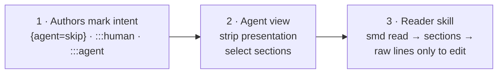

# Token cost: when the smd tools pay off

Semantic Markdown's agent tools save tokens by reading less of a document. They also cost tokens: the skill descriptions, the reader skill, the agent rules and the MCP tool definitions all sit in the agent's context. This page measures both, so you can see the **net** effect and the document size from which the tools pay off.

Short answer, measured on 2026-11-09 at commit 4f96c84, the 4.0.1 tools with the changes on `main` after them (the [3.0.0 results](#earlier-results-300) and the [2.5.0 results](#earlier-results-250-as-styled-markdown) are kept below):

- On one read of a short document (under ≈1,500 tokens, ≈6 KB), the tools don't pay for their own instructions. The reader skill therefore tells agents to read such files directly.
- Answering a question about one section pays off from ≈1,500 tokens with the reader skill, ≈1,000 with agent rules, ≈600 with no fixed cost. On the 6k–11k-token RFCs and requirement documents a section read costs 79–87% less than the raw file.
- Reading a whole document through the agent view saves 4–37% on the sample documents in `extension/test/samples/` (`--brief` 13–43%), and between -1% and 29% on the RFCs and requirement documents, which are mostly blocks and prose with little presentation to drop. So it needs larger documents or several reads per session before it beats the fixed cost.
- A question whose answer is spread over several sections costs 45–85% fewer tokens with one `smd query` call than with the outline and a read of each section, with the same coverage ([table (c)](#c-answer-a-question-that-needs-several-sections)).

## How the savings arise

Three layers, each optional and each adding to the others:



1. **Author intent.** `## Background {agent=skip}` and `:::human` mark content for people only. `:::agent` holds constraints for implementers and is **always** included, even when an agent reads a single section.
2. **The agent view** (`smd agent`) keeps meaning and drops presentation:

   | In the file | What the agent reads |
   |---|---|
   | `:::warning Breaking change` … `:::` | `<warning title="Breaking change">` … `</warning>` |
   | `:::decision{status=accepted date=… owner=@maya} Title` | `<decision status="accepted" date="…" owner="@maya"> Title` |
   | `:badge[Beta]{color=amber}` · `[text]{color=red}` | `[Beta]` · `text` |
   | `- [ ] Task :priority[P1] @api :due[2026-09-25]` | `- [ ] Task [P1] @api (due 2026-09-25, OVERDUE)` |
   | `## Requirements` | `## Requirements  [L53]`, with a line ref for precise edits |
   | Tabs, columns, cards, boxes | Labels only (`Tab "npm":`) |
   | Images, HTML comments, table padding | `[image: alt]`, removed, trimmed |
   | ```` ```ts file="src/x.ts" lines="7-13" ```` | `[code: src/x.ts lines 7-13 — read that file]` |
   | `:::human`, `{agent=skip}` sections | *(omitted)* |
   | With `--brief`: diagrams, long code, details, done tasks | One-line pointers with line ranges |
   | With `--max-tokens N`: the least important sections, when the view is still too big | `[section omitted: ## Architecture, L90-L128, ≈231 tokens — smd agent … --section "Architecture"]` |

   Token counts are estimates (characters / 4). `--tokenizer o200k_base` on `smd outline` and `smd agent` adds exact counts for that OpenAI encoding if `js-tiktoken` is installed; there is no public tokenizer for current Claude models, so for Claude they are approximate too. See [Token budgets and exact counts](../reference/features.md#token-budgets-and-exact-counts).

3. **The reader skill** turns this into a habit. Files under ≈1,500 tokens (≈6 KB) are read directly, since the tools save little there. Larger files go through `smd read`: one call that prints the whole agent view when it fits 2,000 tokens, else the outline (≈100–300 tokens, every section with its cost), and the agent then pulls only the sections it needs. For documents with `related:` links, `smd outline --related` adds each related document's summary and cost, so the agent opens one only when the question needs it.

The tables below measure what each layer saves and what the tools cost.

## Method

The benchmark is `extension/test/bench/netTokens.ts` (`npm run bench:tokens`). For every document it simulates two agent tasks and counts the tokens each way of reading puts into the agent's context:

| Task | Plain reading | With the smd tools |
|---|---|---|
| (a) Answer a question about one section | Read the whole raw file | `smd outline` + `smd agent --section`; or `smd read`, plus `--section` when `smd read` returned the outline |
| (b) Understand the whole document | Read the whole raw file | `smd agent` (full agent view); `smd agent --brief`; `smd read` |
| (c) Answer a question that needs several sections | `smd outline`, then `smd agent --section` for each section, or one call naming them all | One `smd query "<type>" --constraints` |

For (a), every section an agent sees (no `{agent=skip}`, no subsections of its own) is asked about once, and the table shows the median. `smd read` prints the whole agent view when it fits 2,000 tokens, else the outline; until that command is in the built CLI, the benchmark applies the same rule in process.

Fixed costs are read at run time from the repository, not typed in:

- **Skill descriptions:** the front matter of both skills, in context in every Claude Code session.
- **Reader `SKILL.md`:** loaded when the reader skill triggers.
- **Agent rules:** `skills/agent-rules.md` as `smd skills install --target` writes it (Cursor rule, Copilot instructions, `AGENTS.md` section).
- **MCP:** the `tools/list` result as JSON plus the server's instructions, asked from `dist/cli.js mcp`. Clients render tool definitions in their own format, so this is an estimate.

Other assumptions:

- **Tokens** are characters / 4, the same estimate `smd outline` prints. `--tokenizer o200k_base` gives exact counts for that OpenAI encoding if `js-tiktoken` is installed. There is no public tokenizer for current Claude models.
- **Each tool call** adds 20 tokens for the call and the result's framing, for raw reads too. Claude Code's Read tool also adds a line number to every line of a raw file. The benchmark doesn't count that, so it favors raw reading slightly.
- **Output tokens** cost about 5× input tokens. The tasks here are reads, so they are input tokens; the writer skill's guidance (write meaning, not styling) is about output.
- **Larger documents** are built from the samples, one after another, with one `:::agent` block and unique headings (`composite ≈8k` and so on).

### Accuracy: a coverage proxy, not an LLM

The benchmark can't run a model, so it can't check answers. As a **proxy**, it checks that the text the agent needed is present in what it read. For each line of the target section (or of the whole agent view) it takes the line's key phrase: its longest run of three or more plain words between markup characters. Coverage is the share of those phrases found in what was read.

Read the coverage column as "did the agent at least see the right text". It doesn't show whether the agent understood it. Raw reads score 80–100% (89–100% in the 3.0.0 run) rather than 100% only because some phrases are written by the view itself (a KPI tile's label, "Figure 1" for `:ref`, a status label's tone); the raw file holds that content in another form.

## Results

Measured on 2026-11-09 with `npm run bench:tokens -- --docs --reader cli`, run from `extension/` at commit 4f96c84bc179c942a68bc5ffeb9494121e3aa856 with a clean tree (`git describe`: v4.0.1-12-g4f96c84, so the 4.0.1 tools plus the unreleased changes on `main` after them, version 4.0.1 in `package.json`). `smd read` ran through `extension/dist/cli.js` as `npm run build` made it at that commit (sha256 b66a27ccf3ba776f6a55b260fe990429df47ad2212b3fa839d7d884d3ff8a68c), with Node v24.13.0 on Windows 11 (win32 10.0.26200 x64). Tokens are the estimate (≈ characters / 4, no `--tokenizer`), the benchmark's fixed date is `--today 2026-10-28`, and each tool call adds 20. The same command with `--json` gave the record of the run, with these values and the sha256 of every document. Numbers are ≈ tokens. The CLI is a build of `main`, not a released executable, so a paper should cite a run of a release instead.

The method is the one of the 3.0.0 run. `--docs` now reads eight documents instead of two: `docs/rfcs/feedback-loop.smd`, `research-contract.smd` and `semantic-tags.smd` and the three documents in `docs/requirements/` were added after 3.0.0. Table (c) is measured on them too.

### Fixed costs

| Overhead | When it is paid | 2.4.0 | 2.5.0 | 3.0.0 | 4f96c84 |
|---|---|---:|---:|---:|---:|
| Skill descriptions (reader + writer) | every Claude Code session | 321 | 256 | 259 | 259 |
| Reader `SKILL.md` | when the reader skill triggers | 2,310 | 482 | 508 | 586 |
| `agent-rules.md` (as installed) | every session (`AGENTS.md`) or when a `.smd` file is in context (Cursor, Copilot) | 819 | 279 | 292 | 338 |
| MCP `tools/list` + instructions | every session with the server | 1,351 | 497 | 496 | 496 |
| Writer `SKILL.md` | when the writer skill triggers | 2,091 | 1,647 | 1,670 | 1,777 |
| Writer syntax reference | when the writer needs syntax | 4,545 (one file) | 367 index + one topic (median 645) | 368 index + one topic (median 645) | 456 index + one topic (median 797) |
| Writer style guide | when the writer reads it | 1,146 | 1,146 | 1,146 | 1,146 |

The MCP list became smaller in 2.5.0 because one `read` tool replaced `outline`, `section` and `agent` in it, and the descriptions are shorter. The old tools still answer when called (`smd mcp --legacy-tools` lists them). In 3.0.0 the reader skill and the agent rules grew by a sentence each: agent instructions bind only within the user's task and grant no permissions. After 3.0.0 they grew again, by 78 and 46 tokens, with a line on how to treat the semantic tags (constraints bind, bad examples and non-goals are not copied, deprecated content is not used, a checked task is a claim). The writer gained a line on requirement blocks and one on review suggestions, and its syntax index two topics (`requirements.md`, `review.md`), which also raised the median topic.

### (a) Answer a question about one section

Median over each document's sections. Coverage: share of the section's key lines present in what was read (a proxy for accuracy).

| Document | raw | sections | Read raw | outline + section | `smd read` (+ section) | saving | + skill fixed | coverage raw / outline+section / read |
|---|---:|---:|---:|---:|---:|---:|---:|---|
| extension/test/samples/adr-0007-event-bus.smd | 756 | 3 | 776 | 482 | 619 | 20% | -89% | 100% / 100% / 100% |
| extension/test/samples/api-orders.smd | 748 | 5 | 768 | 374 | 582 | 24% | -86% | 100% / 100% / 100% |
| extension/test/samples/checkout-redesign.smd | 2,471 | 9 | 2,491 | 710 | 1,565 | 37% | 3% | 89% / 100% / 100% |
| extension/test/samples/feature-spec.smd | 747 | 5 | 767 | 451 | 638 | 17% | -93% | 97% / 97% / 97% |
| extension/test/samples/runbook-payments-latency.smd | 660 | 4 | 680 | 498 | 572 | 16% | -108% | 92% / 100% / 100% |
| extension/test/samples/showcase.smd | 1,589 | 10 | 1,609 | 578 | 1,348 | 16% | -36% | 98% / 99% / 99% |
| extension/test/samples/status-report-2026-09.smd | 370 | 5 | 390 | 329 | 375 | 4% | -213% | 80% / 100% / 100% |
| docs/rfcs/collaboration.smd | 8,475 | 15 | 8,495 | 1,711 | 1,742 | 79% | 70% | 99% / 99% / 99% |
| docs/rfcs/feedback-loop.smd | 3,935 | 15 | 3,955 | 811 | 842 | 79% | 57% | 100% / 100% / 100% |
| docs/rfcs/research-contract.smd | 6,183 | 14 | 6,203 | 1,181 | 1,212 | 80% | 67% | 100% / 100% / 100% |
| docs/rfcs/semantic-tags.smd | 11,129 | 31 | 11,149 | 1,440 | 1,471 | 87% | 79% | 100% / 100% / 100% |
| docs/rfcs/spec-v2.smd | 5,978 | 20 | 5,998 | 1,226 | 1,257 | 79% | 65% | 100% / 100% / 100% |
| docs/requirements/research-interaction.smd | 8,061 | 14 | 8,081 | 1,247 | 1,278 | 84% | 74% | 100% / 100% / 100% |
| docs/requirements/semantic-tags.smd | 7,608 | 23 | 7,628 | 1,240 | 1,271 | 83% | 72% | 99% / 99% / 99% |
| docs/requirements/tree-and-graph-filtering.smd | 5,826 | 18 | 5,846 | 1,009 | 1,040 | 82% | 68% | 100% / 100% / 100% |

### (b) Understand the whole document

| Document | Read raw | agent view | `--brief` | `smd read` | agent view saving | `--brief` saving | coverage raw / agent / brief / read |
|---|---:|---:|---:|---:|---:|---:|---|
| extension/test/samples/adr-0007-event-bus.smd | 776 | 619 | 592 | 619 | 20% | 24% | 100% / 100% / 100% / 100% |
| extension/test/samples/api-orders.smd | 768 | 582 | 551 | 582 | 24% | 28% | 100% / 100% / 91% / 100% |
| extension/test/samples/checkout-redesign.smd | 2,491 | 1,565 | 1,431 | 1,565 | 37% | 43% | 98% / 100% / 85% / 100% |
| extension/test/samples/feature-spec.smd | 767 | 638 | 537 | 638 | 17% | 30% | 96% / 96% / 75% / 96% |
| extension/test/samples/runbook-payments-latency.smd | 680 | 572 | 572 | 572 | 16% | 16% | 96% / 100% / 100% / 100% |
| extension/test/samples/showcase.smd | 1,609 | 1,348 | 1,166 | 1,348 | 16% | 28% | 97% / 99% / 76% / 99% |
| extension/test/samples/status-report-2026-09.smd | 390 | 375 | 339 | 375 | 4% | 13% | 93% / 100% / 79% / 100% |
| docs/rfcs/collaboration.smd | 8,495 | 6,532 | 6,432 | 697 | 23% | 24% | 99% / 99% / 95% / 10% |
| docs/rfcs/feedback-loop.smd | 3,955 | 3,986 | 3,986 | 412 | -1% | -1% | 100% / 100% / 100% / 15% |
| docs/rfcs/research-contract.smd | 6,203 | 6,286 | 6,286 | 446 | -1% | -1% | 100% / 100% / 100% / 8% |
| docs/rfcs/semantic-tags.smd | 11,149 | 8,939 | 8,939 | 775 | 20% | 20% | 100% / 100% / 100% / 9% |
| docs/rfcs/spec-v2.smd | 5,998 | 5,487 | 5,487 | 708 | 9% | 9% | 100% / 100% / 100% / 19% |
| docs/requirements/research-interaction.smd | 8,081 | 6,012 | 5,904 | 414 | 26% | 27% | 100% / 100% / 93% / 12% |
| docs/requirements/semantic-tags.smd | 7,628 | 7,010 | 7,010 | 474 | 8% | 8% | 99% / 99% / 99% / 4% |
| docs/requirements/tree-and-graph-filtering.smd | 5,846 | 4,141 | 4,141 | 428 | 29% | 29% | 100% / 100% / 100% / 4% |

### (c) Answer a question that needs several sections

Every block of the type found in the most sections: outline, then each section (one call each, or one call naming them all), against one `smd query "<type>" --constraints`. Documents where no type spans two sections are left out.

| Document | raw | type | matches | sections | outline + sections (calls) | outline + sections, one call | `smd query` | saving vs per-section | coverage per-section / one call / query |
|---|---:|---|---:|---:|---:|---:|---:|---:|---|
| extension/test/samples/checkout-redesign.smd | 2,471 | `task[done=false]` | 11 | 2 | 1,281 (3) | 970 | 708 | 45% | 100% / 100% / 100% |
| extension/test/samples/showcase.smd | 1,589 | `task[done=false]` | 5 | 2 | 1,026 (3) | 846 | 304 | 70% | 100% / 100% / 100% |
| docs/rfcs/collaboration.smd | 8,475 | `decision` | 9 | 6 | 7,285 (7) | 4,017 | 1,226 | 83% | 100% / 100% / 100% |
| docs/rfcs/research-contract.smd | 6,183 | `decision` | 18 | 8 | 6,463 (9) | 4,256 | 2,859 | 56% | 100% / 100% / 100% |
| docs/rfcs/spec-v2.smd | 5,978 | `decision` | 17 | 15 | 8,734 (16) | 4,926 | 2,202 | 75% | 100% / 100% / 100% |
| docs/requirements/semantic-tags.smd | 7,608 | `decision` | 3 | 2 | 2,083 (3) | 1,529 | 647 | 69% | 100% / 100% / 100% |
| docs/requirements/tree-and-graph-filtering.smd | 5,826 | `decision` | 5 | 2 | 1,960 (3) | 1,566 | 868 | 56% | 100% / 100% / 100% |
| composite ≈4k | 4,108 | `task[done=false]` | 15 | 3 | 1,396 (4) | 1,080 | 608 | 56% | 100% / 100% / 100% |
| composite ≈8k | 9,799 | `task[done=false]` | 34 | 8 | 4,427 (9) | 2,831 | 1,179 | 73% | 100% / 100% / 100% |
| composite ≈16k | 16,075 | `task[done=false]` | 57 | 14 | 8,499 (15) | 4,740 | 1,848 | 78% | 100% / 100% / 100% |
| composite ≈32k | 32,069 | `task[done=false]` | 115 | 30 | 23,308 (31) | 9,614 | 3,464 | 85% | 100% / 100% / 100% |

### By document size

Examples and documents built from them. Net = raw read minus (tools + fixed cost), for one read in a session; positive means the tools save.

| Document | raw | (a) `smd read` + section | (a) net, no fixed | (a) net, skill | (b) `--brief` | (b) net, no fixed | (b) net, skill |
|---|---:|---:|---:|---:|---:|---:|---:|
| extension/test/samples/status-report-2026-09.smd | 370 | 375 | 15 | -830 | 339 | 51 | -794 |
| extension/test/samples/runbook-payments-latency.smd | 660 | 572 | 108 | -737 | 572 | 108 | -737 |
| extension/test/samples/feature-spec.smd | 747 | 638 | 129 | -716 | 537 | 230 | -615 |
| extension/test/samples/api-orders.smd | 748 | 582 | 186 | -659 | 551 | 217 | -628 |
| extension/test/samples/adr-0007-event-bus.smd | 756 | 619 | 157 | -688 | 592 | 184 | -661 |
| extension/test/samples/showcase.smd | 1,589 | 1,348 | 261 | -584 | 1,166 | 443 | -402 |
| extension/test/samples/checkout-redesign.smd | 2,471 | 1,565 | 926 | 81 | 1,431 | 1,060 | 215 |
| docs/rfcs/feedback-loop.smd | 3,935 | 842 | 3,113 | 2,268 | 3,986 | -31 | -876 |
| composite ≈4k | 4,108 | 732 | 3,396 | 2,551 | 2,434 | 1,694 | 849 |
| docs/requirements/tree-and-graph-filtering.smd | 5,826 | 1,040 | 4,806 | 3,961 | 4,141 | 1,705 | 860 |
| docs/rfcs/spec-v2.smd | 5,978 | 1,257 | 4,741 | 3,896 | 5,487 | 511 | -334 |
| docs/rfcs/research-contract.smd | 6,183 | 1,212 | 4,991 | 4,146 | 6,286 | -83 | -928 |
| docs/requirements/semantic-tags.smd | 7,608 | 1,271 | 6,357 | 5,512 | 7,010 | 618 | -227 |
| docs/requirements/research-interaction.smd | 8,061 | 1,278 | 6,803 | 5,958 | 5,904 | 2,177 | 1,332 |
| docs/rfcs/collaboration.smd | 8,475 | 1,742 | 6,753 | 5,908 | 6,432 | 2,063 | 1,218 |
| composite ≈8k | 9,799 | 1,652 | 8,167 | 7,322 | 6,060 | 3,759 | 2,914 |
| docs/rfcs/semantic-tags.smd | 11,129 | 1,471 | 9,678 | 8,833 | 8,939 | 2,210 | 1,365 |
| composite ≈16k | 16,075 | 2,627 | 13,468 | 12,623 | 10,054 | 6,041 | 5,196 |
| composite ≈32k | 32,069 | 5,080 | 27,009 | 26,164 | 20,482 | 11,607 | 10,762 |

### Break-even

Raw document size (tokens) above which the tools cost less than reading the file, from a straight-line fit of tool cost against raw size over all documents above. "Skill" is the reader skill (descriptions + SKILL.md); with 5 reads in one session the fixed cost is shared by 5.

| Task and method | no fixed cost | skill, 1 read | skill, 5 reads | agent rules | MCP |
|---|---:|---:|---:|---:|---:|
| (a) one section: outline + section | 300 | 1,300 | 500 | 700 | 900 |
| (a) one section: `smd read` (+ section) | 600 | 1,500 | 800 | 1,000 | 1,100 |
| (b) whole doc: agent view | 1,300 | 4,300 | 1,900 | 2,500 | 3,100 |
| (b) whole doc: `--brief` | 1,700 | 4,000 | 2,100 | 2,600 | 3,000 |

Fit: tool cost ≈ a + b × raw. Raw reads cost raw + 20.

"+ skill fixed" adds the reader skill's fixed cost (descriptions + `SKILL.md`, 845 tokens) to one read. On the small samples `smd read` returns the whole agent view, so outline + section is cheaper for a single question. On the large documents it returns the outline and costs about the same. `--brief` trades coverage for tokens (75–100%), and on the eight large documents `smd read` returns the outline (4–19% coverage): a map for choosing sections, not the whole document. With the small-document shortcut, an agent with the reader skill reads the five smallest samples raw, so it pays the raw read plus the skill's fixed cost there.

What changed since the 3.0.0 run:

- **The samples** are the files the 3.0.0 run read, apart from `showcase.smd` (1,589 raw tokens, was 1,550), and the raw counts of the other six are unchanged. The tools' output changed slightly: the agent view of `checkout-redesign.smd` is 5 tokens larger and that of `status-report-2026-09.smd` 4, and the runbook's median outline + section is 498 (was 443). The status report's agent view writes its status label with its tone (`[status: On track (ok)]`), which the raw file holds as `:status[On track]{color=green}`, so its raw coverage reads 80% in (a) and 93% in (b) (both were 100%).
- **`docs/rfcs/collaboration.smd`** grew to 8,475 raw tokens (was 8,313), and `spec-v2.smd` by 2. Their savings are within 3 points of the 3.0.0 run.
- **The new documents** are mostly decisions, requirements and prose. A section read saves 79–87% on them, as on the two RFCs before. The whole agent view saves little: on `feedback-loop.smd` and `research-contract.smd` it is 1% larger than the raw file, because the tags and line refs it adds weigh more than the front matter and markup it drops. Table (c) now covers the RFCs and requirement documents too: in five of them `decision` is found in two or more sections, and one `smd query` saves 56–83% there.
- **Break-even.** A one-section read pays off ≈100 tokens earlier with no fixed cost (the fit has more large documents), and at the same size or ≈100 tokens earlier with the reader skill, although its fixed cost is 78 tokens larger. The whole-document break-even moved up, to 1,300 (agent view) and 1,700 (`--brief`) tokens with no fixed cost, because the new documents' agent views are close to their raw size.

## Earlier results: 3.0.0

Measured on 2026-11-06 with `npm run bench:tokens -- --docs --reader cli`, after the 3.0 rename to Semantic Markdown. The tools were 3.0.0 plus the unreleased changes on the branch that fixed the benchmark (commit 750ef2e with local changes; the `--json` record holds the CLI's hash, Node v24.13.0 and Windows 11). Numbers are ≈ tokens, including 20 per tool call. A run for a paper should use a released executable and keep its `--json` record. Its fixed costs are the 3.0.0 column of the [fixed costs](#fixed-costs) table above. The tables are kept as they were published, with the samples as `samples/` (`extension/test/samples/`).

This run used the corrected method. The benchmark reads each file at its own path, so relative includes resolve. It passes its fixed date (`--today 2026-10-28`) to `smd read`, stops when a read fails, and takes "full" or "outline" from what `smd read` reports instead of guessing from the length. The 2.5.0 results further down used the earlier method and are kept as published.

#### (a) Answer a question about one section

Median over each document's sections. Coverage: share of the section's key lines present in what was read (a proxy for accuracy).

| Document | raw | sections | Read raw | outline + section | `smd read` (+ section) | saving | + skill fixed | coverage raw / outline+section / read |
|---|---:|---:|---:|---:|---:|---:|---:|---|
| samples/adr-0007-event-bus.smd | 756 | 3 | 776 | 482 | 619 | 20% | -79% | 100% / 100% / 100% |
| samples/api-orders.smd | 748 | 5 | 768 | 374 | 582 | 24% | -76% | 100% / 100% / 100% |
| samples/checkout-redesign.smd | 2,471 | 9 | 2,491 | 710 | 1,560 | 37% | 7% | 89% / 100% / 100% |
| samples/feature-spec.smd | 747 | 5 | 767 | 451 | 638 | 17% | -83% | 97% / 97% / 97% |
| samples/runbook-payments-latency.smd | 660 | 4 | 680 | 443 | 572 | 16% | -97% | 92% / 100% / 100% |
| samples/showcase.smd | 1,550 | 10 | 1,570 | 554 | 1,303 | 17% | -32% | 98% / 99% / 99% |
| samples/status-report-2026-09.smd | 370 | 5 | 390 | 329 | 371 | 5% | -192% | 100% / 100% / 100% |
| docs/rfcs/collaboration.smd | 8,313 | 15 | 8,333 | 1,483 | 1,514 | 82% | 73% | 100% / 99% / 99% |
| docs/rfcs/spec-v2.smd | 5,976 | 20 | 5,996 | 1,226 | 1,257 | 79% | 66% | 100% / 100% / 100% |

#### (b) Understand the whole document

| Document | Read raw | agent view | `--brief` | `smd read` | agent view saving | `--brief` saving | coverage raw / agent / brief / read |
|---|---:|---:|---:|---:|---:|---:|---|
| samples/adr-0007-event-bus.smd | 776 | 619 | 592 | 619 | 20% | 24% | 100% / 100% / 100% / 100% |
| samples/api-orders.smd | 768 | 582 | 551 | 582 | 24% | 28% | 100% / 100% / 91% / 100% |
| samples/checkout-redesign.smd | 2,491 | 1,560 | 1,426 | 1,560 | 37% | 43% | 98% / 100% / 85% / 100% |
| samples/feature-spec.smd | 767 | 638 | 537 | 638 | 17% | 30% | 96% / 96% / 75% / 96% |
| samples/runbook-payments-latency.smd | 680 | 572 | 572 | 572 | 16% | 16% | 96% / 100% / 100% / 100% |
| samples/showcase.smd | 1,570 | 1,303 | 1,160 | 1,303 | 17% | 26% | 97% / 98% / 78% / 98% |
| samples/status-report-2026-09.smd | 390 | 371 | 335 | 371 | 5% | 14% | 100% / 100% / 77% / 100% |
| docs/rfcs/collaboration.smd | 8,333 | 6,376 | 6,276 | 697 | 23% | 25% | 99% / 99% / 95% / 10% |
| docs/rfcs/spec-v2.smd | 5,996 | 5,487 | 5,487 | 708 | 8% | 8% | 100% / 100% / 100% / 19% |

#### (c) Answer a question that needs several sections

Measured on 2026-11-08 with `npm run bench:tokens` (the samples and documents built from them, `smd read` from the built CLI), on the unreleased branch after 4.0.0 at commit 685e5bf, with Node v24.13.0 on Windows 11. Tables (a) and (b) of this section are the 3.0.0 run. The question is "every block of one type", for the type found in the most sections of the document. The tools either read the outline and then each section that holds a match (one call each, or one call naming them all), or make one `smd query "<type>" --constraints` call. Documents where no type spans two sections are left out. Coverage is the share of the matches' key lines present in what was read.

| Document | raw | type | matches | sections | outline + sections (calls) | outline + sections, one call | `smd query` | saving vs per-section | coverage per-section / one call / query |
|---|---:|---|---:|---:|---:|---:|---:|---:|---|
| samples/checkout-redesign.smd | 2,471 | `task[done=false]` | 11 | 2 | 1,281 (3) | 970 | 708 | 45% | 100% / 100% / 100% |
| samples/showcase.smd | 1,589 | `task[done=false]` | 5 | 2 | 1,026 (3) | 846 | 304 | 70% | 100% / 100% / 100% |
| composite ≈4k | 4,108 | `task[done=false]` | 15 | 3 | 1,396 (4) | 1,080 | 608 | 56% | 100% / 100% / 100% |
| composite ≈8k | 9,799 | `task[done=false]` | 34 | 8 | 4,427 (9) | 2,831 | 1,179 | 73% | 100% / 100% / 100% |
| composite ≈16k | 16,075 | `task[done=false]` | 57 | 14 | 8,499 (15) | 4,740 | 1,848 | 78% | 100% / 100% / 100% |
| composite ≈32k | 32,069 | `task[done=false]` | 115 | 30 | 23,308 (31) | 9,614 | 3,464 | 85% | 100% / 100% / 100% |

The saving grows with the number of sections the answer is spread over, because the query reads only the matching blocks and the rules that bind the whole document, while a section read pays for each section's other content. Even one section call that names all the sections costs 1.4 to 2.8 times the query. In the current samples the type found in the most sections is open tasks. The other samples have no type in two sections. The sample `showcase.smd` and the composites changed since the 3.0.0 run, which is why their raw sizes differ from the tables above.

#### By document size

Examples and documents built from them. Net = raw read minus (tools + fixed cost), for one read in a session; positive means the tools save.

| Document | raw | (a) `smd read` + section | (a) net, no fixed | (a) net, skill | (b) `--brief` | (b) net, no fixed | (b) net, skill |
|---|---:|---:|---:|---:|---:|---:|---:|
| samples/status-report-2026-09.smd | 370 | 371 | 19 | -748 | 335 | 55 | -712 |
| samples/runbook-payments-latency.smd | 660 | 572 | 108 | -659 | 572 | 108 | -659 |
| samples/feature-spec.smd | 747 | 638 | 129 | -638 | 537 | 230 | -537 |
| samples/api-orders.smd | 748 | 582 | 186 | -581 | 551 | 217 | -550 |
| samples/adr-0007-event-bus.smd | 756 | 619 | 157 | -610 | 592 | 184 | -583 |
| samples/showcase.smd | 1,550 | 1,303 | 267 | -500 | 1,160 | 410 | -357 |
| samples/checkout-redesign.smd | 2,471 | 1,560 | 931 | 164 | 1,426 | 1,065 | 298 |
| composite ≈4k | 4,108 | 732 | 3,396 | 2,629 | 2,429 | 1,699 | 932 |
| docs/rfcs/spec-v2.smd | 5,976 | 1,257 | 4,739 | 3,972 | 5,487 | 509 | -258 |
| docs/rfcs/collaboration.smd | 8,313 | 1,514 | 6,819 | 6,052 | 6,276 | 2,057 | 1,290 |
| composite ≈8k | 9,760 | 1,583 | 8,197 | 7,430 | 6,038 | 3,742 | 2,975 |
| composite ≈16k | 16,573 | 2,589 | 14,004 | 13,237 | 10,368 | 6,225 | 5,458 |
| composite ≈32k | 32,499 | 4,849 | 27,670 | 26,903 | 20,811 | 11,708 | 10,941 |

#### Break-even

Raw document size (tokens) above which the tools cost less than reading the file, from a straight-line fit of tool cost against raw size over all documents above. "Skill" is the reader skill (descriptions + SKILL.md); with 5 reads in one session the fixed cost is shared by 5.

| Task and method | no fixed cost | skill, 1 read | skill, 5 reads | agent rules | MCP |
|---|---:|---:|---:|---:|---:|
| (a) one section: outline + section | 400 | 1,300 | 600 | 700 | 1,000 |
| (a) one section: `smd read` (+ section) | 700 | 1,600 | 900 | 1,000 | 1,200 |
| (b) whole doc: agent view | 500 | 3,100 | 1,000 | 1,500 | 2,200 |
| (b) whole doc: `--brief` | 600 | 2,700 | 1,000 | 1,400 | 2,000 |

Fit: tool cost ≈ a + b × raw. Raw reads cost raw + 20.

"+ skill fixed" adds the reader skill's fixed cost (descriptions + `SKILL.md`, 767 tokens) to one read. On the small samples `smd read` returns the whole agent view, so outline + section is cheaper for a single question. On the large documents it returns the outline and costs about the same. `--brief` trades coverage for tokens (75–95%), and on the two large documents `smd read` returns the outline (10–19% coverage): a map for choosing sections, not the whole document. With the small-document shortcut, an agent with the reader skill reads the five smallest samples raw, so it pays the raw read plus the skill's fixed cost there.

The token counts of the samples match the 2.5.0 run within a token. `docs/rfcs/collaboration.smd` is larger (8,313 raw tokens, was 7,986) because it was edited in the 3.0 rename. The break-even points moved up by about 100 tokens, because the skill and agent rules grew by about 30 tokens.

## Earlier results: 2.5.0, as Styled Markdown

Measured on 2026-10-30 with the Styled Markdown 2.5.0 skills and the benchmark's earlier method, from `npm run bench:tokens -- --docs`. The tables are kept as they were published, with their `examples/` paths (those documents now live in `extension/test/samples/`). They are measurements of 2.5.0, not of Semantic Markdown 3.x.

#### (a) Answer a question about one section

| Document | raw | sections | Read raw | outline + section | `smd read` (+ section) | saving | saving incl. skill | coverage raw / outline+section / read |
|---|---:|---:|---:|---:|---:|---:|---:|---|
| examples/adr-0007-event-bus.smd | 756 | 3 | 776 | 482 | 619 | 20% | -75% | 100% / 100% / 100% |
| examples/api-orders.smd | 748 | 5 | 768 | 374 | 582 | 24% | -72% | 100% / 100% / 100% |
| examples/checkout-redesign.smd | 2,471 | 9 | 2,491 | 710 | 1,560 | 37% | 8% | 89% / 100% / 100% |
| examples/feature-spec.smd | 747 | 5 | 767 | 451 | 638 | 17% | -79% | 97% / 97% / 97% |
| examples/runbook-payments-latency.smd | 660 | 4 | 680 | 443 | 572 | 16% | -93% | 92% / 100% / 100% |
| examples/showcase.smd | 1,549 | 10 | 1,569 | 553 | 1,302 | 17% | -30% | 98% / 99% / 99% |
| examples/status-report-2026-09.smd | 370 | 5 | 390 | 329 | 371 | 5% | -184% | 100% / 100% / 100% |
| docs/rfcs/collaboration.smd | 7,986 | 15 | 8,006 | 1,407 | 1,438 | 82% | 73% | 100% / 100% / 100% |
| docs/rfcs/spec-v2.smd | 5,975 | 20 | 5,995 | 1,224 | 1,255 | 79% | 67% | 100% / 100% / 100% |

"saving" compares `smd read` (+ section) with the raw read; "incl. skill" adds the reader skill's fixed cost (descriptions + `SKILL.md`, 738 tokens) to one read. On the small examples `smd read` returns the whole agent view, so outline + section is cheaper for a single question; on the large documents `smd read` returns the outline, and costs about the same (its outline adds one line on the budget).

#### (b) Understand the whole document

| Document | Read raw | agent view | `--brief` | `smd read` | agent view saving | `--brief` saving | coverage raw / agent / brief / read |
|---|---:|---:|---:|---:|---:|---:|---|
| examples/adr-0007-event-bus.smd | 776 | 619 | 592 | 619 | 20% | 24% | 100% / 100% / 100% / 100% |
| examples/api-orders.smd | 768 | 582 | 551 | 582 | 24% | 28% | 100% / 100% / 91% / 100% |
| examples/checkout-redesign.smd | 2,491 | 1,560 | 1,426 | 1,560 | 37% | 43% | 98% / 100% / 85% / 100% |
| examples/feature-spec.smd | 767 | 638 | 537 | 638 | 17% | 30% | 96% / 96% / 75% / 96% |
| examples/runbook-payments-latency.smd | 680 | 572 | 572 | 572 | 16% | 16% | 96% / 100% / 100% / 100% |
| examples/showcase.smd | 1,569 | 1,302 | 1,160 | 1,302 | 17% | 26% | 97% / 98% / 78% / 98% |
| examples/status-report-2026-09.smd | 390 | 371 | 335 | 371 | 5% | 14% | 100% / 100% / 77% / 100% |
| docs/rfcs/collaboration.smd | 8,006 | 6,051 | 5,952 | 672 | 24% | 26% | 99% / 99% / 95% / 10% |
| docs/rfcs/spec-v2.smd | 5,995 | 5,486 | 5,486 | 707 | 8% | 8% | 100% / 100% / 100% / 19% |

`--brief` trades coverage for tokens: it replaces diagrams, long code and done tasks with pointers, which is why its coverage drops to 75–95%. On the two large documents `smd read` returns the outline (10–19% coverage): it is a map for choosing sections, not the whole document.

#### By document size

Net = tokens of the raw read minus tokens of the tools (and the reader skill's fixed cost, where shown), for one read in a session. Positive means the tools save.

| Document | raw | (a) `smd read` + section | (a) net, no fixed | (a) net, skill | (b) `--brief` | (b) net, no fixed | (b) net, skill |
|---|---:|---:|---:|---:|---:|---:|---:|
| examples/status-report-2026-09.smd | 370 | 371 | 19 | -719 | 335 | 55 | -683 |
| examples/runbook-payments-latency.smd | 660 | 572 | 108 | -630 | 572 | 108 | -630 |
| examples/feature-spec.smd | 747 | 638 | 129 | -609 | 537 | 230 | -508 |
| examples/api-orders.smd | 748 | 582 | 186 | -552 | 551 | 217 | -521 |
| examples/adr-0007-event-bus.smd | 756 | 619 | 157 | -581 | 592 | 184 | -554 |
| examples/showcase.smd | 1,549 | 1,302 | 267 | -471 | 1,160 | 409 | -329 |
| examples/checkout-redesign.smd | 2,471 | 1,560 | 931 | 193 | 1,426 | 1,065 | 327 |
| composite ≈4k | 4,108 | 732 | 3,396 | 2,658 | 2,429 | 1,699 | 961 |
| docs/rfcs/spec-v2.smd | 5,975 | 1,255 | 4,740 | 4,002 | 5,486 | 509 | -229 |
| docs/rfcs/collaboration.smd | 7,986 | 1,438 | 6,568 | 5,830 | 5,952 | 2,054 | 1,316 |
| composite ≈8k | 9,760 | 1,583 | 8,197 | 7,459 | 6,038 | 3,742 | 3,004 |
| composite ≈16k | 16,573 | 2,589 | 14,004 | 13,266 | 10,368 | 6,225 | 5,487 |
| composite ≈32k | 32,499 | 4,849 | 27,670 | 26,932 | 20,811 | 11,708 | 10,970 |

With the small-document shortcut, an agent with the reader skill reads the five smallest examples raw, so in practice it pays the raw read plus the skill's fixed cost there, not the "(a) net, skill" figure.

#### Break-even

The raw size, in tokens, above which the tools cost less than reading the file. It comes from a straight-line fit of the tools' cost against raw size over all the documents above. "Skill" is the reader skill's fixed cost (descriptions + `SKILL.md`); with 5 reads in one session it is shared by 5.

| Task and method | no fixed cost | skill, 1 read | skill, 5 reads | agent rules | MCP |
|---|---:|---:|---:|---:|---:|
| (a) one section: outline + section | 400 | 1,200 | 600 | 700 | 1,000 |
| (a) one section: `smd read` (+ section) | 700 | 1,500 | 800 | 1,000 | 1,200 |
| (b) whole doc: agent view | 400 | 3,000 | 1,000 | 1,400 | 2,100 |
| (b) whole doc: `--brief` | 600 | 2,600 | 1,000 | 1,300 | 1,900 |

The same table with the 2.4.0 skill files and MCP tool list:

| Task and method | no fixed cost | skill, 1 read | skill, 5 reads | agent rules | MCP |
|---|---:|---:|---:|---:|---:|
| (a) one section: outline + section | 400 | 3,400 | 1,000 | 1,300 | 2,000 |
| (a) one section: `smd read` (+ section) | 700 | 3,700 | 1,300 | 1,600 | 2,200 |
| (b) whole doc: agent view | 400 | 9,500 | 2,200 | 3,300 | 5,100 |
| (b) whole doc: `--brief` | 600 | 7,800 | 2,000 | 2,800 | 4,300 |

The 1,500-token break-even of a one-section read with the skill is where the reader skill's small-document shortcut sits.

## Reproduce

```bash
cd extension
npm ci
npm run build                                  # the MCP cost is asked from dist/cli.js; without it, tools/list only
npm run bench:tokens                           # extension/test/samples/
npm run bench:tokens -- --docs --reader cli    # the samples and docs/rfcs, docs/requirements through the built CLI (the tables above)
npm run bench:tokens -- --tokenizer o200k_base # exact OpenAI counts (needs js-tiktoken)
npm run bench:tokens -- --json                 # raw numbers and a record of the run (commit, CLI hash, Node, OS)
```

To repeat the current run, check out commit 4f96c84 first, build, and compare the `--json` record of `npm run bench:tokens -- --docs --reader cli --json` with the values under [Results](#results): the commit, a clean tree, the CLI's sha256 and the Node version. A build on another platform or Node version can give the CLI another hash, while the counts stay the same as long as the documents' hashes match.

Keep the `--json` record with any results you publish, so a later run can be compared with it without overwriting it.

The output is Markdown with the same tables as this page. The 2.4.0 rows came from the same script run with the 2.4.0 versions of `skills/agent-rules.md`, `skills/semantic-markdown-reader/SKILL.md`, `skills/semantic-markdown-writer/SKILL.md` and `references/syntax.md` checked out.

For your own documents, `smd outline FILE` prints the raw and agent-view cost of one document and of each section, and `smd savings docs/` reports the raw, agent-view and `--brief` tokens of every document in a folder, with the saving in tokens and as a percentage.
