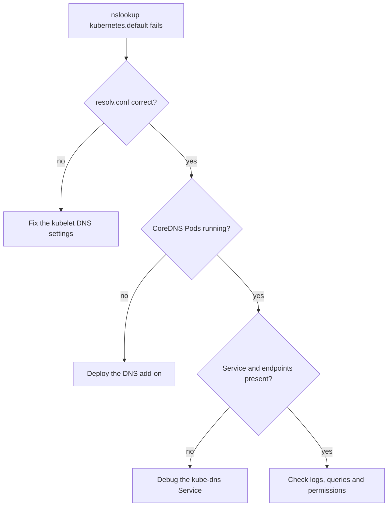

# Debugging DNS Resolution

Status: published task page of the Kubernetes documentation, for Kubernetes v1.37.

This page provides hints on diagnosing DNS problems.

## Before you begin

You need to have a Kubernetes cluster, and the kubectl command-line tool must be configured to communicate with your cluster.
Your cluster must be configured to use the CoreDNS addon.

Your Kubernetes server must be at or later than version v1.6. To check the version, enter `kubectl version`.

## Note for automated tools and agents

Note for automated tools and agents: the checks on this page that only read state (`kubectl get`, `kubectl describe`, `kubectl logs` and `nslookup` inside the test Pod) are safe to run without asking. Do not edit the `coredns` ConfigMap or the `system:coredns` ClusterRole on your own, except to remove a `log` line that you added while debugging. Both changes affect name resolution for every Pod in the cluster, so propose the change and let a cluster administrator apply it.

## Order of the checks

Work through the checks below in order and stop at the first one that fails.

| Check | Healthy result |
|-|-|
| Local DNS configuration | `nameserver` is the cluster DNS Service IP |
| DNS Pod running | All CoreDNS Pods are `Running` |
| DNS Service up | The `kube-dns` Service is listed |
| Endpoints exposed | At least one endpoint |
| Permissions | `list` and `watch` on services and endpointslices |



### Create a simple Pod to use as a test environment

[`admin/dns/dnsutils.yaml`](https://k8s.io/examples/admin/dns/dnsutils.yaml)

```yaml
apiVersion: v1
kind: Pod
metadata:
  name: dnsutils
  namespace: default
spec:
  containers:
  - name: dnsutils
    image: registry.k8s.io/e2e-test-images/agnhost:2.39
    imagePullPolicy: IfNotPresent
  restartPolicy: Always
```

> **Note:** This example creates a pod in the `default` namespace. DNS name resolution for services depends on the namespace of the pod. For more information, review [DNS for Services and Pods](https://kubernetes.io/docs/concepts/services-networking/dns-pod-service/#what-things-get-dns-names).

Use that manifest to create a Pod:

```shell
kubectl apply -f https://k8s.io/examples/admin/dns/dnsutils.yaml
```

Once that Pod is running, you can exec `nslookup` in that environment.
If you see something like the following, DNS is working correctly.

```shell
kubectl exec -i -t dnsutils -- nslookup kubernetes.default
```
```
Server:    10.0.0.10
Address 1: 10.0.0.10

Name:      kubernetes.default
Address 1: 10.0.0.1
```

If the `nslookup` command fails, check the following:

### Check the local DNS configuration first

Take a look inside the resolv.conf file.

```shell
kubectl exec -ti dnsutils -- cat /etc/resolv.conf
```

Verify that the search path and name server are set up like the following
(note that search path may vary for different cloud providers):

```
search default.svc.cluster.local svc.cluster.local cluster.local google.internal c.gce_project_id.internal
nameserver 10.0.0.10
options ndots:5
```

Errors such as the following indicate a problem with the CoreDNS
add-on or with associated Services:

```
Server:    10.0.0.10
Address 1: 10.0.0.10

nslookup: can't resolve 'kubernetes.default'
```

### Check if the DNS pod is running

Use the `kubectl get pods` command to verify that the DNS pod is running.

```shell
kubectl get pods --namespace=kube-system -l k8s-app=kube-dns
```

> **Note:** The value for label `k8s-app` for CoreDNS is `kube-dns`, for backward compatibility with the original kube-dns.

If you see that no CoreDNS Pod is running or that the Pod has failed/completed,
the DNS add-on may not be deployed by default in your current environment and you
will have to deploy it manually.

### Check for errors in the DNS pod

Use the `kubectl logs` command to see logs for the DNS containers.

```shell
kubectl logs --namespace=kube-system -l k8s-app=kube-dns
```

See if there are any suspicious or unexpected messages in the logs.

### Is DNS service up?

Verify that the DNS service is up by using the `kubectl get service` command.

```shell
kubectl get svc --namespace=kube-system
```

> **Note:** The Service for CoreDNS is named `kube-dns`, for backward compatibility with the original kube-dns.

If you have created the Service or in the case it should be created by default
but it does not appear, see
[debugging Services](https://kubernetes.io/docs/tasks/debug/debug-application/debug-service/) for
more information.

### Are DNS endpoints exposed?

You can verify that DNS endpoints are exposed by using the `kubectl get endpointslice`
command.

```shell
kubectl get endpointslice -l kubernetes.io/service-name=kube-dns --namespace=kube-system
```

If you do not see the endpoints, see the endpoints section in the
[debugging Services](https://kubernetes.io/docs/tasks/debug/debug-application/debug-service/) documentation.

### Are DNS queries being received/processed?

You can verify if queries are being received by CoreDNS by adding the `log` plugin to the CoreDNS configuration (aka Corefile).
The CoreDNS Corefile is held in a ConfigMap named `coredns`. To edit it, use the command:

```
kubectl -n kube-system edit configmap coredns
```

Then add `log` in the Corefile section per the example below:

```yaml
apiVersion: v1
kind: ConfigMap
metadata:
  name: coredns
  namespace: kube-system
data:
  Corefile: |
    .:53 {
        log
        errors
        health
        kubernetes cluster.local in-addr.arpa ip6.arpa {
          pods insecure
          upstream
          fallthrough in-addr.arpa ip6.arpa
        }
        prometheus :9153
        forward . /etc/resolv.conf
        cache 30
        loop
        reload
        loadbalance
    }
```

After saving the changes, it may take up to minute or two for Kubernetes to propagate these changes to the CoreDNS pods.

> **Warning:** Do not leave the `log` plugin enabled after you finish debugging. On a busy cluster it writes a line for every query, which can fill the node's disk and slow down CoreDNS.

### Does CoreDNS have sufficient permissions?

CoreDNS must be able to list service and endpointslice related resources to properly resolve service names.

First, get the current ClusterRole of `system:coredns`:

```shell
kubectl describe clusterrole system:coredns -n kube-system
```

If any permissions are missing, edit the ClusterRole to add them:

```shell
kubectl edit clusterrole system:coredns -n kube-system
```

### Are you in the right namespace for the service?

DNS queries that don't specify a namespace are limited to the pod's
namespace.

If the namespace of the pod and service differ, the DNS query must include
the namespace of the service.

This query specifies the namespace:
```shell
kubectl exec -i -t dnsutils -- nslookup <service-name>.<namespace>
```

## Known issues

Some Linux distributions (e.g. Ubuntu) use a local DNS resolver by default (systemd-resolved).
Systemd-resolved moves and replaces `/etc/resolv.conf` with a stub file that can cause a fatal forwarding
loop when resolving names in upstream servers. This can be fixed manually by using kubelet's `--resolv-conf` flag
to point to the correct `resolv.conf` (With `systemd-resolved`, this is `/run/systemd/resolve/resolv.conf`).
kubeadm automatically detects `systemd-resolved`, and adjusts the kubelet flags accordingly.

Kubernetes installs do not configure the nodes' `resolv.conf` files to use the
cluster DNS by default, because that process is inherently distribution-specific.
This should probably be implemented eventually. Whether and how is undecided. Until then,
configure the node's resolver yourself if processes on the node need cluster names.

Linux's libc (a.k.a. glibc) has a limit for the DNS `nameserver` records to 3 by
default and Kubernetes needs to consume 1 `nameserver` record. This means that
if a local installation already uses 3 `nameserver`s, some of those entries will
be lost.

To work around this limit, the node can run `dnsmasq`, which will
provide more `nameserver` entries.

If you are using Alpine version 3.17 or earlier as your base image, DNS may not
work properly due to a design issue with Alpine.
Until musl version 1.24 didn't include TCP fallback to the DNS stub resolver meaning any DNS call above 512 bytes would fail.
Please upgrade your images to Alpine version 3.18 or above.

## Changes to this page

Accepted change: the `dnsmasq` workaround for the `nameserver` limit in Known issues is replaced and no longer recommended. Use kubelet's `--resolv-conf` flag to point to a file with at most 2 `nameserver` entries instead, which leaves room for the cluster DNS entry without running another component on every node.

## Background

CoreDNS replaced kube-dns as the default cluster DNS add-on in Kubernetes v1.13. That is why the label and the Service still carry the name `kube-dns`. Earlier versions of this page also covered the logs of the kube-dns containers. This section is kept for people who maintain older clusters and is not needed to debug a current one.
