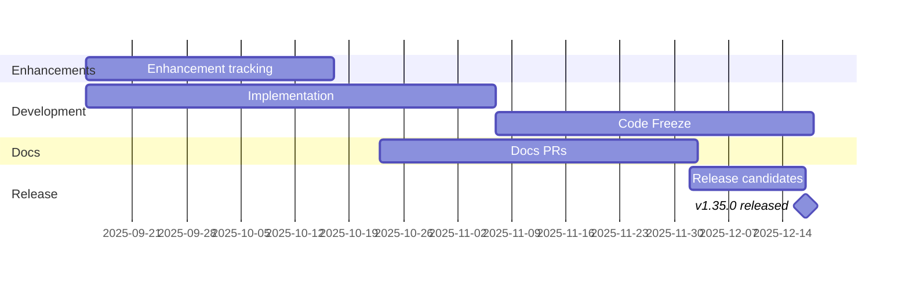

# Kubernetes v1.35 Release Information

Information regarding the current release cycle including important dates, Release Team contact information, tracking spreadsheets and more!

Status: schedule finalized on Friday 19th September 2025. This page combines the v1.35 release schedule with the release phases and the guide to targeting work at a release milestone.

## Background: Timbernetes v1.35 - World Tree Release

2025 began in the shimmer of Octarine: The Color of Magic (v1.33) and rode the gusts of Of Wind & Will (v1.34). With the v1.35 release, we close the year with our hands on the World Tree, inspired by Yggdrasil, the tree of life that binds many realms. Like any great tree, Kubernetes grows ring by ring and release by release, shaped by the care of a global community.

At its center sits the Kubernetes wheel wrapped around the Earth, grounded by the resilient maintainers, contributors and users who keep showing up. Between day jobs, life changes, and steady open-source stewardship, they prune old APIs, graft new features and keep one of the world's largest open source projects healthy.

Three squirrels guard the tree: a wizard holding the LGTM scroll for reviewers, a warrior with an axe and Kubernetes shield for the release crews who cut new branches, and a rogue with a lantern for the triagers who bring light to dark issue queues.

Together, they stand in for a much larger adventuring party. Kubernetes v1.35 adds another growth ring to the World Tree, a fresh cut shaped by many hands, many paths and a community whose branches reach higher as its roots grow deeper.

## Links

* [This document](https://git.k8s.io/sig-release/releases/release-1.35/README.md)
* [Release Team](https://github.com/kubernetes/sig-release/blob/master/releases/release-1.35/release-team.md)
* [Meeting Minutes](https://bit.ly/k8s135-releasemtg) (members of [release-team@] receive meeting invites)
* [v1.35 Release Calendar](https://bit.ly/k8s-release-cal)
* Contact: [#sig-release](https://kubernetes.slack.com/archives/C2C40FMNF) on slack
* [Internal Contact Info](https://bit.ly/k8s135-contacts) (accessible only to members of [release-team@])

## Release cycle decisions

Decision (Lead, Monday 15th September 2025): Code Freeze and Test Freeze begin on Thursday 30th October 2025 (AoE) / Friday 31st October 2025, 12:00 UTC, in week 7, so that Burndown is well under way before KubeCon NA. Contributors should plan for every enhancement PR to be merge-ready by that date.

## Summary

The v1.35 release cycle is as follows:

- **Monday 15th September 2025**: Week 1 — Release cycle begins
- **Thursday 9th October 2025 (AoE) / Friday 10th October 2025, 12:00 UTC**: Week 4 — [Production Readiness Freeze]
- **Thursday 16th October 2025 (AoE) / Friday 17th October 2025, 12:00 UTC**: Week 5 — [Enhancements Freeze]
- **Thursday 30th October 2025 (AoE) / Friday 31st October 2025, 12:00 UTC**: Week 7 — [Feature blog freeze]
- **Thursday 6th November 2025 (AoE) / Friday 7th November 2025, 12:00 UTC**: Week 8 — [Code Freeze] and [Test Freeze]
- **Monday 10th - Thursday 13th November 2025**: Week 9 - [KubeCon NA](https://events.linuxfoundation.org/kubecon-cloudnativecon-north-america/)
- **Tuesday 2nd December 2025 (AoE) / Wednesday 3rd December 2025, 12:00 UTC**: Week 12 — [Docs Freeze]
- **Wednesday 17th December 2025**: Week 14 — Kubernetes v1.35.0 released

### Note on AoE deadlines

Deadlines are expressed in "Anywhere on Earth" (AoE) time. This means the date ends when the calendar day finishes in the last timezone on Earth (UTC−12).
Example: A deadline of Thursday, Oct 16 (AoE) gives contributors their full Thursday everywhere in the world. The cutoff therefore would be Friday, Oct 17 at 12:00 UTC.

### Schedule changes

The schedule was finalized on Friday 19th September 2025. Code Freeze and Test Freeze moved one week later, to week 8, to leave room for the Feature blog freeze and the Call for Code Freeze Exceptions in week 7. This replaces the week 7 Code Freeze date decided on Monday 15th September 2025.



## Timeline

| What | Who | When | Week | Release Signal |
|-|-|-|-|-|
| Start of Release Cycle | Lead | Monday 15th September 2025 | week 1 | [master-blocking], [master-informing] |
| Start Enhancements Tracking | Enhancements Lead | Monday 15th September 2025 | week 1 | |
| Schedule finalized | Lead | Friday 19th September 2025 | week 1 | |
| Team finalized | Lead | Friday 19th September 2025 | week 1 | |
| Begin APAC-friendly meetings | Lead | Wednesday 24th September 2025 | week 2 | |
| Start Release Notes Draft | Docs Lead | Wednesday 1st October 2025 | week 3 | |
| Call for PRR and Enhancement Freeze [Exceptions][Exception] | Lead | Thursday 2nd October 2025 | week 3 | |
| v1.35.0-alpha.1 released | Branch Manager | Wednesday 8th October 2025 | week 4 | |
| **Begin [Production Readiness Freeze]** | Enhancements Lead | Thursday 9th October 2025 (AoE) / Friday 10th October 2025, 12:00 UTC | week 4 | |
| **Begin [Enhancements Freeze]** | Enhancements Lead | Thursday 16th October 2025 (AoE) / Friday 17th October 2025, 12:00 UTC | week 5 | |
| v1.35.0-alpha.2 released | Branch Manager | Wednesday 22nd October 2025 | week 6 | |
| Brace Yourself, Code Freeze is Coming | Comms / Release Signal | Monday 27th October 2025 | week 7 | |
| Docs deadline — Open placeholder PRs | Docs Lead | Thursday 23th October 2025 | week 6 | |
| **Begin [Feature blog freeze] - Open placeholder PRs** | Comms Lead | Thursday 30th October 2025 (AoE) / Friday 31st October 2025, 12:00 UTC | week 7 | |
| Call for Code Freeze [Exceptions][Exception] | Lead | Friday 31st October 2025 | week 7 | |
| v1.35.0-alpha.3 released | Branch Manager | Wednesday 5th November 2025 | week 8 | |
| **Begin [Code Freeze] and [Test Freeze]** | Branch Manager | Thursday 6th November 2025 (AoE) / Friday 7th November 2025, 12:00 UTC | week 8 | |
| **KubeCon NA** | | Monday 10th - Thursday 13th November 2025 | week 9 | |
| **Begin [Burndown]** (Monday, Wednesday, and Friday meetings) | Lead | Monday 17th November 2025 | week 10 | |
| Deprecations and Removals blog published | Comms | Monday 17th November 2025 | week 10 | |
| Docs deadline — PRs ready for review | Docs Lead | Tuesday 18th November 2025 | week 10 | |
| Release Highlights deadline | Comms | Tuesday 18th November 2025 | week 10 | |
| v1.35.0-beta.0 released | Branch Manager | Wednesday 19th November 2025 | week 10 | |
| Release blog ready to review | Comms / Docs | Thursday 20th November 2025 (AoE) / Friday 21st November 2025, 12:00 UTC | week 10 | |
| Feature blogs ready to review | Enhancement Owner / SIG Leads | Monday 24th November 2025 | week 11 | |
| Burndown Meetings daily (Tuesday & Thursday over Slack) | Lead | Monday 24th November 2025 | week 11 | |
| release-1.35 branch created | Branch Manager | Tuesday 2nd December 2025 | week 12 | |
| release-1.35 jobs created | Branch Manager | Tuesday 2nd December 2025 | week 12 | |
| Start final draft of Release Notes | Docs Lead | Tuesday 2nd December 2025 | week 12 | |
| **[Docs Freeze]** | Docs Lead | Tuesday 2nd December 2025 (AoE) / Wednesday 3rd December 2025, 12:00 UTC | week 12 | |
| v1.35.0-rc.0 released | Branch Manager | Tuesday 2nd December 2025 | week 12 | [1.35-informing], [1.35-blocking], [master-blocking], [master-informing] |
| Release Highlights complete | Docs Lead | Tuesday 9th December 2025 | week 13 | |
| v1.35.0-rc.1 released | Branch Manager | Tuesday 9th December 2025 | week 13 | |
| Release Notes complete — reviewed & merged to https://github.com/kubernetes/kubernetes | Docs Lead | Wednesday 17th December 2025 | week 14 | |
| **v1.35.0 released** | Branch Manager | Wednesday 17th December 2025 | week 14 | |
| Release blog published | Comms | Wednesday 17th December 2025 | week 14 | |
| [Thaw] | Comms | Thursday 18th December 2025 | week 14 | |
| Feature blog publication starts | Comms | Thursday 18th December 2025 | | |

### Open question: a second release candidate

Undecided: whether v1.35 needs a v1.35.0-rc.2. The release team decides at the Burndown meeting after v1.35.0-rc.1. Until then, v1.35.0-rc.1 on Tuesday 9th December 2025 is the last planned release candidate, and only fixes for release-blocking issues are cherry-picked into the release-1.35 branch.

# Release Phases

## KEP Readiness Deadline

The KEP Readiness Deadline is a hard deadline happening one week before the [Enhancements Freeze]. After the KEP Readiness Deadline, no new KEPs may be opted into the milestone.

All enhancements wishing to be included in the current release must have an [open issue in kubernetes/enhancements](https://github.com/kubernetes/enhancements/issues/) that:
- is in the current Release Milestone
- has the `lead-opted-in` label applied

As described [here](https://github.com/kubernetes/community/blob/master/sig-architecture/production-readiness.md#submitting-a-kep-for-production-readiness-approval), by the KEP Readiness Deadline, KEP authors must have at least a PR opened in [kubernetes/enhancements] with:
- The KEP's [PRR questionnaire](https://github.com/kubernetes/enhancements/tree/master/keps/NNNN-kep-template#production-readiness-review-questionnaire) filled out
- The [kep.yaml](https://github.com/kubernetes/enhancements/blob/master/keps/NNNN-kep-template/kep.yaml) updated with:
    - `stage` set to the current stage
    - `latest-milestone` set to the current release
    - `milestone` struct updated with the current stage and release (only if graduating to a new stage)
- A [PRR approval file](https://github.com/kubernetes/enhancements/blob/master/keps/prod-readiness/template/nnnn.yaml) with the PRR approver listed for the stage the KEP is targeting

It is important to note that the KEP Readiness Deadline **_does not_** mean that the KEPs need to have received an approval or even a review from the PRR team by this date.

If the enhancement does not meet these requirements, it will be removed from the milestone and will require an [Exception].

## PRR Freeze

As of v1.38, this deadline has been renamed to the [KEP Readiness Deadline].

## Enhancements Freeze

By enhancements freeze, all enhancements must have the [KEP Readiness Deadline] requirements listed above, as well as the following updates, merged into [kubernetes/enhancements]:

- The `kep.yaml` updated with:
    - `status` set to `implementable`
- A `README.md`
    - That uses the [latest template](https://github.com/kubernetes/enhancements/tree/master/keps/NNNN-kep-template)
    - That has up-to-date `Graduation Criteria`
    - That has an updated detailed `Test Plan` section filled out
- A completed [Production Readiness Review](https://github.com/kubernetes/enhancements/blob/master/docs/glossary.md#production-readiness-review-prr)

*Note*: For deprecations/removals, the `kep.yaml` status should be set to `withdrawn`, and the [Kubernetes Deprecation Policy](https://kubernetes.io/docs/reference/using-api/deprecation-policy/) should be followed.

If the enhancement does not meet these requirements, it will be removed from the milestone and will require an [Exception].

## Burndown

Several weeks prior to [Code Freeze], we increase the cadence of release team meetings to begin tracking work more closely. We call this Burndown, because at this point we have a list of outstanding issues and PRs, and are actively working to burn that list down. SIG representatives will be asked to attend if their SIG has specific outstanding issues that are blocking the release.

Please subscribe to the [Kubernetes Release Calendar] to see meeting events. Burndown meetings may conflict with other community meetings. Please prioritize this meeting if a member of the release team asks you to attend.

The intent of these meetings is to:

* Focus on fixing bugs, eliminating test flakes and general release stabilization.
* Ensure docs and release notes are written and accurate.
* Identify all enhancement going into the release, and make sure alpha, beta, GA is marked in enhancements repo.
* Provide a one-stop view of release progress via the current meeting notes (TODO: link to the template?) including relevant release metrics.

## Code Freeze

All enhancements going into the release must be in a merge-ready state with `approved` and `lgtm` labels applied. This **includes** tests, and docs PRs opened by the due date. Due to the Prow queue, this may mean that approved PRs merge shortly after the deadline.

The docs PRs don't have to be ready to merge, but it should be clear what the topic will be and who is responsible for writing it. This person will become the primary contact for the documentation lead. It's incredibly important that documentation work gets completed as quickly as possible.

At this point, the only PRs allowed to proceed with changes are those related to release-blocking issues within the milestone.

## Test Freeze

The date after which no more tests may be changed (or promoted to Conformance), unless there are release-blocking or other exceptional reasons. Before this date, it is acceptable to improve test coverage of existing code. After this date, the goal is to fix, revert, or remove tests that are failing.

Every merged PR, which is part of the current milestone and therefore merged into the master branch, will be automatically merged into the release branch via the [periodic release branch fast forward job](https://testgrid.k8s.io/sig-release-releng-blocking#git-repo-kubernetes-fast-forward) in prow.

## Thaw

Thaw specifies the end of both [Code Freeze] and [Test Freeze]. At this point it is expected that all outstanding PRs for the release of Kubernetes have been merged into the release branch. Assuming the release team agrees, [Code Freeze], will be lifted, and we enter Thaw. This means from a technical perspective, that now the `master` and `release-1.x` branch diverge. After Thaw, the `master` branch develops toward the next minor release and the release branch goes into maintenance mode. From this point forward, any PRs intended for the current release must be cherry-picked into the appropriate branch.

## Exceptions

Starting at the [KEP Readiness Deadline], the release team will solicit and rule on [Exception] requests for enhancements and test work that is unlikely to be done by [Code Freeze]. The [Exception] approval is the responsibility of the SIG or SIGs labeled in the pull request. The release team may intervene or deny the request only if it poses a risk to release quality, or could negatively impact the overall timeline. Changes introduced at this point should be well-tested, well-understood, limited in architectural scope, and low risk. All of those factors should be considered in the approval process. Enhancements on an feature branch with documentation, test cases, and passing CI are more likely to be accepted.

*Exception requests must be received within three days of the relevant freeze deadline to be considered.*

Exception requests for v1.35 and the release team's rulings are recorded in `releases/release-1.35/exceptions.yaml`. An excerpt:

```yaml
# Code Freeze Exceptions requested in v1.35

codeFreeze:
- name: "Restart all containers on container exits"
  issue: 5532
  date_requested: 2025-11-07
  date_reviewed: 2025-11-10
  thread: "https://groups.google.com/g/kubernetes-sig-release/c/BN3cpxFiwWc"
  pull_requests:
    - "https://github.com/kubernetes/kubernetes/pull/134345"
  status: "approved"

- name: "Pod Level Resource Managers"
  issue: 5526
  date_requested: 2025-11-06
  date_reviewed: 2025-11-10
  thread: "https://groups.google.com/g/kubernetes-sig-release/c/H7jUtSMZYKY"
  pull_requests:
    - "https://github.com/kubernetes/kubernetes/pull/134768"
  status: "rejected"
```

## Feature Blog Freeze

Feature blogs are an amazing way to showcase all the hard work you and your team have done with the enhancement. While providing technical depth in terms of content, they are also great avenues to attract newer contributors to the Kubernetes project. You can opt in to write a feature blog for your enhancement and this deadline is to freeze the collection phase for the ongoing cycle. Once the collection phase is completed, the Release Comms team will coordinate further with you to work out details around delivery & review.

## Pruning

Enhancements that are partially implemented and/or lack sufficient tests may be considered for pruning beginning after [Code Freeze], unless they've been granted an [Exception].

The release team will work with SIGs and enhancements owners to evaluate each case, but for example, pruning could include actions such as:

* Disabling the use of a new API or field
* Switching the default value of a flag or field
* Moving a new API or field behind an Alpha Enhancements gate
* Reverting commits or deleting code

This should occur before 1.x.0-beta.1 is cut so we have time to gather signal on whether the system is stable in this state. These are considered drastic measures, so the release team will strive to coordinate at-risk work with SIGs before this time. The goal is to make code freeze, and overall project transparency, enforceable despite the lack of a consistently used feature branch process.

## Docs

If an enhancement needs documentation, enter "Yes" in the enhancement tracking spreadsheet and add a link to the documentation PR. You can open documentation PRs in the [kubernetes/website] repository. If you have questions, the release documentation lead, or representatives from SIG-Docs will be happy to assist you.

For documentation PRs:

* Open PRs against the dev-1.x branch based off of the current release PR. The documentation workflow uses feature branches for release documentation, rather than basing from master. **Be sure to open your PR against the release branch**.
* Add your PR to the current Release milestone.

## Docs Freeze

All enhancements that are determined to require documentation must have their docs PRs in a `ready to merge` state by the Docs Freeze deadline for the release. To be considered ready to merge, a PR must have a technical review as well as the `lgtm` and `approve` labels applied, with no outstanding comments or suggestions from SIG Docs.

After Docs Freeze, the owners of any outstanding documentation PRs must file an exception request. The release team will work with SIG Docs and the SIG or SIGs labeled in the pull request to determine whether or not an exception can be granted. Authors and reviewers should prioritize getting the PR into a state where it is accurate and useful enough to be merged even if it isn't perfect, and then open a separate PR to continue work on that documentation post-release.

# Targeting enhancements, Issues and PRs to Release Milestones

This document is focused on Kubernetes developers and contributors who need to create an enhancement, issue, or pull request which targets a specific release milestone.

The process for shepherding enhancements, issues, and pull requests into a Kubernetes release spans multiple stakeholders:

- the enhancement, issue, and pull request owner(s)
- SIG leadership
- the [Release Team][release-team]

Information on workflows and interactions are described below.

As the owner of an enhancement, issue, or pull request (PR), it is your responsibility to ensure release milestone requirements are met. Automation and the Release Team will be in contact with you if updates are required, but inaction can result in your work being removed from the milestone. Additional requirements exist when the target milestone is a prior release (see [cherry pick process][cherry-picks] for more information).

## TL;DR

If you want your PR to get merged, it needs the following required labels and milestones, represented here by the Prow /commands it would take to add them:

### Normal Dev (Weeks 1-11)

- /sig {name}
- /kind {type}
- /lgtm
- /approved

### [Code Freeze][code-freeze] (Weeks 12-14)

- /milestone {v1.y}
- /sig {name}
- /kind {bug, failing-test}
- /lgtm
- /approved

For example, a fix for a failing test owned by SIG Node, targeted at v1.35 during Code Freeze, gets these comments:

```text
/milestone v1.35
/sig node
/kind failing-test
```

### Post-Release (Weeks 14+)

Return to 'Normal Dev' phase requirements:

- /sig {name}
- /kind {type}
- /lgtm
- /approved

Merges into the 1.y branch are now [via cherry picks][cherry-picks], approved by [Release Managers][release-managers].

In the past, there was a requirement for a milestone-targeted pull requests to have an associated GitHub issue opened, but this is no longer the case. Features or enhancements are effectively GitHub issues or [KEPs][keps] which lead to subsequent PRs.

The general labeling process should be consistent across artifact types.

## Definitions

- *issue owners*: Creator, assignees, and user who moved the issue into a release milestone
- *Release Team*: Each Kubernetes release has a team doing project management tasks described [here][release-team]. The contact info for the team associated with any given release can be found [here](https://git.k8s.io/sig-release/releases/).
- *Y days*: Refers to business days
- *enhancement*: see "[Is My Thing an Enhancement?](https://git.k8s.io/enhancements/README.md#is-my-thing-an-enhancement)"
- *[KEP Readiness Deadline][kep-readiness-deadline]*: the deadline by which [KEPs][keps] have to be opted into the release with production readiness reviewers identified
- *[Enhancements Freeze][enhancements-freeze]*: the deadline by which [KEPs][keps] have to be completed in order for enhancements to be part of the current release
- *[Exception Request][exceptions]*: The process of requesting an extension on the deadline for a particular Enhancement
- *[Code Freeze][code-freeze]*: The period of ~4 weeks before the final release date, during which only critical bug fixes are merged into the release.
- *[Pruning](https://git.k8s.io/sig-release/releases/release_phases.md#pruning)*: The process of removing an Enhancement from a release milestone if it is not fully implemented or is otherwise considered not stable.
- *release milestone*: semantic version string or [GitHub milestone](https://help.github.com/en/github/managing-your-work-on-github/associating-milestones-with-issues-and-pull-requests) referring to a release MAJOR.MINOR `vX.Y` version. See also [release versioning](https://git.k8s.io/sig-release/release-engineering/reference/versioning.md).
- *release branch*: Git branch `release-X.Y` created for the `vX.Y` milestone. Created at the time of the `vX.Y-rc.0` release and maintained after the release for approximately 12 months with `vX.Y.Z` patch releases.

  Note: releases 1.19 and newer receive 1 year of patch release support, and releases 1.18 and earlier received 9 months of patch release support.

## The Release Cycle

Kubernetes releases currently happen approximately three times per year.

The release process can be thought of as having three main phases:

- Enhancement Definition
- Implementation
- Stabilization

But in reality, this is an open source and agile project, with feature planning and implementation happening at all times. Given the project scale and globally distributed developer base, it is critical to project velocity to not rely on a trailing stabilization phase and rather have continuous integration testing which ensures the project is always stable so that individual commits can be flagged as having broken something.

With ongoing feature definition through the year, some set of items will bubble up as targeting a given release. **[Enhancements Freeze][enhancements-freeze]** starts ~4 weeks into release cycle. By this point all intended feature work for the given release has been defined in suitable planning artifacts in conjunction with the Release Team's [Enhancements Lead](https://git.k8s.io/sig-release/release-team/role-handbooks/enhancements/README.md).

After Enhancements Freeze, tracking milestones on PRs and issues is important. Items within the milestone are used as a punchdown list to complete the release. *On issues*, milestones must be applied correctly, via triage by the SIG, so that [Release Team][release-team] can track bugs and enhancements (any enhancement-related issue needs a milestone).

There is some automation in place to help automatically assign milestones to PRs.

This automation currently applies to the following repos:

- `kubernetes/enhancements`
- `kubernetes/kubernetes`
- `kubernetes/release`
- `kubernetes/sig-release`
- `kubernetes/test-infra`

At creation time, PRs against the `master` branch need humans to hint at which milestone they might want the PR to target. Once merged, PRs against the `master` branch have milestones auto-applied so from that time onward human management of that PR's milestone is less necessary. On PRs against release branches, milestones are auto-applied when the PR is created so no human management of the milestone is ever necessary.

Any other effort that should be tracked by the Release Team that doesn't fall under that automation umbrella should be have a milestone applied.

Implementation and bug fixing is ongoing across the cycle, but culminates in a code freeze period.

**[Code Freeze][code-freeze]** starts in week ~12 and continues for ~2 weeks. Only critical bug fixes are accepted into the release codebase during this time.

There are approximately two weeks following Code Freeze, and preceding release, during which all remaining critical issues must be resolved before release. This also gives time for documentation finalization.

When the code base is sufficiently stable, the master branch re-opens for general development and work begins there for the next release milestone. Any remaining modifications for the current release are cherry picked from master back to the release branch. The release is built from the release branch.

## Removal Of Items From The Milestone

Before getting too far into the process for adding an item to the milestone, please note:

Members of the [Release Team][release-team] may remove issues from the milestone if they or the responsible SIG determine that the issue is not actually blocking the release and is unlikely to be resolved in a timely fashion.

Members of the Release Team may remove PRs from the milestone for any of the following, or similar, reasons:

- PR is potentially de-stabilizing and is not needed to resolve a blocking issue
- PR is a new, late feature PR and has not gone through the enhancements process or the [exception process][exceptions]
- There is no responsible SIG willing to take ownership of the PR and resolve any follow-up issues with it
- PR is not correctly labelled
- Work has visibly halted on the PR and delivery dates are uncertain or late

While members of the Release Team will help with labelling and contacting SIG(s), it is the responsibility of the submitter to categorize PRs, and to secure support from the relevant SIG to guarantee that any breakage caused by the PR will be rapidly resolved.

Where additional action is required, an attempt at human to human escalation will be made by the Release Team through the following channels:

- Comment in GitHub mentioning the SIG team and SIG members as appropriate for the issue type
- Emailing the SIG mailing list
  - bootstrapped with group email addresses from the [community sig list][sig-list]
  - optionally also directly addressing SIG leadership or other SIG members
- Messaging the SIG's Slack channel
  - bootstrapped with the slackchannel and SIG leadership from the [community sig list][sig-list]
  - optionally directly "@" mentioning SIG leadership or others by handle

## Adding An Item To The Milestone

### Milestone Maintainers

The members of the [`milestone-maintainers`](https://github.com/orgs/kubernetes/teams/milestone-maintainers/members) GitHub team are entrusted with the responsibility of specifying the release milestone on GitHub artifacts.

This group is [maintained](https://git.k8s.io/sig-release/release-team/README.md#milestone-maintainers) by SIG Release and has representation from the various SIGs' leadership.

### Note for automated tools and agents

Bots and automated assistants that comment on, label or triage issues and pull requests in the repositories listed above must not set, change or remove a release milestone. Only members of `milestone-maintainers` specify milestones. During Code Freeze such tools may suggest `/sig` and `/kind` labels in a comment, but they must not add `/lgtm` or `/approve`.

### Feature additions

Feature planning and definition takes many forms today, but a typical example might be a large piece of work described in a [KEP][keps], with associated task issues in GitHub. When the plan has reached an implementable state and work is underway, the enhancement or parts thereof are targeted for an upcoming milestone by creating GitHub issues and marking them with the Prow "/milestone" command.

For the first ~4 weeks into the release cycle, the Release Team's Enhancements Lead will interact with SIGs and feature owners via GitHub, Slack, and SIG meetings to capture all required planning artifacts.

If you have an enhancement to target for an upcoming release milestone, begin a conversation with your SIG leadership and with that release's Enhancements Lead.

### Issue additions

Issues are marked as targeting a milestone via the Prow "/milestone" command.

The Release Team's [Bug Triage Lead](https://git.k8s.io/sig-release/release-team/role-handbooks/bug-triage/README.md) and overall community watch incoming issues and triage them, as described in the contributor guide section on [issue triage](https://git.k8s.io/community/contributors/guide/issue-triage.md).

Marking issues with the milestone provides the community better visibility regarding when an issue was observed and by when the community feels it must be resolved. During [Code Freeze][code-freeze], a milestone must be set to merge a PR.

An open issue is no longer required for a PR, but open issues and associated PRs should have synchronized labels. For example a high priority bug issue might not have its associated PR merged if the PR is only marked as lower priority.

### PR Additions

PRs are marked as targeting a milestone via the Prow "/milestone" command.

This is a blocking requirement during Code Freeze as described above.

## Other Required Labels

[Here is the list of labels and their use and purpose.](https://git.k8s.io/test-infra/label_sync/labels.md#labels-that-apply-to-all-repos-for-both-issues-and-prs)

### SIG Owner Label

The SIG owner label defines the SIG to which we escalate if a milestone issue is languishing or needs additional attention. If there are no updates after escalation, the issue may be automatically removed from the milestone.

These are added with the Prow "/sig" command. For example to add the label indicating SIG Storage is responsible, comment with `/sig storage`.

### Priority Label

Priority labels are used to determine an escalation path before moving issues out of the release milestone. They are also used to determine whether or not a release should be blocked on the resolution of the issue.

- `priority/critical-urgent`: Never automatically move out of a release milestone; continually escalate to contributor and SIG through all available channels.
  - considered a release blocking issue
  - requires daily updates from issue owners during [Code Freeze][code-freeze]
  - would require a patch release if left undiscovered until after the minor release
- `priority/important-soon`: Escalate to the issue owners and SIG owner; move out of milestone after several unsuccessful escalation attempts.
  - not considered a release blocking issue
  - would not require a patch release
  - will automatically be moved out of the release milestone at Code Freeze after a 4 day grace period
- `priority/important-longterm`: Escalate to the issue owners; move out of the milestone after 1 attempt.
  - even less urgent / critical than `priority/important-soon`
  - moved out of milestone more aggressively than `priority/important-soon`

### Issue/PR Kind Label

The issue kind is used to help identify the types of changes going into the release over time. This may allow the Release Team to develop a better understanding of what sorts of issues we would miss with a faster release cadence.

For release targeted issues, including pull requests, one of the following issue kind labels must be set:

- `kind/api-change`: Adds, removes, or changes an API
- `kind/bug`: Fixes a newly discovered bug.
- `kind/cleanup`: Adding tests, refactoring, fixing old bugs.
- `kind/design`: Related to design
- `kind/documentation`: Adds documentation
- `kind/failing-test`: CI test case is failing consistently.
- `kind/feature`: New functionality.
- `kind/flake`: CI test case is showing intermittent failures.

[Production Readiness Freeze]: https://git.k8s.io/sig-release/releases/release_phases.md#prr-freeze
[Enhancements Freeze]: https://git.k8s.io/sig-release/releases/release_phases.md#enhancements-freeze
[Burndown]: https://git.k8s.io/sig-release/releases/release_phases.md#burndown
[Code Freeze]: https://git.k8s.io/sig-release/releases/release_phases.md#code-freeze
[Exception]: https://git.k8s.io/sig-release/releases/EXCEPTIONS.md
[Thaw]: https://git.k8s.io/sig-release/releases/release_phases.md#thaw
[Test Freeze]: https://git.k8s.io/sig-release/releases/release_phases.md#test-freeze
[Docs Freeze]: https://git.k8s.io/sig-release/releases/release_phases.md#docs-freeze
[Feature blog freeze]: https://git.k8s.io/sig-release/releases/release_phases.md#feature-blog-freeze
[KEP Readiness Deadline]: https://git.k8s.io/sig-release/releases/release_phases.md#kep-readiness-deadline
[master-blocking]: https://testgrid.k8s.io/sig-release-master-blocking#Summary
[master-informing]: https://testgrid.k8s.io/sig-release-master-informing#Summary
[1.35-blocking]: https://testgrid.k8s.io/sig-release-1.35-blocking#Summary
[1.35-informing]: https://testgrid.k8s.io/sig-release-1.35-informing#Summary
[release-team@]: https://groups.google.com/a/kubernetes.io/g/release-team
[kubernetes/website]: https://github.com/kubernetes/website
[kubernetes/enhancements]: https://github.com/kubernetes/enhancements
[Kubernetes Release Calendar]: https://bit.ly/k8s-release-cal
[cherry-picks]: https://git.k8s.io/community/contributors/devel/sig-release/cherry-picks.md
[code-freeze]: https://git.k8s.io/sig-release/releases/release_phases.md#code-freeze
[kep-readiness-deadline]: https://git.k8s.io/sig-release/releases/release_phases.md#kep-readiness-deadline
[enhancements-freeze]: https://git.k8s.io/sig-release/releases/release_phases.md#enhancements-freeze
[exceptions]: https://git.k8s.io/sig-release/releases/release_phases.md#exceptions
[keps]: https://git.k8s.io/enhancements/keps
[release-managers]: https://kubernetes.io/releases/release-managers/
[release-team]: https://git.k8s.io/sig-release/release-team
[sig-list]: https://git.k8s.io/community/sig-list.md
