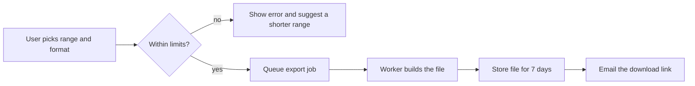

# Ledger export to accounting tools

Status: approved for build, last edited 2026-09-22 by the Invoicing team.

Tallyhook customers can send their invoices, payments and credit notes to their accounting tool as a ledger export, so their bookkeeper stops retyping them. This spec covers the first version of the feature.

## Background

Bookkeepers have asked for this since the 2024 customer survey, where "send everything to my accountant" was the third most requested item. Until now support has built CSV files by hand from the admin console, about 40 a month through 2025, which took Dana roughly a day a week. Two customers left in the first quarter of 2026 and named the missing export as the reason. None of this changes the requirements below. It is here so that people joining the project know why the feature exists and why it was rushed into the autumn plan.

## Scope

The export covers invoices, payments received and credit notes. Expenses are not exported, because Tallyhook does not store them. Draft invoices are never exported. A voided invoice is exported once more as a reversal entry, but only if it had been exported before it was voided.

Account owners and users with the Bookkeeper role can start an export. Other roles see the menu item greyed out, except for support staff, who can start an export for any account from the admin console while impersonating it.

Multi-entity accounts export one entity at a time. There is no combined export across entities in this version.

Out of scope for this version: a public API endpoint for exports, and direct connections that push entries into a cloud accounting tool. The second one is not planned before 2027.

## Account mapping

Every ledger line needs an account code from the customer's own chart of accounts. Tallyhook ships default codes (1200 for receivables, 4000 for sales, 2200 for sales tax), and users can change them on the export settings page. An account can have up to 200 mapping rules, and a code can be at most 20 characters long. Rules match on product category, customer group or payment method, and the first matching rule wins.

Lines that no rule matches go to the suspense account 9999 "Unmapped", so the bookkeeper sees them instead of losing them. Tax lines are the exception. They always go to the tax account set under tax settings and cannot be remapped here, because a wrong tax code is the mistake bookkeepers told us hurts most.

Changing a mapping affects future exports only. Files that were already built are not rebuilt.

## Rounding and totals

Amounts are rounded per line, so the sum of the lines can differ from the invoice total by a cent or two on invoices with many lines. When the difference for one invoice is more than 0.00 and at most 0.05, the export adds a rounding line on account 8990. When it is more than 0.05, the export stops with an error that names the invoice, because something other than rounding is wrong.

## Exporting the same range twice

Nothing stops a user from exporting the same months again. Tallyhook does not track which lines a customer has already imported. The `entry_id` of a line stays the same across exports, so tools that de-duplicate on it import each line once. Tools that do not will import duplicates, and the export page says so in a short note under the date picker.

## Formats

| Format | File | Who it is for |
|-|-|-|
| Generic CSV | `.csv`, UTF-8 with a byte order mark | Spreadsheets and most small tools |
| Ledgerline XML | `.xml` | The two desktop accounting tools that read it |
| Journal JSON | `.json` | Integrations and scripts |

Dates use ISO 8601 (`2026-09-22`) in every format. Amounts are written in the account's base currency with two decimals, and the original currency and exchange rate go in their own fields. The CSV uses a comma as separator even for accounts in countries that normally use a semicolon, since the import tools we tested all handle commas.

Ledgerline XML is written against version 2.1 of that schema. Version 3 is not supported, since neither desktop tool reads it yet. We checked both tools in September and will check again before the next major release. File names follow the pattern `tallyhook-<entity>-<from>-<to>.<ext>` in every format, so a bookkeeper with several clients can sort them in a folder.

Each line of a Journal JSON export looks like this.

```json
{
  "entry_id": "TH-2026-000184-1",
  "date": "2026-09-14",
  "account": "1200 Accounts receivable",
  "debit": "1250.00",
  "credit": "0.00",
  "currency": "EUR",
  "original_currency": "GBP",
  "rate": "1.1712",
  "source": { "type": "invoice", "number": "INV-0184" }
}
```

## Limits

A single export covers at most 12 months and at most 50,000 ledger lines. Larger requests are rejected with a message that suggests a shorter date range. An account can start 5 exports per hour. Finished files stay available for download for 7 days and are then deleted.

**Important:** An export must never contain a customer's full card number or bank account number. Payment lines carry only the last four digits. A file with full numbers in it would break our card processor's terms and could cost us the processing agreement.

## How an export runs

On-demand exports (decided 2026-08-03)

Users start an export whenever they want, for any date range inside the limits above. This replaces the monthly schedule decided in May, after the beta group said they close their books on different days and several needed mid-month files for VAT returns. The worker pool handles the load at low priority, so the original reason for a fixed schedule no longer holds.



Export jobs run on the shared worker pool at low priority. A job that has not finished after 15 minutes is cancelled and the user is asked to try a shorter range. The download link in the email works only for the person who started the export, and it asks them to sign in again if their session is older than 24 hours.

When an export fails, the user gets one of these messages in the app and by email. Each one says what to change, and none of them shows a stack trace or an internal job ID.

- The range is longer than 12 months or holds more than 50,000 lines. Pick a shorter range.
- You have started 5 exports in the last hour. Try again later.
- Invoice INV-0184 does not add up after rounding. Contact support and quote the invoice number.
- The export took too long. Try a shorter range.

Support sees the internal job ID and the full error in the admin console. Failed jobs are not retried automatically, since most failures come from a range that is too large and would fail again the same way.

## Decisions

Monthly scheduled exports (decided 2026-05-12)

Exports run on a fixed schedule, on the 1st of each month, and cover the previous calendar month. There is no on-demand export. A fixed schedule keeps the load on the worker pool predictable and gives bookkeepers one file per month to import.

## Open questions

Should exports include the invoice PDFs?

Undecided. Bookkeepers in the beta asked for it, but the files would grow by roughly 40 times. Until then, exports contain ledger data only, and users download PDFs separately from the invoice list.

## Rollout

The export is behind the `ledger_export` feature flag. The beta opened to 30 accounts on 2026-10-06, chosen from the customers who asked support for manual CSV files in 2025. General availability is planned for 2026-11-17 if the beta shows fewer than 2 failed exports per 100. Support keeps building manual files for accounts outside the beta until then, and stops on the day the flag is turned on for everyone.
