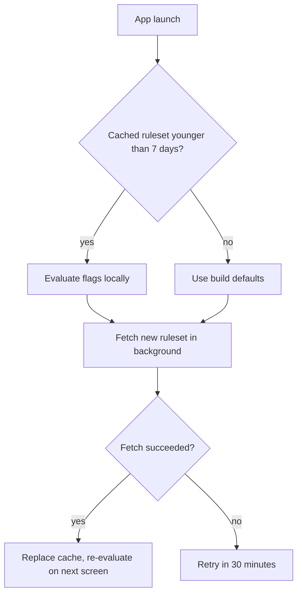

# ADR-022: Feature flags for the Linguaroo apps

Status: accepted on 2026-04-22 by the client platform group. Owner: Teodora Vasquez (Client Platform).

Linguaroo will run feature flags on Pennant, an open-source flag server that we host ourselves, with flags evaluated on the device by the Pennant SDK in the iOS and Android apps. This record explains why we picked Pennant over a hosted flag service and over extending our own config service, and sets the rules every squad follows when it adds a flag.

## Background (for people new to the team)

Until early 2025 Linguaroo shipped features on a fixed two-week release train, and anything unfinished stayed on a branch. That worked while we had three squads. With nine squads it meant long-lived branches, painful merges and a lot of "can we sneak this into the train" messages on release day. In March 2025 we started using the remote config blob in Tuner, our config service, as a stand-in for flags. Squads added booleans to a shared JSON file and the apps read it at launch.

That is how the streak freeze incident happened in September 2025. A half-finished streak freeze feature was behind a Tuner boolean that someone flipped for every platform at once while testing on staging, because staging and production read the same file with a different prefix. For about four hours every learner could freeze their streak for free, and around 31,000 learners lost a paid streak freeze they had already bought when we turned it off again. Support spent most of a week on refunds. The postmortem asked for real flags with targeting, an audit trail and per-environment separation, and this ADR is the answer.

## Context

Linguaroo has about 2.4 million monthly active learners across iOS, Android and the web app. Lessons work offline, and many learners open the app on a commute with no signal, so whatever we pick has to keep working with a stale ruleset. The apps cache the last ruleset they received and use it for up to 7 days without a refresh, after which they fall back to the defaults compiled into the build. A flag check must take under 5 ms on a low-end Android phone, because some flags are read while a lesson screen is drawn.

No learner personal data may leave our own infrastructure for targeting, which in practice means learner IDs, email addresses and birth years stay inside our cluster. Child accounts (learners under 13, set up through a parent or a school) are a separate case. Experiments are not allowed on child accounts, except for accessibility fixes, which may be rolled out to child accounts by percentage like any other release flag.

Tuner itself has limits that made it a poor fit. Its blob is capped at 64 KB per platform, a change takes about 15 minutes to reach the apps, and it can only target by platform and app version.

## Options considered

| Option | Where it runs | Where flags are evaluated | Yearly cost (estimate) | Main concern |
|-|-|-|-|-|
| A. Extend Tuner | Our cluster | Our server | About two engineer-quarters to build, then upkeep | We would be writing a flag product from scratch |
| B. Flagstaff (hosted service) | Vendor cloud | Vendor SDK on device | $46,000 at today's learner count | Sends learner IDs to the vendor |
| C. Pennant (open source, self-hosted) | Our cluster | Pennant SDK on device | About $9,000 in infrastructure plus half an engineer | We run and patch it ourselves |

Decision (rejected 2026-03-18): Option B, the hosted Flagstaff service. Its SDK sends the learner ID and country to the vendor for every targeting call, which our privacy commitments do not allow, and its price doubles once we pass 3 million monthly active learners, which the growth plan expects in 2027.

Option A was attractive because Tuner is already in every app. We dropped it after the estimate came back, since most of the work would be rebuilding what Pennant already does, including the audit log and percentage rollouts.

## Decision

Decision (accepted 2026-04-22): we adopt Option C. Pennant runs in our cluster, and the iOS and Android apps evaluate flags on the device with the Pennant SDK, using a ruleset they download at launch and every 30 minutes while the app is open. This replaces the server-side evaluation decision of 2026-02-10 in "How flags are evaluated". Local evaluation was chosen after the offline tests showed that a server round trip at lesson start added up to 1.8 seconds on a slow connection.

Tuner stays for plain configuration, such as copy, timeouts and URLs. It is not used for feature flags any more, and the existing booleans move to Pennant by the end of Q3 2026.

## How flags are evaluated

Decision (accepted 2026-02-10): flag evaluation happens on the server only. At session start each app calls the flags endpoint with the learner's session token and receives a resolved list of flag values. The apps never see targeting rules, which keeps school and partner names out of the app bundles.

The flow on the device looks like this.



## Rules for squads

Every flag has a named owner and an expiry date. A release flag lives at most 90 days and an experiment flag at most 45 days. Kill switches, which turn off a feature in an incident, have no expiry. Each app can hold at most 200 active flags, and the Pennant server refuses a new flag above that limit. Flag names are lower case with underscores and start with the squad prefix, for example `speak_` or `streaks_`.

A flag definition lives in the `flags` repository and looks like this.

```yaml
name: streaks_freeze_v2
owner: teodora.vasquez
kind: release
expires: 2026-07-31
default: false
rules:
  - match: { platform: [ios, android], app_version: ">=8.14.0" }
    rollout: 10
  - match: { account_type: child }
    value: false
```

> **Important:** Never use a flag to change what a learner pays or to gate a paid feature. Prices and entitlements come from the billing service and the app stores only. A flag that changes a price breaks store rules and, as the streak freeze incident showed, ends in refunds.

Squads may turn a flag on for up to 10% of learners on their own. Going past 10% needs a second person from the squad to approve the change in Pennant, and going to 100% on a weekend is not allowed unless the flag is a kill switch.

## Moving off Tuner

There are 63 feature booleans in the Tuner blobs today. About 20 of them have been on for every learner for more than a year and can simply be deleted along with the code paths they guard. The rest move to Pennant one squad at a time, starting with the streaks squad in May. A boolean is removed from Tuner only after the app versions that read it drop below 2% of active learners, which for iOS usually takes about six weeks after a release and for Android closer to ten. The web app reads the new flags from its first release after the move, since it has no old versions in the wild.

## Open question

Undecided: whether the web app should evaluate flags locally like the mobile apps. Doing so would put targeting rules in the browser bundle, where anyone can read them. Until then, the web app keeps calling the Pennant server's evaluate endpoint, and rules that name a school or partner are left out of the web ruleset.

## Consequences

We now run one more service, and the client platform squad owns its upgrades and its on-call. Pennant releases a minor version about every six weeks, and we plan to stay at most one minor version behind. Squads get targeting by country, app version, account type and percentage, and every change is logged with who made it. The streak freeze class of incident goes away because staging and production use separate Pennant projects with separate keys.
