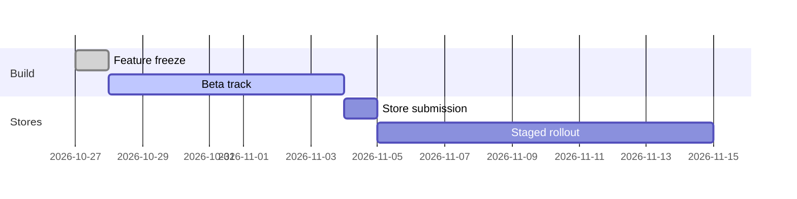

# FareLoop mobile 4.12 release: weekly status, week 44

Status: at risk. Report for the week of 2026-10-26, sent Friday 2026-10-30 by the release captain, Mira Okafor.

## Summary

4.12 is the release that brings account-based ticketing to the FareLoop rider app. Riders can tap their phone at a gate instead of showing a QR code, and fares cap automatically across a service day. Feature work closed on Tuesday and the build went to the beta track on Wednesday. Two problems keep the release at risk. The offline ticket cache drops tickets when the phone clock is wrong, and the Android crash-free rate on the beta track is 99.41%, which is under our gate. Both block store submission.

## Status at a glance

| Workstream | Owner | Status | Notes |
|-|-|-|-|
| Account-based ticketing | Tomasz Reyes | Done | Fare capping verified against the back office for 3 sample days |
| Tap-to-pay (Android) | Priya Anand | Done | Works on 41 of 43 devices in the lab |
| Tap-to-pay (iOS) | Priya Anand | Blocked | Waiting on store entitlement review, see Rollout rules |
| Offline ticket cache | Mira Okafor | At risk | Clock skew bug, fix in review |
| Crash rate (Android) | Jun Watanabe | At risk | 99.41% crash-free on beta, gate is 99.6% |
| Accessibility audit | Lena Brandt | Done | 2 minor findings, both fixed |
| Store listing and screenshots | Ade Martins | On track | Copy approved by marketing |

## Release plan

Release decision (week 42): 4.12 goes to both stores on Wednesday 2026-11-04. Android is submitted first thing in the morning and iOS is submitted the same day as soon as the build clears internal QA. Marketing has the rider newsletter booked for the following Monday, so the date does not move without the release board.



The beta track has 1,180 riders on it, mostly transit agency staff and the Riverside commuter panel. We want at least 1,000 active beta users for a full 48 hours before a store submission.

## Rollout rules

The staged rollout on Android starts at 5% of users, then goes to 20%, 50% and 100%. It must not move past 20% until the crash-free sessions rate has stayed at or above 99.6% for 48 hours in a row. iOS uses the store's phased release and follows the same percentages by day.

> **Important:** The tap-to-pay flow must stay switched off for iOS in 4.12. The store entitlement for contactless payments is still under review, and shipping the flow before it is granted can get the whole app pulled from the store.

Offline ticket purchase is not supported in 4.12. Riders must be online to buy a ticket, except for monthly pass holders, who can renew a pass offline and have it confirmed when the phone next connects. A ticket bought online can be shown offline for up to 72 hours, after which the app asks the rider to reconnect. Riders can buy at most 6 tickets in one purchase, and the QR code on a ticket refreshes every 30 seconds.

The app download size has to stay under 85 MB on both platforms. The 4.12 Android build is 79.4 MB and iOS is 83.1 MB, so there is little room left for late assets.

## Blockers

**Offline ticket cache.** When the phone clock is more than 5 minutes off network time, cached tickets are treated as expired and hidden. On the beta track this hit 37 riders this week, mostly on older Android phones that do not sync time automatically. The fix compares against the last server time we saw instead of the phone clock. It is in review and needs one more pass from QA on the device lab.

**Android crash rate.** The beta crash-free sessions rate is 99.41%. Most of the crashes, about 70%, come from the NFC service on two older phone models when the rider locks the screen during a tap. Jun has a patch that releases the NFC session on screen lock. The rest are spread thin and none is above 0.05%.

## Testing

The device lab ran the full regression suite twice this week, 412 cases on 43 devices. Two failures are still open, both on the tap-to-pay screen on phones we no longer list as supported. Payment tests ran against the payment provider's sandbox only. We do not run payment tests against production cards, even for the small-value smoke test, since a refund takes up to 10 working days and riders have complained about it in the past.

Gate reader testing at the Northgate depot found that the reader firmware times out a tap after 1.5 seconds. Our tap-to-pay flow takes 0.9 seconds on a mid-range phone and up to 1.3 seconds on the slowest phone we support, which is close to the limit.

Risk: older gate readers on the Harbor line run firmware that times out at 1.0 seconds, not 1.5. Impact high, likelihood medium. If the agency has not updated them by launch, tap-to-pay will fail for some riders at those gates. The agency says the update is scheduled for the week of 2026-11-09, and we have asked for written confirmation.

## Decisions this week

Decision (accepted 2026-10-29): the store release moves to Wednesday 2026-11-11. This replaces the 2026-11-04 date agreed in week 42. The extra week covers the offline cache fix and gives the crash-rate patch a full 48 hours on the beta track. Marketing moved the newsletter to 2026-11-16.

We also agreed that the release board can approve the 11-11 submission by message on 2026-11-10 instead of holding another meeting, if both blockers are closed by then.

## Open question

Undecided: whether 4.12 still supports Android 9. About 2.8% of active riders are on it, and the NFC library we use for tap-to-pay drops it next year. Product and the agency partners meet on 2026-11-05 to decide. Until then, the build keeps Android 9 as the minimum version, and tap-to-pay is hidden on Android 9 devices.

## Feature flags

The 4.12 build ships with these defaults. The remote config can change them without a new build.

```json
{
  "account_ticketing": true,
  "tap_to_pay_android": true,
  "tap_to_pay_ios": false,
  "offline_pass_renewal": true,
  "fare_capping_banner": true,
  "max_tickets_per_purchase": 6
}
```

## Action items

- [ ] Merge the offline cache fix after device lab QA, priority P1, @mira, due 2026-11-03
- [ ] Ship the NFC screen-lock patch to the beta track, priority P1, @jun, due 2026-11-02
- [ ] Re-run the fare capping checks against the back office with November fares, priority P2, @tomasz, due 2026-11-06
- [x] Send the updated date to marketing and the agency partners, @mira
- [ ] Prepare the store submission notes for 11-11, priority P2, @ade, due 2026-11-09

## Notes from Thursday's go/no-go (for the team)

Present: Mira, Tomasz, Priya, Jun, Lena, Ade, and Sam from the agency side. The meeting ran long because we spent the first twenty minutes on whether to ship 4.12 on 11-04 without tap-to-pay at all and add it in 4.12.1. Sam was against it. The agencies have already printed gate signs that mention tapping your phone, and a point release two weeks later would mean two rounds of rider support questions. Priya pointed out that most of the tap-to-pay code is already behind flags, so slipping a week costs less than splitting the release. Lena asked that we keep the accessibility fixes in 4.12 either way, which nobody disagreed with.

We also looked back at 4.9, the last release that slipped. That time we held the date and shipped with a known crash in the trip planner, and the crash-free rate took nine days to recover. Nobody wants a repeat of that, which is most of why the vote to move to 11-11 was quick.
